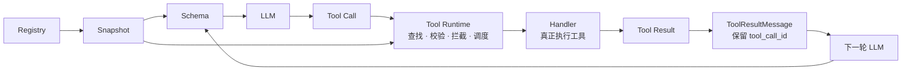

# 2\.2 Tool Runtime 设计

\[tool\_runtime\_demo\.py\]

# 2\.2 Tool Runtime 设计：让 Tool Call 进入受控执行

> 建议讲授时长：约 40 分钟
> 
> 本节主线：注册工具定义 → 发现并冻结本轮工具 → 执行 Tool Call → 回写 Tool Result 术语表、完整代码和验收清单作为讲义使用，不逐项朗读；课堂口播聚焦关键边界与故障路径。
> 
> 




其中：

- `Registry`：系统有哪些工具。 

- `Snapshot`：本轮实际开放哪些工具。 

- `Schema`：模型能看到什么。 

- `Runtime`：这次调用是否允许执行，以及如何执行。 

- `ToolResultMessage`：把结果和原始 `tool_call_id` 重新关联，再交给下一轮 LLM。

## 一、先回答学习预期：不能徒手写完整 Runtime，算没有掌握吗？

### 1\.1 什么是 Tool Runtime，它有什么用？

先给出一个最简定义：Tool Runtime 是 Agent 应用中的工具执行层。它位于“模型返回 Tool Call”和“业务 handler 产生真实副作用”之间，负责把模型提出的候选动作，转换成一次可以校验、可以拒绝、可以执行、可以追踪的业务调用。

把它放回整条链路里看，就更清楚了：

```Plain Text
模型：我想调用 create_ticket，参数是……
        ↓
Tool Runtime：工具存在吗？参数合法吗？有权限吗？需要批准吗？依赖可用吗？
        ↓
handler：真正访问数据库、HTTP API 或文件系统
        ↓
Tool Runtime：校验结果、记录审计、保留 tool_call_id
        ↓
Agent Loop：把 ToolResultMessage 写回上下文，决定是否继续
```

所以，Runtime 不是模型，也不是业务 handler，更不是 Agent Loop 本身。模型负责提出候选动作；handler 负责完成具体业务；Agent Loop 负责驱动多轮对话；Runtime 负责在候选动作进入真实系统之前，建立确定性的执行边界。

为什么必须有这一层？因为模型输出具有不确定性，而工具执行可能产生真实副作用。没有 Runtime，系统很容易把“模型生成的 JSON”直接当成“可以执行的命令”，从而出现几类问题：模型调用了本轮没有开放的工具，参数格式正确但业务语义错误，用户没有权限却进入了写操作，写请求超时后被重复重试，或者工具结果返回了却无法和原来的 Tool Call 对应。

Runtime 的价值，就是把这些问题放到业务副作用之前处理。它至少要完成五件事：从本轮快照查找工具；校验和准备参数；检查权限、风险、审批、依赖和启停状态；在超时、取消和重试策略下调用 handler；把成功或失败统一包装成带 tool\_call\_id 的 ToolResultMessage。

这里的“Runtime”不是要求你必须实现一个庞大的平台。课堂演示中，它可能只是一个 invoke\(\) 方法；生产环境中，它可能还会接入 Registry、策略服务、审计系统、队列和 Trace。无论代码有几十行还是几千行，只要它承担的是“Tool Call 到受控结果”的这段职责，就属于 Tool Runtime。

理解这个定义以后，再回答本节开头的问题就不会跑偏：学习重点不是背出某个框架的 Runtime 源码，而是能判断这条执行边界是否存在、是否放在正确的位置，以及它是否真的阻止了错误和越权。

### 1\.2 学完以后，必须脱离 AI 默写整套代码吗？

先直接回答：不需要。

先把学习要求分成三层，但每一层只回答一个问题：你需要做到什么程度？

|学习层次|本节要求|
|---|---|
|**不要求**|脱离 AI 默写完整 Runtime、背诵框架源码、记住 ToolDefinition 的所有字段|
|**必须做到**|能解释 Runtime 为什么存在；能画出注册、发现、快照、执行和回写主链；能说清 ToolDefinition、Registry/Snapshot、Runtime 的边界；能独立写出最小骨架|
|**真正掌握**|能审查 AI 生成的实现，发现越权、参数未校验、版本漂移、错误未结构化、写操作误重试和 tool\_call\_id 丢失，并用测试证明修改有效|

这意味着，学习重点不是和 AI 比谁能更快写出三百行代码，而是掌握四个工程判断：为什么需要 Registry 和 Snapshot；模型为什么只能看到 Tool Schema；权限和参数校验为什么必须发生在 handler 之前；不同工具为什么需要不同的超时、重试和审计策略。

AI 可以生成数据类、异常分支、序列化代码和普通测试，但不能替你决定工具边界、可信字段、开放范围、风险等级和验收条件。代码由谁写不是核心问题，核心问题是你能否解释它、审查它，并用测试证明它没有把错误请求送进业务系统。

### 1\.3 训练重点与验收方式

本节把学习目标收敛为四项能力，并为每项能力设置一个可观察的验收结果：

|训练能力|工程师必须完成的工作|AI 可以辅助的工作|
|---|---|---|
|构建闭环|把定义、发现、快照、执行和结果回写串起来|生成数据类、样板和适配代码|
|做工程判断|设计契约、职责、可信边界、权限、风险和失败语义|根据明确规格补充分支和注释|
|协作开发|给出对象边界、执行顺序、验收条件，并审查生成结果|生成普通测试、重构重复代码|
|选择构建方向|判断工具粒度、读写属性、开放范围和 MVP 边界|列出候选方案并实现确定的方案|

验收时按四级递进：

|层级|验收方式|
|---|---|
|能解释|不看稿说清 Registry、Snapshot、Runtime 和 handler 分别解决什么问题|
|能补全|根据接口补出 Runtime 的查找、校验、拦截、执行和回写|
|能审查|找出 AI 代码中的越权、版本漂移、错误重试和 ID 丢失|
|能迁移|把工单示例迁移成数据库、HTTP 或文件工具，并重新设计权限、风险和失败语义|

因此，最低交付不是“看懂代码”，而是能画出主链、补出最小骨架并通过测试；更高的目标是能够约束、审查和改造 AI 生成的实现。

判断一个动作是否值得做成 Tool，可以用四个问题验收：它是否需要访问模型之外的数据或产生真实业务动作；能否定义稳定的输入、输出和错误契约；能否把权限和副作用收缩到一个清晰边界；MVP 是否真的需要模型自主选择它。create\_ticket 适合做 Tool，是因为它访问外部工单系统、产生写入，并且可以定义窄而稳定的参数；纯粹改写一句话，通常用 Prompt 完成即可。

### 1\.4 从 Function Calling 到 Tool Runtime，中间缺了什么？

上一节我们讲完了 Function Calling。模型读到工具的名称、说明和参数 Schema 以后，可以返回一条 Tool Call，告诉系统它想调用哪个工具，以及准备传入什么参数。

到这里会产生第二个问题：既然工具名和参数都有了，为什么不直接执行？

```Plain Text
if call.name == "get_weather":
    result = await get_weather(**call.arguments)
elif call.name == "search_orders":
    result = await search_orders(**call.arguments)
elif call.name == "create_ticket":
    result = await create_ticket(**call.arguments)
```

这段代码在演示里可以工作，但它没有回答生产环境中的问题：call\.name 是不是本轮开放的工具？参数是否属于当前版本？当前用户有没有权限？下游服务不可用时怎么办？工具执行超时以后能不能重试？结果又怎样与原来的 Tool Call 对应？

问题的根源不是 if/elif 不够优雅，而是它把“模型建议做什么”和“系统允许做什么”混成了一件事。

> 模型负责提出候选动作；Tool Runtime 负责把候选动作变成一次可校验、可拒绝、可执行、可追踪的业务调用。
> 
> 

模型可以生成候选代码和参数，但工具粒度、可信字段、开放范围、权限风险、版本依赖、超时重试和审计规则，必须由工程师决定并负责。

为了把这些决定落进代码，本节只建立三个核心对象：

```Plain Text
ToolDefinition：描述一个工具的协议、实现和治理规则
ToolRegistry：保存已注册工具，并为当前轮次生成工具快照
ToolRuntime：从快照中查找、校验、拦截、执行并包装结果
```

后面所有知识点都沿着同一条时间线展开：

```Plain Text
工程师注册 ToolDefinition
        ↓
Harness 根据任务和策略发现 active tools，并冻结本轮快照
        ↓
从快照投影出模型可见的 Tool Schema
        ↓
模型返回 Tool Call
        ↓
Tool Runtime：prepare → execute → finalize
        ↓
ToolResultMessage 写回 Agent Loop，模型继续决策
```

先注册，再发现，最后执行。这个顺序就是接下来阅读概念和代码的索引。

---

## 二、先划清边界：Tool Schema、Registry 和 Runtime 分别解决什么问题？

这一部分先解决一个基础问题：为什么大家听 Tool、Function Calling、Registry、Runtime、Harness 时容易混乱？

因为这些词不在同一个层次，而且不同框架的命名也不完全一致。Function Calling 是模型协议能力；Tool Schema 是发给模型的能力说明；Registry、Snapshot 和 Runtime 是我们在应用侧建立的工程对象；AgentTool 又是 pi 对运行侧工具接口的命名。名称相似，不代表职责相同。

先把本节会反复使用的术语一次说清。下面这张表不用背，它是后文的索引。

|名称|本节中的准确含义|容易混淆的地方|
|---|---|---|
|Function Calling / Tool Use|模型根据工具说明生成 Tool Call 的协议能力|它生成调用建议，不负责执行函数|
|Tool|提供给模型选择的一项受管理能力，通常由契约、治理信息和执行入口共同构成|这里的 Tool 不等于 Python 函数，也不等于一条 Tool Call|
|Tool Schema|真正发给模型的 name \+ description \+ parameters；不同 Provider 再适配成各自格式|它是 ToolDefinition 的安全投影，不包含 handler、权限和密钥|
|ToolDefinition|本课程在应用侧使用的完整工具定义|它包含模型协议、治理字段和 handler|
|AgentTool|pi 中对可执行工具接口的命名|是 pi 的类型名，不是行业统一标准|
|handler|查询数据库、调用 HTTP API 等具体业务函数|handler 只做业务动作，不等于完整 Tool|
|Tool Registry|保存已注册工具及版本的目录|管“有哪些”，不执行 Tool Call|
|工具注册|工程师把一份经过检查的 ToolDefinition 放入 Registry|注册成功只表示平台认识它，不表示本轮开放或已经执行|
|工具发现|Harness 根据任务、策略和运行模式筛选本轮候选工具|发生在模型请求之前，不等于模型选工具|
|active tools|工具发现产生的本轮开放集合|是发现结果，不是 Registry 的全部工具|
|ToolSnapshot|某一轮冻结后的工具定义视图|不是普通缓存，也不是数据库快照|
|Tool Runtime|Agent 应用中的工具执行层|不是 Python Runtime 或 Java Runtime|
|Harness|装配模型、工具、上下文、Hook 和本轮状态的外层运行框架|它组织运行，但不能绕过 Runtime 的检查|
|Agent Loop|请求模型、处理 Tool Call、写回结果并继续下一轮的控制循环|Loop 驱动流程，handler 不驱动流程|
|Tool Call|模型输出的工具名、参数和调用 ID|它是候选动作，不表示业务已经发生|
|ToolResult|handler 或 Runtime 内部产生的执行结果|还不一定能直接写回模型消息|
|ToolResultMessage|带调用关联信息、可以写回 Agent Loop 的结果消息|必须保留原来的 tool\_call\_id|

三类 ID 也从一开始分开，后面的代码和审计才不会混用：

|ID|关联对象|由谁产生|不能替代什么|
|---|---|---|---|
|tool\_call\_id|一条 Tool Call 与对应 ToolResultMessage|模型协议层产生，Runtime 原样保留|不能当业务单号，也不能代表整次运行|
|trace\_id / run\_id|一次 Agent 运行中的模型、工具和 Hook 事件|Harness 或可观测系统产生|不能用来判断某个业务动作是否已成功|
|业务 ID|工单、订单、支付等真实业务对象|handler 调用的业务系统产生|不能代替 Tool Call 配对和跨阶段 Trace|

不同 Provider 可能使用 Function Calling、Tool Calling 或 Tool Use 等名称，消息字段也不完全相同。本节不把这些命名差异当成三套技术：它们共同解决“怎样让模型输出结构化工具调用建议”；Provider 适配层负责格式转换，应用侧 Runtime 仍使用统一的 ToolCall。

从职责上再压缩一次：

```Plain Text
Tool Schema / ToolDefinition：分别描述模型可见契约，以及完整契约与治理信息
Tool Registry：管理系统有哪些工具、有哪些版本
工具发现：决定本轮开放哪些工具
ToolSnapshot：冻结本轮模型协议与执行实现
Tool Runtime：决定这次能否执行、怎样执行和回写
handler：只完成具体业务动作
Harness / Agent Loop：装配本轮上下文并驱动多轮循环
```

为什么要分开？因为它们面对不同的变化。Schema 会随协议升级，Registry 会随工具发布变化，active tools 会随任务模式变化，Runtime 的判断会随本次参数、身份和依赖状态变化。揉在一起以后，一次工具升级就可能同时破坏模型提示、权限判断和执行代码。

特别注意，Registry 不是 Runtime。Registry 像工具目录，负责“平台有哪些”和“本轮选哪些”；Runtime 像执行现场，负责“这一次能不能做”和“做完怎样收口”。

pi 0\.83\.0 的源码也体现了这个边界。它的 AgentTool 在模型协议字段之外，保存真实执行入口和调度信息：

```Plain Text
interface AgentTool<TParameters, TDetails> extends Tool<TParameters> {
  label: string;
  prepareArguments?: (args: unknown) => TParameters;
  execute(
    toolCallId: string,
    params: TParameters,
    signal?: AbortSignal,
    onUpdate?: (partialResult: AgentToolResult<TDetails>) => void,
  ): Promise<AgentToolResult<TDetails>>;
  executionMode?: "sequential" | "parallel";
}
```

这段接口要分成两部分看。继承自 Tool 的名称、说明和参数 Schema 会投影给模型；

execute\(\)、prepareArguments 和 executionMode 只在模型返回 Tool Call 以后由运行环境使用。

模型能看到“怎么申请调用”，但拿不到真正的函数对象，也不能替系统修改执行模式。


这里引用 pi，不是要求大家记住 TypeScript 接口，而是借源码验证一个边界：模型侧协议和运行侧能力必须分开。以后换成其他框架，类名可能不同，但你仍然要寻找“模型看到了什么、真实执行入口在哪里、执行前后由谁拦截”这三个位置。

pi 的 AgentHarness 还分别保存全量 tools、activeToolNames 和当前 turn 的状态；agent\-loop\.ts 则消费当前上下文中的工具，完成准备、执行和结果包装。这给了我们一个很好的实现参照，但本节会用 Python 重建同样的边界。

边界确定以后，下面不再来回跳。我们按真实运行顺序讲三件事：第一，怎样注册一份完整工具定义；第二，怎样发现并冻结本轮工具；第三，Runtime 怎样执行一条 Tool Call。

---

## 三、第一阶段——注册：怎样把一个业务函数变成受管理的工具？

### 3\.1 为什么不能只注册一个 handler？

这一小节的结论是：handler 只回答“业务动作怎样完成”，ToolDefinition 还要回答“谁能调用、怎样校验、失败怎样表达、运行怎样治理”。

如果 Registry 里只保存函数，代码可能是这样：

```Plain Text
registry["create_ticket"] = create_ticket
```

这行代码能找到函数，却找不到输入 Schema、输出结构、错误码、权限、风险、超时、版本和依赖。于是这些判断只能散落在 handler、路由层和调用方里。工具一多，同一套权限规则会被复制十遍，错误格式也会各写各的。

更稳妥的做法，是注册一份不可变的 ToolDefinition。为了便于理解，可以把字段分成三组：

```Plain Text
@dataclass(frozen=True)
class ToolDefinition:
    # 第一组：调用契约
    name: str
    version: str
    description: str
    input_model: type[BaseModel]
    output_model: type[BaseModel]
    error_codes: tuple[str, ...]

    # 第二组：运行治理
    permission: str
    risk: Literal["low", "medium", "high"]
    timeout_s: float
    retry: RetryPolicy
    audit_fields: tuple[str, ...]
    dependencies: tuple[str, ...]
    execution_mode: Literal["sequential", "parallel"]

    # 第三组：真实实现
    handler: ToolHandler
```

这段代码不是要求所有团队都使用同一组字段，而是建立一个检查框架。第一组定义调用双方的契约；第二组告诉 Runtime 怎样治理；第三组才是真正访问数据库、HTTP API 或文件系统的业务函数。

这里还要区分“完整 ToolDefinition”和“模型可见 Tool Schema”。完整定义属于运行环境，模型通常只需要名称、说明和输入参数：

```Plain Text
def to_provider_tool(tool: ToolDefinition) -> dict[str, Any]:
    return {
        "type": "function",
        "function": {
            "name": tool.name,
            "description": tool.description,
            "parameters": tool.input_model.model_json_schema(),
        },
    }
```

to\_provider\_tool\(\) 的作用不是转换格式这么简单，而是做安全投影。它有意排除了 handler、权限、风险、依赖、超时和审计规则。模型可以依据输入 Schema 生成候选参数，但不能在参数里写“我有管理员权限”或者“本次风险为低”。这些信息必须来自 ToolDefinition 和经过认证的 ExecutionContext。

**代码阅读卡：ToolDefinition。** 这段代码位于主链的“工程师注册 ToolDefinition”阶段，解决契约、治理与业务实现散落的问题。重点看输入输出模型、治理字段、handler 三组对象，以及 to\_provider\_tool\(\) 的单向投影。如果只登记 handler，Runtime 就无从统一校验和治理；如果把完整定义交给模型，权限规则与内部实现又可能泄漏。工程师负责分清模型可控字段与可信字段，AI 可以据此补数据类和投影样板。

这一段怎样算学会？不是默写 dataclass，而是给你一个新业务函数时，你能先把字段分成“模型可以填写”“运行环境掌握”“业务实现使用”三组。分组由你完成以后，AI 很适合继续生成模型类和投影代码。

### 3\.2 一份完整 ToolDefinition 为什么要包含这些字段？

先避免一个名称误会。课程大纲中的“Tool Schema”有时泛指完整工具契约；本节统一把真正发送给模型的 name \+ description \+ parameters 称为“模型可见 Tool Schema”。输出、错误、权限、风险、超时、重试和审计属于运行侧 ToolDefinition，不应全部暴露给模型。不同 Provider 的外层字段差异由适配层处理，不改变这条边界。

这一小节不再堆字段名，而是回答每个字段解决什么问题。工程师只有知道字段由谁消费，才能避免写出一份看起来完整、实际没人执行的配置。

|字段|解决的问题|谁在什么时候使用|
|---|---|---|
|名称、说明|模型怎样选择工具，工程师怎样稳定引用|模型请求前；Registry 查找时|
|输入参数|模型能填什么，Runtime 怎样拒绝非法参数|模型生成 Tool Call；prepare 阶段|
|输出结构|handler 的结果能否稳定被 Agent、UI 和下游消费|finalize 阶段|
|错误结构 / 错误码|失败后模型能否修正、重试或解释|每个失败出口|
|权限级别|当前身份是否有权执行|handler 之前|
|风险级别|是否需要审批、沙箱或额外确认|handler 之前|
|超时配置|下游卡住时何时停止等待|handler 执行期间|
|重试策略|哪些失败可以再试，最多试几次|handler 执行期间|
|审计字段|事后怎样回答谁在何时调用了什么|执行结束后|

这里最需要人判断的是语义，而不是类型。Pydantic 类和 JSON Schema 可以让 AI 快速生成，但 AI 不知道“创建工单超时是否已经产生副作用”，也不知道企业里谁拥有 ticket:write 权限。这些业务事实必须由工程师确认。

以 create\_ticket 为例，title、description 和 priority 可以让模型填写；user\_id、tenant\_id、permission 和 approved 不能让模型填写，因为它们代表系统已经确认的事实。再比如，查询订单超时后通常可以重试，但创建工单超时后不能盲目重试，否则可能创建两张工单。除非下游支持幂等键，否则写工具默认只执行一次。

所以，“定义写得对不对”不能只看 JSON 是否能解析，还要问三个问题：模型是否只控制它应该控制的字段；Runtime 是否真的读取治理字段；失败语义是否足够稳定。AI 可以补字段，工程师要决定字段意味着什么。

### 3\.3 Tool Registry 注册时要做哪些检查？

这一小节的结论是：注册阶段负责尽早发现定义冲突，不负责决定本轮是否开放，也不负责执行工具。

```Plain Text
class ToolRegistry:
    def __init__(self) -> None:
        self._tools: dict[tuple[str, str], ToolDefinition] = {}

    def register(self, tool: ToolDefinition) -> None:
        key = (tool.name, tool.version)
        if key in self._tools:
            raise ValueError(f"duplicate tool: {tool.name}@{tool.version}")
        if tool.timeout_s <= 0 or tool.retry.max_attempts < 1:
            raise ValueError("timeout and retry policy must be positive")
        self._tools[key] = tool

    def get(self, name: str, version: str) -> ToolDefinition:
        try:
            return self._tools[(name, version)]
        except KeyError as exc:
            raise KeyError(f"tool not registered: {name}@{version}") from exc
```

这段代码在注册时拒绝相同的 name@version，避免插件加载顺序悄悄覆盖旧实现；在查找时使用精确版本，避免 search\_orders 的 v1 和 v2 混在一起。生产环境还可以在这里检查名称格式、Schema 是否可生成、错误码是否重复、超时是否为正数，以及依赖声明是否完整。

**代码阅读卡：Registry。** 这段代码仍位于“工具注册”阶段，解决重复定义和版本歧义。重点看 \(name, version\) 组合键、注册时快速失败和精确版本查找。如果 Registry 默默覆盖同名定义，加载顺序就会改变线上行为；如果执行时临时取 latest，模型看到的 Schema 与 handler 版本就可能漂移。工程师决定版本兼容和发布规则，AI 可以补校验与异常样板。

不过，注册成功只代表平台认识这个工具。deploy\_service 可以被平台注册，却不应该出现在客服 Agent 的工具列表里。是否开放给当前任务，是下一阶段“工具发现”要解决的问题。

### 3\.4 工具元数据和分类应该怎样设计？

这一小节只保留一个判断标准：每个元数据字段都要有明确消费者。

天气查询、数据库查询、内部 HTTP API 和文件处理，都可以注册成 ToolDefinition。为了批量管理，通常再记录业务类型、读写属性、负责人和数据等级：

```Plain Text
@dataclass(frozen=True)
class BusinessMetadata:
    category: Literal["database", "http", "file", "external"]
    access: Literal["read", "write"]
    owner: str
    data_classification: Literal["public", "internal", "sensitive"]
```

这段代码的作用，是让策略可以读取元数据，而不是让工具列表更好看。例如，发现阶段可以在只读模式排除 access="write" 的工具；调度阶段可以把写工具默认设为顺序执行；审计阶段可以对 sensitive 工具只记录参数摘要；依赖告警可以根据 owner 找到维护团队。

分类只能提供默认策略，不能代替逐次授权。一个 HTTP GET 也可能导出敏感数据，一个写草稿工具也未必需要人工审批。最终是否执行，仍然要结合用户、租户、环境和本次参数判断。

注册阶段到这里结束。我们已经有了“平台认识的全部工具”，但还没有把它们全部发给模型。下一步要做的是从全量工具中选出本轮真正需要的集合。

---

## 四、第二阶段——发现：本轮模型应该看到哪些工具？

### 4\.1 为什么要区分注册、发现和执行？

这一小节先给结论：注册、发现和执行是三道不同的门，前一道门通过，不代表后一道门自动通过。

```Plain Text
注册：平台是否认识这项工具
发现：当前 Agent、任务和模式是否应该把它交给模型
执行：当前用户的这一次 Tool Call 是否真的允许发生
```

例如，平台已经注册 search\_orders 和 create\_ticket。客服只读模式只发现前者，工单处理模式才发现两者。即使模型在工单处理模式看到了 create\_ticket，Runtime 仍要检查当前用户有没有 ticket:write 权限，以及这条高风险调用是否已经批准。

工具发现不是让模型先看到一百个工具，再让模型自己挑。开放范围本身就是安全和产品策略，应该由 Harness 根据任务类型、Agent 配置、租户能力和运行模式计算。一个最小实现可以从明确的工具配置开始：

这里要把“工具发现”和“模型选工具”分开。工具发现发生在模型请求之前，由 Harness 决定候选集合；模型选工具发生在请求之后，由 Function Calling 在候选集合中生成某个 Tool Call。前者决定模型**可以选什么**，后者决定模型**这一次想选什么**。

```Plain Text
TOOL_PROFILES = {
    "customer_readonly": {
        "search_orders": "1.0.0",
    },
    "ticket_operation": {
        "search_orders": "1.0.0",
        "create_ticket": "1.0.0",
    },
}

routes = TOOL_PROFILES[run_mode]
snapshot = registry.snapshot(routes, enabled_state)
```

这段代码里，routes 同时明确了工具名和版本。它解决的不是模型“会不会选对”，而是先把模型的选择空间限制在当前业务允许的范围。工具很多以后，可以增加标签检索或策略服务，但最后仍应产出一份确定的名称与版本列表。

**代码阅读卡：工具发现。** 这段代码位于“创建 ToolSnapshot 之前”，解决本轮应该向模型开放什么。重点看 Harness 选择的 run\_mode、明确的 name@version 路由，以及 discovery 与模型选工具的先后关系。如果把发现交给模型，模型就可能看见本不该暴露的写工具；如果只做发现、不在执行时复查权限，看到工具又会被误当成允许执行。工程师决定开放范围，AI 可以辅助维护配置和普通匹配代码。

### 4\.2 为什么模型和 Runtime 必须使用同一份快照？

这一小节的答案很直接：为了保证模型看到的协议，与 Runtime 最终执行的实现是同一份定义。

```Plain Text
snapshot = registry.snapshot(routes, enabled_state)
provider_tools = snapshot.provider_tools()

assistant_message = await provider.complete(
    messages=messages,
    tools=provider_tools,
)

for raw_call in parse_tool_calls(assistant_message):
    result_message = await runtime.invoke(
        snapshot=snapshot,
        call=ToolCall.model_validate(raw_call),
        context=context,
    )
    messages.append(result_message)
```

这段代码有一个刻意的设计：模型请求和 runtime\.invoke\(\) 使用同一个 snapshot。Runtime 不接收全局 Registry，因此不能在模型返回以后重新读取“最新工具”。

**代码阅读卡：Snapshot。** 这段代码位于“发现 active tools 之后、发送模型请求之前”，解决一次模型请求期间的协议一致性。重点看 provider\_tools 和 runtime\.invoke\(\) 共享同一个 snapshot。如果先请求模型、之后才创建快照，或执行时改读全局 Registry，就会出现 v1 参数交给 v2 handler 的版本漂移。工程师决定快照生命周期和版本切换时点，AI 可以补不可变映射与投影代码。

Snapshot 也不是为了提速做的普通缓存。缓存过期后可以重新取值，而本轮 Snapshot 的职责恰恰是“不更新”：它把本轮模型看到的 Schema、版本和 handler 绑定在一起，直到这一轮 Tool Call 处理结束。

为什么要这样做？看一个具体时序。search\_orders 的 v1 接收 status: str，v2 改成 statuses: list\[str\]：

```Plain Text
T1：Harness 从 Registry 解析出 v1，并把 v1 Schema 发给模型
T2：管理员把默认版本切换到 v2
T3：模型仍按刚才看到的 v1 Schema 返回 status="pending"
T4：如果 Runtime 重新读取 Registry，就会拿 v2 handler 执行 v1 参数
```

这种情况在线上并不罕见。模型请求有网络延迟，Extension 可以热加载，管理员也可能在这几秒调整版本或状态。没有快照，模型侧协议和执行侧实现就会发生漂移。

正确做法是：版本切换只影响下一次快照，当前轮次继续使用已经冻结的定义。pi 的 AgentHarness\.createTurnState\(\) 会把当前工具、active tools、系统提示和 tool context 组成 turn 状态，再交给 Agent Loop，体现的也是“同一轮使用同一份状态”这个思路。

### 4\.3 工具版本和灰度切换应该放在哪里？

前面我们解决的是“工具能不能被注册和发现”。接下来要面对一个生产问题：**工具已经在运行，怎么安全地升级？**

假设我们有一个 `search_orders` 工具。v1 查询速度较慢，准备上线 v2，v2 增加了订单状态过滤，但内部 SQL 和返回字段也发生了变化。如果直接把 Registry 中的 v1 替换成 v2，正在执行的任务可能遇到两个问题：

- 同一个会话前后拿到不同版本，参数或返回结构不一致；

- 新版本刚上线就被所有租户使用，一旦出错，影响范围无法控制。

所以，Runtime 需要考虑版本路由和灰度切换。它的价值不只是“支持多个版本”，而是保证**版本升级可控、问题可回滚、一次执行过程中的版本稳定**。

这里要先区分两个时间点：

- 创建快照之前，决定本轮使用哪个版本；

- 创建快照之后，本轮固定版本，不再临时切换。

例如，测试租户使用 v2，其他租户继续使用稳定版 v1：

```Python
def choose_version(
    tool_name: str,
    tenant_id: str,
    stable: dict[str, str],
    canary: dict[str, tuple[str, set[str]]],
) -> str:
    candidate = canary.get(tool_name)

    if candidate and tenant_id in candidate[1]:
        return candidate[0]

    return stable[tool_name]


routes = {
    name: choose_version(
        tool_name=name,
        tenant_id=context.tenant_id,
        stable=stable_versions,
        canary=canary_versions,
    )
    for name in requested_tools
}

snapshot = registry.snapshot(routes)
```

这段代码的关键不在于 `choose_version` 的写法，而在于版本选择发生在 `snapshot` 之前。

假设当前配置是：

```Python
stable_versions = {
    "search_orders": "v1",
}

canary_versions = {
    "search_orders": ("v2", {"tenant_test"}),
}
```

那么测试租户创建的快照中会固定使用 `search_orders:v2`，普通租户仍然使用 `search_orders:v1`。即使管理员随后扩大灰度范围，已经创建的快照也不会被修改。

一个完整的升级过程通常是：

1. 注册 v2，但不立即替换 v1；

2. 只让测试租户使用 v2；

3. 对比成功率、延迟、错误类型和结果质量；

4. 逐步扩大灰度范围；

5. 将 v2 切换为 stable 版本；

6. 等待旧会话和旧工作流完成后，再下线 v1。

这样做的本质，是把“版本发布”和“版本执行”隔离开。Registry 负责保存多个版本，路由策略负责选择版本，Snapshot 负责冻结本轮版本，Runtime 则按照快照执行。

所以这一小节的结论是：

**版本切换应该发生在创建快照之前；快照一旦创建，本轮执行就必须使用同一版本。**

有了版本快照，我们还需要处理另一个更紧急的问题：工具在运行过程中可能突然异常，管理员需要立即关闭它。接下来我们看工具启停和依赖检查为什么也必须分层处理。

---

### 4\.4 工具启停和依赖检查为什么要分两次做？

这一小节解决的是运行中的“紧急止血”问题。结论是：

**发现阶段决定工具能不能被模型看到，执行阶段确认工具现在还能不能真正运行。**

这两个检查必须分开，因为它们发生在不同时间点。

还是以 `search_orders` 为例。创建快照时，这个工具是正常的，所以它被交给模型。模型思考几秒后生成了 Tool Call，但就在这几秒内，订单服务出现故障，管理员把工具关闭。

如果 Runtime 只在创建快照时检查一次，已经生成的 Tool Call 仍然会继续执行，停用开关就失去了意义。

因此，启停状态应该独立于工具定义保存：

```Python
enabled_state = {
    "search_orders": True,
    "create_ticket": False,
}
```

创建快照时，先过滤掉已停用工具：

```Python
snapshot = registry.snapshot(
    routes=routes,
    enabled_state=enabled_state,
)
```

这一步解决的是“不要把当前不可用的工具交给模型”。但 Runtime 执行 Tool Call 时，还要再次读取最新状态：

```Python
def execute_tool(call, snapshot, enabled_state):
    tool = snapshot.get(call.name)

    if tool is None:
        return error_message(
            call,
            "TOOL_NOT_FOUND",
            "tool is not available in this snapshot",
        )

    if not enabled_state.get(call.name, True):
        return error_message(
            call,
            "TOOL_DISABLED",
            "tool is temporarily disabled",
        )

    return tool.handler(**call.arguments)
```

这里的两次检查分别解决两个问题：

- 快照检查：减少模型提出无效工具调用；

- 执行前检查：保证管理员可以在运行中立即阻止危险或异常调用。

依赖检查也可以按这个思路分层。

在工具注册或服务启动时，检查静态依赖，例如 API 密钥、数据库客户端和本地目录是否存在：

```Python
def validate_registration(config):
    if not config.api_key:
        raise ValueError("missing api key")

    if not config.data_dir.exists():
        raise ValueError("data directory does not exist")
```

执行前再检查动态依赖，例如数据库是否健康、内部 HTTP 服务是否可访问：

```Python
def check_runtime_dependency(tool, call):
    if tool.requires_db and not db.is_healthy():
        return error_message(
            call,
            "DEPENDENCY_UNAVAILABLE",
            "required dependency is temporarily unavailable",
        )

    return None
```

不要在每次模型请求前检查所有工具的所有依赖。这样会增加发现延迟，而且很多工具本轮根本不会被调用。更合理的做法是：

- 注册阶段检查基础配置；

- 创建快照时过滤停用工具；

- 执行阶段只检查当前工具需要的依赖；

- 异常时返回稳定错误码，不泄露内部地址、密钥名称和堆栈信息。

到这里，我们就能看到 Registry、Snapshot 和 Runtime 的分工：

- Registry 保存工具定义和版本；

- Snapshot 冻结本轮可见工具及其版本；

- Runtime 在执行前重新确认状态、权限和依赖。

因此，工具不是“被发现了就一定能执行”，而是要经过发现、快照和执行前检查这三道边界。接下来，我们进入 Runtime 的核心环节：如何对 Tool Call 做参数校验、权限判断和风险拦截。

---

## 五、第三阶段——执行：一条 Tool Call 在 Runtime 中怎样流动？

### 5\.1 为什么执行前要先分清参与者？

这一小节的结论是：只有职责分清，参数校验、权限和业务逻辑才不会互相绕过。

|参与者|负责什么|不负责什么|
|---|---|---|
|模型|从开放工具中提出名称和候选参数|不决定权限、风险、版本和批准状态|
|Agent Loop|请求模型、保存消息、把 Tool Call 交给 Runtime、决定是否继续|不直接实现业务动作|
|Tool Runtime|查找、校验、拦截、调度、归一化错误和包装结果|不替 handler 实现业务语义|
|handler|查询订单、调用内部 API、处理文件等具体动作|不自行决定模型可见范围|
|工程师|设计以上边界和策略|不把治理决策交给模型猜|

分层的直接收益是，每个失败都能停在正确位置。工具名不在快照里，handler 不会被找到；参数非法，handler 不会启动；权限不足，业务系统不会收到请求；handler 抛异常，Agent Loop 也不会被 Python 堆栈打断。

### 5\.2 Runtime 为什么要分成 prepare、execute 和 finalize？

这一小节先给出总结构：

```Plain Text
prepare
  查找工具 → 参数兼容 → Schema 校验 → 启停/权限/风险/依赖检查
        ↓
execute
  调用 handler → 超时 → 取消 → 按策略重试 → 过程更新
        ↓
finalize
  输出校验 → 后置脱敏 → 审计 → ToolResultMessage → 写回 Agent Loop
```

这三个阶段解决三类问题。prepare 保证“不该执行的调用绝不进入业务系统”；execute 控制“业务动作怎样运行”；finalize 保证“无论成功失败，都产生可关联、可消费的结果”。

pi 的 agent\-loop\.ts 也是先 prepareToolCall，再执行工具，最后运行 afterToolCall 并创建 ToolResultMessage。它的 beforeToolCall 位于参数校验之后、handler 之前，适合权限、批准和策略拦截；afterToolCall 位于 handler 结果之后、结果消息之前，适合脱敏、改写和补充终止提示。

为什么顺序不能换？如果先执行再校验，模型生成的原始 JSON 已经进入业务系统；如果先写回消息再做脱敏，敏感数据已经进入上下文；如果在 handler 内部才检查通用权限，十个工具就会复制十套判断，而且很容易漏掉一个。

### 5\.3 用创建工单场景走一遍，Runtime 到底做了什么？

这一小节用一个场景把刚才的概念落地。假设模型返回：

```Plain Text
{
  "id": "call-42",
  "name": "create_ticket",
  "arguments": {
    "title": "退款失败",
    "description": "用户已等待两天",
    "priority": "high"
  }
}
```

Runtime 收到以后，不会立刻调用内部工单 API，而是依次处理：

第一步，从本轮 snapshot 查找 create\_ticket。如果客服当前处于只读模式，快照里根本没有这个工具，返回 TOOL\_NOT\_FOUND。这里拦截的是“本轮未开放”。

第二步，用 CreateTicketInput 校验 arguments。标题太短、优先级不在枚举中，或者模型额外加入 approved: true，都会返回 INVALID\_ARGUMENT。这里拦截的是“不符合输入契约”。

第三步，从认证后的 ExecutionContext 读取 user\_id、tenant\_id 和权限，而不是相信模型参数。如果缺少 ticket:write，返回 PERMISSION\_DENIED；如果工具是高风险且 call\-42 没有批准记录，返回 APPROVAL\_REQUIRED。这里拦截的是“参数合法，但当前人不允许做”。

第四步，检查 ticket\-service 和凭据是否可用。缺少依赖时返回 DEPENDENCY\_UNAVAILABLE，handler 仍然不会运行。

第五步，调用 handler，并应用超时与重试规则。创建工单是写操作，如果没有幂等键，超时后不能自动再创建一次。查询类工具则可以在明确的瞬时故障下有限重试。

第六步，校验 handler 输出，执行脱敏和审计，最后创建带有 tool\_call\_id="call\-42" 的 ToolResultMessage。Agent Loop 依据这个 ID，把结果与原 Tool Call 对应起来，再交给模型继续回答。

这里顺便辨析三个经常混用的 ID：

|ID|关联什么|主要用途|
|---|---|---|
|tool\_call\_id|一条模型 Tool Call 与对应 ToolResultMessage|并行调用乱序以后仍能正确配对|
|trace\_id / run\_id|一次 Agent 运行及其模型、工具、Hook 事件|跨阶段排障和性能分析|
|业务 ID|工单号、订单号、支付单号等真实业务对象|查询业务状态、幂等和补偿|

tool\_call\_id 不能替代工单号，工单号也不能替代 Trace。一个 Agent Run 可以包含多条 Tool Call；一条创建工单的 Tool Call 成功以后，又会产生新的业务 ID。工程师需要在审计记录中保存它们之间的关系。

现在回答一个常见问题：如果模型试图绕开策略，在参数里加上 permission="admin"、risk="low" 或 approved=true 会怎样？

答案是，这些字段不在输入 Schema 中，应被 extra="forbid" 拒绝；即使输入模型允许额外字段，Runtime 的权限和风险判断也只读取 ToolDefinition 与可信 ExecutionContext，不读取模型自报的治理字段。模型只能提交申请，不能给自己盖章。

### 5\.4 核心的 invoke\(\) 应该怎样组织？

这一小节不追求完整代码，只看 Runtime 的骨架。完整可运行版本放在第六部分。

```Plain Text
async def invoke(
    self,
    snapshot: ToolSnapshot,
    call: ToolCall,
    context: ExecutionContext,
) -> ToolResultMessage:
    tool = snapshot.tools.get(call.name)
    if tool is None:
        return self.error(call, "TOOL_NOT_FOUND")

    params = tool.input_model.model_validate(call.arguments)
    await self.policy.check(tool, call, params, context)

    raw_output = await asyncio.wait_for(
        tool.handler(params, context),
        timeout=tool.timeout_s,
    )
    output = tool.output_model.model_validate(raw_output)

    return self.finalize(tool, call, output, context)
```

读这段代码时只看五个检查点：第一，查找范围是 snapshot，不是全局 Registry；第二，模型参数先校验；第三，策略检查发生在 handler 之前；第四，handler 受超时控制；第五，原始输出经过 finalize 才能进入 Agent Loop。

**代码阅读卡：Runtime\.invoke。** 这段代码位于主链的 prepare → execute → finalize 阶段，解决的是把不可信 Tool Call 变成受控业务执行。重点看 Snapshot 查找、Pydantic 校验、policy\.check\(\)、受控 handler 和 finalize 五个检查点。顺序一旦写错，后果不是“返回值不优雅”：先执行后鉴权会让越权副作用真实发生；先写回后脱敏会把敏感内容送进模型上下文；失败时丢掉 tool\_call\_id 会让并行结果无法配对。工程师必须规定顺序和失败语义，AI 可以在固定骨架下补分支。

实际实现会把每个异常转换成稳定错误码，并保证所有出口都保留 tool\_call\_id。因此工具失败只是一次可观察的业务结果，不会直接把整个 Agent Loop 弄断。模型拿到 INVALID\_ARGUMENT 可以修正参数，拿到 APPROVAL\_REQUIRED 可以请求用户确认，拿到 DEPENDENCY\_UNAVAILABLE 可以解释当前能力不可用。

### 5\.5 如果 AI 生成了一段能运行的 Runtime，应该怎样审查？

这一小节直接对应“我总想去看 AI 怎么写”的问题。可以看，也可以让 AI 写，但你至少要能判断下面这段代码为什么不能上线：

```Plain Text
async def invoke(registry, call, context):
    tool = registry.get_latest(call.name)
    result = await tool.handler(**call.arguments)

    if tool.permission not in context.permissions:
        return {"error": "PERMISSION_DENIED"}
    if call.arguments.get("approved") is not True:
        return {"error": "APPROVAL_REQUIRED"}

    return {"result": result}
```

这段代码语法没有问题，正常参数下甚至会返回成功，但它至少有五个工程错误。

第一，它在执行时读取 Registry 的最新版本，没有使用本轮 Snapshot。模型看到 v1 Schema、Runtime 却执行 v2 handler 时，就会发生协议漂移。

第二，它把模型生成的原始参数直接传给 handler，没有经过 Schema 校验。多余字段、错误类型和越界值都会进入业务系统。

第三，它先执行 handler，再检查权限。即使最后返回 PERMISSION\_DENIED，工单可能已经创建。错误响应不能撤销已经发生的副作用。

第四，它相信 arguments\.approved。这相当于允许模型自己填写批准结果。批准记录必须来自可信 ExecutionContext，并与当前 tool\_call\_id 和参数绑定。

第五，它没有超时、稳定错误结构、输出校验、审计和 tool\_call\_id。并发调用以后，Agent Loop 无法可靠地把结果对应回原请求。

这就是本节真正要训练的能力：不是比 AI 更快写出 invoke\(\)，而是先用主链和职责边界审查实现，再用测试证明非法调用没有进入 handler。AI 可以重写这段代码，但“什么算正确”必须由工程师给出。

### 5\.6 多个 Tool Call 什么时候并行，什么时候顺序执行？

这一小节只解决调度问题。结论是：并行不是模型决定的，而是工具定义和 Runtime 策略共同决定的。

两个只读查询通常可以并行；两个写同一文件的工具、先创建再查询的工具，或者任何标记为 sequential 的工具，应按顺序执行。一个保守而清晰的批量策略是：只要本批次包含顺序工具，就整批顺序执行；否则并行。

```Plain Text
async def invoke_many(
    runtime: ToolRuntime,
    snapshot: ToolSnapshot,
    calls: list[ToolCall],
    context: ExecutionContext,
) -> list[ToolResultMessage]:
    must_run_in_order = any(
        snapshot.tools.get(call.name)
        and snapshot.tools[call.name].execution_mode == "sequential"
        for call in calls
    )

    if must_run_in_order:
        return [
            await runtime.invoke(snapshot, call, context)
            for call in calls
        ]

    return await asyncio.gather(
        *(runtime.invoke(snapshot, call, context) for call in calls)
    )
```

这段代码表达的是调度规则，不是完整的生产调度器。更严格的版本会先按原顺序完成全部 prepare，再并发执行已经通过预检的 handler。这样不会出现一个调用已经开始写入，而另一个调用才发现需要人工批准的交错情况。

还要区分三个顺序：UI 事件可以按完成先后展示；ToolResultMessage 通常按模型提出 Tool Call 的原顺序写回；结果与调用的对应关系始终依靠 tool\_call\_id。pi 的并行路径也是先顺序准备调用、并发等待执行结果，最后按 Assistant Message 中的源顺序生成结果消息。

执行主线已经完整了。下一部分把注册、发现、快照和 Runtime 放进同一个 Python 文件，验证成功、参数错误、权限不足、未批准、内部异常归一化和临时下线六条路径。

---

## 六、完整 Python 演示：怎样从零搭出最小 Tool Runtime？

### 6\.1 这段演示能运行吗，运行前要准备什么？

可以。下面的代码使用 Python 3\.11\+ 和 Pydantic 2\.x，不需要模型 API，也不访问真实网络。我们用一个假的内部 HTTP handler 模拟 create\_ticket，目的是先把 Runtime 骨架跑通。

```Plain Text
提示词：

基于 DeepSeek API 的可运行 Python 代码，实现一个最小但完整的 Agent Tool Runtime：
- 包含 ToolDefinition、ToolRegistry、ToolSnapshot、ToolSchema、ToolRuntime、Handler 和 ToolResultMessage；
- 支持注册天气查询、数据库查询两个工具，
- 完成“LLM → Tool Call → Tool Runtime → Handler → Tool Result → 下一轮 LLM”的闭环，
- 包含参数校验、权限检查、风险等级、超时、错误结构化、tool_call_id 保留、工具停用和基础日志；
- 代码应可直接运行，使用环境变量读取 DEEPSEEK_API_KEY，
- 提供完整依赖、示例工具、主程序和最小测试。

禁止：
- 不要把工具实现直接暴露给模型，
- 不要跳过 Registry、Snapshot、Schema 和 Runtime 直接调用 Handler；
- 不要省略参数校验、权限检查、结构化错误和 tool_call_id。
```

把代码保存为 tool\_runtime\_demo\.py，然后执行：

```Plain Text
python -m pip install "pydantic>=2,<3"
python tool_runtime_demo.py
```

课堂上不要逐行念完整代码。先运行，再带着学生看五个检查点：ToolDefinition、ToolRegistry\.register\(\)、snapshot\(\)、ToolRuntime\.invoke\(\) 和 main\(\) 中的测试与结果。

```Plain Text
from __future__ import annotations

import asyncio
import json
from collections.abc import Awaitable, Callable, Mapping
from dataclasses import dataclass
from types import MappingProxyType
from typing import Any, Literal

from pydantic import BaseModel, ConfigDict, Field, ValidationError


class StrictModel(BaseModel):
    model_config = ConfigDict(extra="forbid")


class CreateTicketInput(StrictModel):
    title: str = Field(min_length=3, max_length=80)
    description: str = Field(min_length=1, max_length=500)
    priority: Literal["low", "medium", "high"] = "medium"


class CreateTicketOutput(StrictModel):
    ticket_id: str
    status: Literal["created"]


class ToolCall(StrictModel):
    id: str
    name: str
    arguments: dict[str, Any]


@dataclass(frozen=True)
class ExecutionContext:
    user_id: str
    tenant_id: str
    permissions: frozenset[str]
    approved_call_ids: frozenset[str] = frozenset()


@dataclass(frozen=True)
class RetryPolicy:
    max_attempts: int = 1
    retry_on_timeout: bool = False


ToolHandler = Callable[[BaseModel, ExecutionContext], Awaitable[dict[str, Any]]]


@dataclass(frozen=True)
class ToolDefinition:
    name: str
    version: str
    description: str
    input_model: type[BaseModel]
    output_model: type[BaseModel]
    handler: ToolHandler
    permission: str
    risk: Literal["low", "medium", "high"]
    timeout_s: float
    retry: RetryPolicy
    error_codes: tuple[str, ...]
    audit_fields: tuple[str, ...]
    category: Literal["database", "http", "file", "external"]
    access: Literal["read", "write"]
    dependencies: tuple[str, ...] = ()
    execution_mode: Literal["sequential", "parallel"] = "parallel"

    def to_provider_tool(self) -> dict[str, Any]:
        # 权限、风险、handler 等治理字段不会发给模型。
        return {
            "type": "function",
            "function": {
                "name": self.name,
                "description": self.description,
                "parameters": self.input_model.model_json_schema(),
            },
        }


@dataclass(frozen=True)
class ToolSnapshot:
    tools: Mapping[str, ToolDefinition]

    def provider_tools(self) -> list[dict[str, Any]]:
        return [tool.to_provider_tool() for tool in self.tools.values()]


@dataclass(frozen=True)
class ToolResultMessage:
    tool_call_id: str
    tool_name: str
    content: list[dict[str, str]]
    details: dict[str, Any]
    is_error: bool
    error: dict[str, Any] | None = None


class ToolRegistry:
    def __init__(self) -> None:
        self._tools: dict[tuple[str, str], ToolDefinition] = {}

    def register(self, tool: ToolDefinition) -> None:
        key = (tool.name, tool.version)
        if key in self._tools:
            raise ValueError(f"duplicate tool: {tool.name}@{tool.version}")
        if tool.timeout_s <= 0 or tool.retry.max_attempts < 1:
            raise ValueError("timeout and retry policy must be positive")
        self._tools[key] = tool

    def snapshot(
        self,
        routes: Mapping[str, str],
        enabled: Mapping[str, bool],
    ) -> ToolSnapshot:
        selected: dict[str, ToolDefinition] = {}
        for name, version in routes.items():
            if not enabled.get(name, True):
                continue
            key = (name, version)
            if key not in self._tools:
                raise KeyError(f"tool not registered: {name}@{version}")
            selected[name] = self._tools[key]
        return ToolSnapshot(MappingProxyType(selected))


class ToolRuntime:
    def __init__(
        self,
        enabled: dict[str, bool],
        healthy_dependencies: set[str],
        audit_log: list[dict[str, Any]],
    ) -> None:
        self.enabled = enabled
        self.healthy_dependencies = healthy_dependencies
        self.audit_log = audit_log

    async def invoke(
        self,
        snapshot: ToolSnapshot,
        call: ToolCall,
        context: ExecutionContext,
    ) -> ToolResultMessage:
        # prepare：查找、启停检查、参数校验、权限和依赖检查。
        tool = snapshot.tools.get(call.name)
        if tool is None:
            return self._error(call, context, None, "TOOL_NOT_FOUND")
        if not self.enabled.get(call.name, True):
            return self._error(call, context, tool, "TOOL_DISABLED")

        try:
            params = tool.input_model.model_validate(call.arguments)
        except ValidationError:
            return self._error(call, context, tool, "INVALID_ARGUMENT")

        if tool.permission not in context.permissions:
            return self._error(call, context, tool, "PERMISSION_DENIED")
        if tool.risk == "high" and call.id not in context.approved_call_ids:
            return self._error(call, context, tool, "APPROVAL_REQUIRED")
        if any(name not in self.healthy_dependencies for name in tool.dependencies):
            return self._error(call, context, tool, "DEPENDENCY_UNAVAILABLE")

        # execute：只有 prepare 全部通过，handler 才能运行。
        for attempt in range(1, tool.retry.max_attempts + 1):
            try:
                raw_output = await asyncio.wait_for(
                    tool.handler(params, context),
                    timeout=tool.timeout_s,
                )
                break
            except TimeoutError:
                if not tool.retry.retry_on_timeout or attempt == tool.retry.max_attempts:
                    return self._error(call, context, tool, "TIMEOUT")
            except Exception:
                # 课堂版不向模型回传原始异常；生产环境应按 trace_id 写受控日志。
                return self._error(call, context, tool, "INTERNAL_ERROR")

        # finalize：校验输出、审计，并包装成能写回 Agent Loop 的消息。
        try:
            output = tool.output_model.model_validate(raw_output)
        except ValidationError:
            return self._error(call, context, tool, "INVALID_OUTPUT")

        self._audit(call, context, tool, "OK")
        return ToolResultMessage(
            tool_call_id=call.id,
            tool_name=call.name,
            content=[
                {
                    "type": "text",
                    "text": json.dumps(
                        output.model_dump(), ensure_ascii=False, sort_keys=True
                    ),
                }
            ],
            details={"version": tool.version, "attempt": attempt},
            is_error=False,
        )

    def _error(
        self,
        call: ToolCall,
        context: ExecutionContext,
        tool: ToolDefinition | None,
        code: str,
    ) -> ToolResultMessage:
        if tool and code not in tool.error_codes:
            raise ValueError(f"undeclared error code: {code}")
        self._audit(call, context, tool, code)
        return ToolResultMessage(
            tool_call_id=call.id,
            tool_name=call.name,
            content=[{"type": "text", "text": code}],
            details={"version": tool.version if tool else None},
            is_error=True,
            error={"code": code, "retryable": code == "TIMEOUT"},
        )

    def _audit(
        self,
        call: ToolCall,
        context: ExecutionContext,
        tool: ToolDefinition | None,
        outcome: str,
    ) -> None:
        self.audit_log.append(
            {
                "tool_call_id": call.id,
                "tool": call.name,
                "version": tool.version if tool else None,
                "tenant_id": context.tenant_id,
                "user_id": context.user_id,
                "outcome": outcome,
                "argument_fields": sorted(
                    name
                    for name in call.arguments
                    if tool and name in tool.audit_fields
                ),
            }
        )


handler_calls: list[str] = []
force_handler_error = False


async def create_ticket(
    params: BaseModel,
    context: ExecutionContext,
) -> dict[str, Any]:
    global force_handler_error
    CreateTicketInput.model_validate(params)
    handler_calls.append(context.user_id)
    if force_handler_error:
        force_handler_error = False
        raise RuntimeError("模拟 ticket-service 内部异常")
    await asyncio.sleep(0.01)  # 模拟内部 HTTP API
    return {"ticket_id": "T-1001", "status": "created"}


def show(result: ToolResultMessage) -> None:
    outcome = result.error["code"] if result.error else f"OK {result.content[0]['text']}"
    print(f"{result.tool_call_id} -> {outcome}")


def assert_stable_error(result: ToolResultMessage, expected_code: str) -> None:
    assert result.is_error is True
    assert result.error is not None
    assert set(result.error) == {"code", "retryable"}
    assert result.error["code"] == expected_code
    assert "Traceback" not in json.dumps(result.__dict__, ensure_ascii=False)


async def main() -> None:
    global force_handler_error
    enabled = {"create_ticket": True}
    healthy_dependencies = {"ticket-service", "ticket-api-key"}
    audit_log: list[dict[str, Any]] = []

    registry = ToolRegistry()
    registry.register(
        ToolDefinition(
            name="create_ticket",
            version="1.0.0",
            description="创建客服工单；调用前需要写权限和人工批准",
            input_model=CreateTicketInput,
            output_model=CreateTicketOutput,
            handler=create_ticket,
            permission="ticket:write",
            risk="high",
            timeout_s=1.0,
            retry=RetryPolicy(max_attempts=1),
            error_codes=(
                "INVALID_ARGUMENT",
                "PERMISSION_DENIED",
                "APPROVAL_REQUIRED",
                "DEPENDENCY_UNAVAILABLE",
                "TOOL_DISABLED",
                "TIMEOUT",
                "INVALID_OUTPUT",
                "INTERNAL_ERROR",
            ),
            audit_fields=("title", "priority"),
            category="http",
            access="write",
            dependencies=("ticket-service", "ticket-api-key"),
            execution_mode="sequential",
        )
    )

    # 工单处理模式只激活明确选择的 name@version。
    snapshot = registry.snapshot({"create_ticket": "1.0.0"}, enabled)
    visible = [item["function"]["name"] for item in snapshot.provider_tools()]
    print("模型可见工具:", ", ".join(visible))

    runtime = ToolRuntime(enabled, healthy_dependencies, audit_log)
    arguments = {"title": "退款失败", "description": "请人工跟进"}
    cases = [
        (
            ToolCall(id="call-1", name="create_ticket", arguments={"title": "短"}),
            ExecutionContext("u-1", "tenant-a", frozenset({"ticket:write"})),
        ),
        (
            ToolCall(id="call-2", name="create_ticket", arguments=arguments),
            ExecutionContext("u-1", "tenant-a", frozenset()),
        ),
        (
            ToolCall(id="call-3", name="create_ticket", arguments=arguments),
            ExecutionContext("u-1", "tenant-a", frozenset({"ticket:write"})),
        ),
        (
            ToolCall(id="call-4", name="create_ticket", arguments=arguments),
            ExecutionContext(
                "u-1",
                "tenant-a",
                frozenset({"ticket:write"}),
                frozenset({"call-4"}),
            ),
        ),
    ]

    expected_codes = [
        "INVALID_ARGUMENT",
        "PERMISSION_DENIED",
        "APPROVAL_REQUIRED",
        None,
    ]
    results: list[ToolResultMessage] = []
    for index, ((call, context), expected_code) in enumerate(
        zip(cases, expected_codes, strict=True)
    ):
        result = await runtime.invoke(snapshot, call, context)
        results.append(result)
        show(result)
        if expected_code is not None:
            assert_stable_error(result, expected_code)
            # 参数、权限和批准任一检查失败，都不能进入 handler。
            assert handler_calls == []
        else:
            assert result.is_error is False
            assert result.tool_call_id == call.id
            assert handler_calls == ["u-1"]

    # handler 的原始异常必须变成稳定错误，不能把 Python 堆栈交给模型。
    force_handler_error = True
    internal_call = ToolCall(id="call-5", name="create_ticket", arguments=arguments)
    internal_context = ExecutionContext(
        "u-1",
        "tenant-a",
        frozenset({"ticket:write"}),
        frozenset({"call-5"}),
    )
    internal_result = await runtime.invoke(snapshot, internal_call, internal_context)
    results.append(internal_result)
    show(internal_result)
    assert_stable_error(internal_result, "INTERNAL_ERROR")
    assert handler_calls == ["u-1", "u-1"]

    # 快照创建后临时下线，执行前的第二次检查仍能阻止旧 Tool Call。
    enabled["create_ticket"] = False
    disabled_call = ToolCall(id="call-6", name="create_ticket", arguments=arguments)
    disabled_context = ExecutionContext(
        "u-1",
        "tenant-a",
        frozenset({"ticket:write"}),
        frozenset({"call-6"}),
    )
    disabled_result = await runtime.invoke(snapshot, disabled_call, disabled_context)
    results.append(disabled_result)
    show(disabled_result)

    assert_stable_error(disabled_result, "TOOL_DISABLED")
    assert handler_calls == ["u-1", "u-1"]

    assert [result.tool_call_id for result in results] == [
        "call-1",
        "call-2",
        "call-3",
        "call-4",
        "call-5",
        "call-6",
    ]
    print("验收通过: 4 条拒绝路径未进入 handler，内部异常也没有泄漏 Python 堆栈")
    print("验收通过: 成功结果保留 tool_call_id，旧快照中的停用工具仍被拒绝")
    print("审计记录数:", len(audit_log))


if __name__ == "__main__":
    asyncio.run(main())
```

运行结果应为：

```Plain Text
模型可见工具: create_ticket
call-1 -> INVALID_ARGUMENT
call-2 -> PERMISSION_DENIED
call-3 -> APPROVAL_REQUIRED
call-4 -> OK {"status": "created", "ticket_id": "T-1001"}
call-5 -> INTERNAL_ERROR
call-6 -> TOOL_DISABLED
验收通过: 4 条拒绝路径未进入 handler，内部异常也没有泄漏 Python 堆栈
验收通过: 成功结果保留 tool_call_id，旧快照中的停用工具仍被拒绝
审计记录数: 6
```

### 6\.2 这份代码应该怎样读？

不要按文件行号阅读，按主链检查五个位置：

|检查点|位于主链哪里|解决什么|重点对象|顺序或边界写错的后果|
|---|---|---|---|---|
|ToolDefinition|注册|把契约、治理和实现组成受管理工具|input\_model、策略字段、handler、安全投影|只注册函数会让校验与策略散落；完整定义发给模型会泄漏运行信息|
|Registry|注册与版本解析|管理平台有哪些 name@version|register\(\)、组合键、重复检查|覆盖或取 latest 会造成不可复现和版本漂移|
|Snapshot|发现后、模型请求前|冻结本轮 Schema 与执行实现|routes、MappingProxyType、provider\_tools\(\)|模型按 v1 生成参数，Runtime 可能拿 v2 执行|
|Runtime\.invoke|Tool Call 返回后|完成 prepare、execute、finalize|查找、校验、策略、handler、结果包装|先执行后鉴权会产生真实越权副作用；先回写后脱敏会泄漏数据|
|测试与结果|回写前后的验收|用副作用探针证明边界有效|handler\_calls、稳定错误、tool\_call\_id|只断言错误文字，无法证明 handler 没有偷偷执行|

先看第一层，ToolDefinition 把模型协议、治理字段和 handler 放在同一份运行定义里。to\_provider\_tool\(\) 只向模型投影名称、说明和输入 Schema，因此模型看不到权限、风险和真实函数。

再看第二层，ToolRegistry\.register\(\) 使用 name@version 保存工具，snapshot\(\) 根据当前模式选择的路由与启停状态，冻结一份 ToolSnapshot。快照使用只读 Mapping，提醒后续代码不要在当前轮次中偷偷替换定义。

第三层是 ToolRuntime\.invoke\(\)。它没有访问全局 Registry，只消费 snapshot；方法内部又明确分成 prepare、execute 和 finalize。所有失败出口都经过 \_error\(\)，所以错误结构一致，tool\_call\_id 也不会丢。

第四层是可信上下文。ExecutionContext 中的用户、租户、权限和批准记录由系统注入。ToolCall\.arguments 中没有这些字段，模型也不能通过增加参数改变它们。

第五层是 main\(\) 的六条路径。call\-1 在输入校验处停止；call\-2 在权限处停止；call\-3 在批准检查处停止；call\-4 才正常完成 handler；call\-5 注入一次内部异常；call\-6 证明即使工具已经进入旧快照，执行前读取最新启停状态仍能阻止调用。assert\_stable\_error\(\) 限定错误只能包含稳定的 code 与 retryable，并检查结果中没有 Python Traceback。这些断言不只看输出文字，而是证明四条拒绝路径都没有产生业务副作用，内部异常经过归一化，成功和失败也都保留原 tool\_call\_id。

这六条路径带来的收获，不是“会写一个 create\_ticket”，而是得到一条可扩展骨架。把 handler 换成查询天气、访问数据库、调用内部 HTTP API 或处理文件，Registry 和 Runtime 的主干都不需要重写；变化主要落在输入输出模型、依赖和策略字段上。

### 6\.3 接入真实 Provider 时，哪一段需要替换？

演示代码直接构造 ToolCall，是为了不让 Provider SDK 干扰 Runtime 主线。接入真实模型时，只需把 main\(\) 中的测试调用替换为模型请求和 Tool Call 解析，runtime\.invoke\(\) 保持不变：

```Plain Text
snapshot = registry.snapshot(routes, enabled)
assistant_message = await provider.complete(
    messages=messages,
    tools=snapshot.provider_tools(),
)

for raw_call in parse_tool_calls(assistant_message):
    call = ToolCall.model_validate(raw_call)
    result_message = await runtime.invoke(snapshot, call, context)
    messages.append(to_provider_result(result_message))
```

这段代码的作用是把 Provider 适配层和 Runtime 解耦。OpenAI、Anthropic 或其他模型的 Tool Call 格式可能不同，但进入 Runtime 以后都归一化为同一个 ToolCall；Runtime 的测试、CLI 演示和线上 Agent Loop 也都调用同一个 invoke\(\)，避免出现“测试走一套入口，生产走另一套入口”。

### 6\.4 学习时应该先自己写，还是先让 AI 写？

结论是：先自己定义骨架和验收条件，再让 AI 补实现，最后自己做故障验证。

第一遍练习时，先关掉完整答案，只写二十行左右的伪代码：注册 ToolDefinition、创建 Snapshot、从 Snapshot 查找工具、校验参数、检查权限、执行 handler、包装带 tool\_call\_id 的结果。这里不要求语法完整，但对象和顺序不能错。

第二步，再把接口、伪代码和约束交给 AI，让它补数据类、异常分支和测试样板。此时你给 AI 的不是一句“帮我写 Tool Runtime”，而是一份明确规格：哪些字段来自模型、哪些来自可信上下文、写操作不自动重试、所有拒绝路径不得进入 handler。

第三步，不看 AI 的解释，只看测试证据。故意传错参数、删除权限、伪造 approved=true、切换工具版本、执行前停用工具，确认 Runtime 在正确阶段停止。然后再把 create\_ticket 换成 search\_orders，重新决定权限、风险和重试策略。

如果你只能复制成功路径，还没有掌握；如果你能写出边界和测试，再让 AI 完成重复代码，这正是现代工程师应该具备的协作能力。

---

## 七、走向生产环境：哪些策略必须接回主链？

前面已经跑通最小闭环。最后这部分不扩展新的架构，只回答四个生产问题：依赖坏了怎样提前失败，超时以后怎样决定是否重试，审计究竟记录什么，以及 Hook 应该放在哪个位置。

### 7\.1 工具依赖怎样声明，检查结果又怎样影响执行？

这一小节的结论是：依赖声明跟随 ToolDefinition，依赖检查分为加载检查和调用检查，失败必须发生在 handler 之前。

依赖包括数据库、内部服务、密钥、文件目录和第三方 SDK。没有依赖声明时，系统只能等 handler 抛出“连接失败”才知道工具不可用，模型已经围绕这个工具做出计划，用户也已经等待了一段时间。

```Plain Text
async def missing_dependencies(
    tool: ToolDefinition,
    checker: DependencyChecker,
) -> list[str]:
    return [
        name
        for name in tool.dependencies
        if not await checker.healthy(name)
    ]
```

这段代码只检查当前工具声明的依赖，不扫描整个平台。加载工具时先检查配置是否存在，执行前再检查本次依赖是否健康。两者不能混为一谈：环境变量中存在 API Key，不代表它仍然有效；数据库客户端成功创建，也不代表此刻连接正常。

检查失败时，对模型返回稳定的 DEPENDENCY\_UNAVAILABLE；依赖名称、内网地址和原始堆栈留在受控日志中。这样模型知道“当前工具暂不可用”，运维又能在日志里看到真实原因。

### 7\.2 超时和重试为什么不能只写两个数字？

这一小节的结论是：超时决定等待边界，重试决定是否再次产生副作用；两者必须结合工具语义设计。

查询天气和查询订单是读操作，遇到一次连接重置，通常可以退避后重试一到两次。创建工单、支付和删除文件是写操作，超时只表示调用方没有及时收到结果，不代表下游没有成功。此时原样重试，可能重复创建、重复扣款或重复删除。

因此，RetryPolicy 至少要回答：哪些错误可重试、最多几次、退避多久、操作是否幂等。写操作只有在下游支持幂等键、去重表或业务唯一约束时，才适合自动重试。

```Plain Text
idempotency_key = f"{context.tenant_id}:{call.id}"

result = await ticket_client.create(
    payload=params.model_dump(),
    idempotency_key=idempotency_key,
    timeout=tool.timeout_s,
)
```

这段代码使用稳定的 tool\_call\_id 生成幂等键。同一条 Tool Call 因网络原因再次发送时，下游能够识别它是同一次业务请求，而不是创建第二张工单。注意，换了一条新的 Tool Call，就应生成新的幂等键。

### 7\.3 审计字段的作用是什么，哪些内容不能记录？

这一小节的结论是：审计用于重建一次调用的决策和结果，不是把所有参数和返回值原样复制到日志。

一条可用审计记录通常包含：tool\_call\_id、工具名与版本、Run ID、租户与用户、策略判断结果、开始和结束时间、耗时、重试次数、错误码，以及经过脱敏的参数摘要。它应该能回答“谁在什么上下文中调用了哪个版本，Runtime 为什么放行或拒绝，最终发生了什么”。

```Plain Text
audit_record = {
    "tool_call_id": call.id,
    "tool": tool.name,
    "version": tool.version,
    "tenant_id": context.tenant_id,
    "user_id": context.user_id,
    "outcome": result.error["code"] if result.error else "OK",
    "argument_fields": sorted(call.arguments.keys()),
}
```

这段代码只记录参数字段名，没有记录工单描述全文。密码、Token、身份证号、文件原文和内部堆栈不应因为“方便排障”进入普通审计日志。真正需要保存的敏感内容，应进入权限更严格、保留周期明确的专用存储。

pi 提供 tool\_execution\_start、tool\_execution\_update 和 tool\_execution\_end 等生命周期事件。你可以订阅事件写 Trace，但事件只是时机，不会替业务决定记录范围、脱敏方式和保留周期。这些仍然是工程师要制定的策略。

### 7\.4 before Hook 和 after Hook 应该各自放什么？

这一小节用一条规则收口：before Hook 只能决定是否允许进入业务动作，after Hook 只能处理已经产生的结果。

before Hook 适合权限、风险、人工批准、依赖和最新启停检查。它可以放行，也可以返回稳定错误，但不应该替 handler 创建工单。after Hook 适合输出校验后的脱敏、结果改写、审计补充和终止提示，但不能假装撤销已经发生的写操作。

例如，文件删除已经提交给下游后，本地 after Hook 返回错误，并不能把文件恢复。需要撤销的业务必须设计补偿接口、状态查询或人工接管，不能把“返回错误”误认为“业务没有发生”。

到这里，生产策略已经全部回到主链：元数据和版本在注册阶段定义；分类、灰度和启停在发现阶段筛选；权限、风险和依赖在 prepare 阶段检查；超时和重试在 execute 阶段控制；输出校验、脱敏和审计在 finalize 阶段完成。

---

## 八、本节总结：学完 Tool Runtime，应该真正会什么？

先回到开头的问题。你不需要证明自己能脱离 AI 默写完整框架，但必须掌握三层、一条主链和一套验证方法。

第一层是 ToolDefinition。它描述调用契约、治理规则和真实 handler。模型只能看到安全投影，不能填写权限、风险和批准结果。

第二层是 Tool Registry 与 ToolSnapshot。Registry 管理平台有哪些工具和版本；工具发现决定本轮开放范围；Snapshot 保证模型看到的协议与 Runtime 执行的实现一致。

第三层是 ToolRuntime。它把不可信的 Tool Call 分成 prepare、execute 和 finalize：先查找与校验，再受控执行，最后统一包装 ToolResultMessage，并始终保留 tool\_call\_id。

```Plain Text
ToolDefinition 注册
        ↓
Harness 发现 active tools，Registry 冻结 ToolSnapshot
        ↓
模型只看到 name + description + parameters
        ↓
模型返回候选 Tool Call
        ↓
Runtime：prepare → execute → finalize
        ↓
Agent Loop 写回 ToolResultMessage，继续下一轮决策
```

在这条链路里，人和 AI 的分工也应该清楚：

|工程师必须负责|AI 可以辅助|
|---|---|
|判断业务动作是否应该做成 Tool，工具粒度多大|生成数据类、序列化和样板代码|
|划分模型参数与可信上下文|根据明确 Schema 补实现|
|设计 Registry、Snapshot、Runtime 的职责|完成重复分支和普通单元测试|
|决定权限、风险、超时、重试和审计语义|根据既定规则重构代码|
|设计故障测试并审查结果|根据测试失败继续修改|
|对生产行为和副作用负责|提高实现效率|

现代程序员不是不用 AI，而是要有能力驾驭 AI。AI 可以帮助写代码，但不能替工程师定义问题、做工程决策、建立评估闭环并对结果负责。

## 九、课堂练习与验收：怎样证明自己不是“只看懂了”？

### 9\.1 口头验收：能不能脱离代码讲清边界？

给自己两分钟，在白纸上画出“注册 → 发现 → 快照 → Tool Call → prepare → execute → finalize → Tool Result”的链路，然后解释下面四组区别：

- Tool Schema 与 ToolDefinition；

- Registry 与 Runtime；

- 工具发现与模型选工具；

- handler、Harness 与 Agent Loop。

如果只能复述名词，却说不出“不分开会造成什么故障”，说明还停留在记忆阶段。

### 9\.2 代码验收：能不能补骨架并抓住错误实现？

不看完整答案，只根据接口补出 invoke\(\) 的五个检查点：从 Snapshot 查找、参数校验、策略拦截、受控执行、结果包装。然后为第 5\.5 节的错误实现编写测试，至少证明：

1. 非法参数不会进入 handler；

2. 权限不足不会产生业务副作用；

3. 模型伪造 approved=true 不能绕过批准；

4. 执行阶段不能读取 Registry 的最新版本；

5. 所有成功和失败结果都保留原 tool\_call\_id。

6. 写操作超时且没有幂等保证时不会被自动重试；

7. 未捕获的内部异常被归一化为稳定错误，返回中不包含 Python 堆栈。

这里允许使用 AI 补测试样板，但失败条件和断言必须由你先写清。

### 9\.3 迁移验收：能不能把知识用到新工具？

在下面两个迁移任务中任选一个：把 create\_ticket 迁移为数据库或 HTTP 查询工具 search\_orders；或者迁移为只允许读取指定目录和文件类型的文件工具 read\_report。不要机械复制工单配置，而要重新判断：

1. 模型可以填写哪些字段，用户、租户和允许目录等可信事实怎样从 ExecutionContext 注入；

2. 权限为 orders:read，风险较低，允许有限重试；

3. 客服只读模式只发现 search\_orders，工单处理模式发现两个工具；

4. search\_orders 可以 parallel，create\_ticket 保持 sequential；

5. v1 与 v2 通过租户路由选择，并在本轮 Snapshot 中冻结；

6. 数据库依赖不可用时返回 DEPENDENCY\_UNAVAILABLE，handler 不执行；

7. 审计日志记录参数摘要，不记录敏感订单内容；

8. CLI、测试和未来 Provider 接入仍然调用同一个 ToolRuntime\.invoke\(\)。

最终的掌握标准不是“我能不能比 AI 更快写完”，而是“我能否先定义正确结构和验收条件，再让 AI 高效实现，并用证据确认结果可靠”。如果能够做到这一点，你已经掌握了这一节真正需要的 Agent 工程能力。

本节先搭好了工具执行的确定性骨架。下一节进入工具治理和安全边界时，我们会继续沿着同一个 Runtime\.invoke\(\)，把更细的身份、授权、确认、审计和故障恢复策略接到正确阶段；主链不变，治理强度再逐步增加。

## 参考源码

- packages/agent/src/types\.ts：AgentTool、AgentToolResult、beforeToolCall、afterToolCall 与执行模式。

- packages/agent/src/agent\-loop\.ts：Tool Call 的 prepare、顺序与并行执行、finalize、结果归一化和消息回写。

- packages/agent/src/harness/agent\-harness\.ts：工具 Map、activeToolNames、tool context 与当前 turn 状态。

- packages/coding\-agent/src/core/agent\-session\.ts：可执行工具、active tools 和系统提示的动态重建。

- packages/coding\-agent/src/core/extensions/types\.ts：扩展工具 ToolDefinition、defineTool\(\) 与来源、提示、渲染相关字段。

