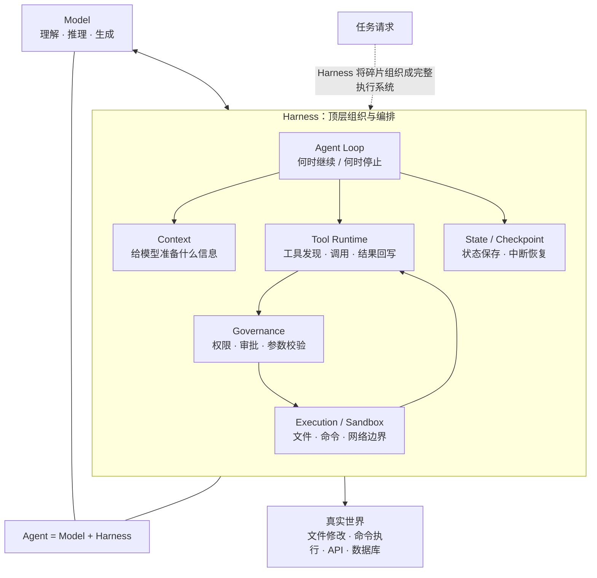
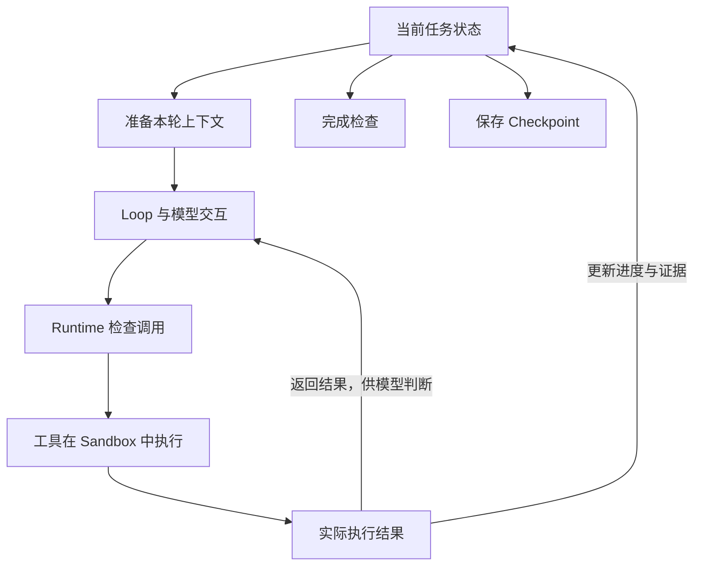
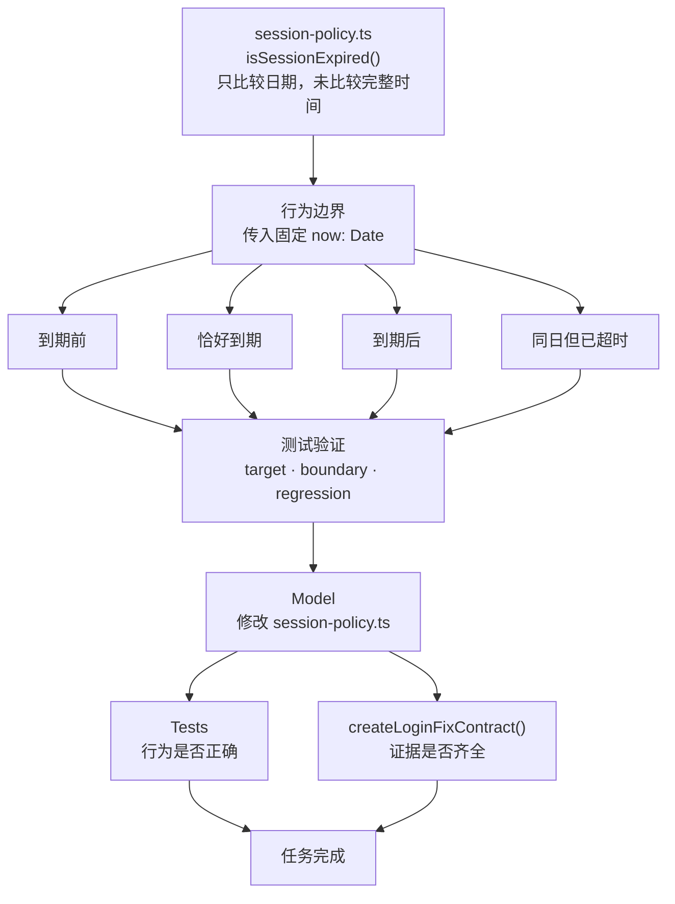
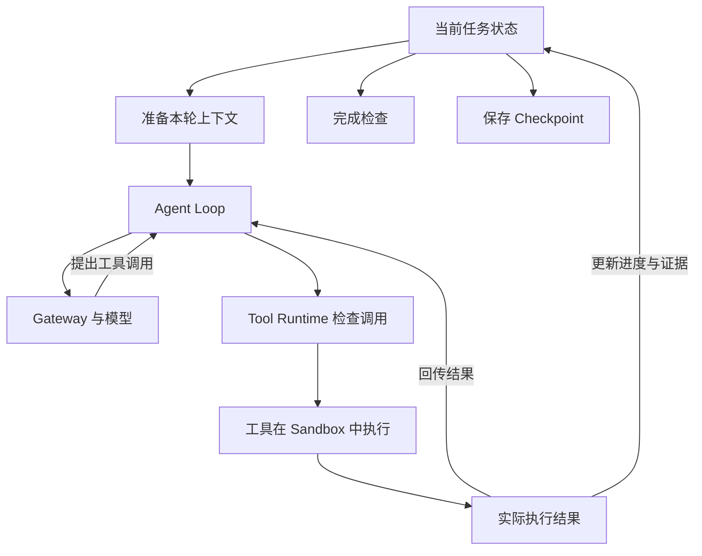
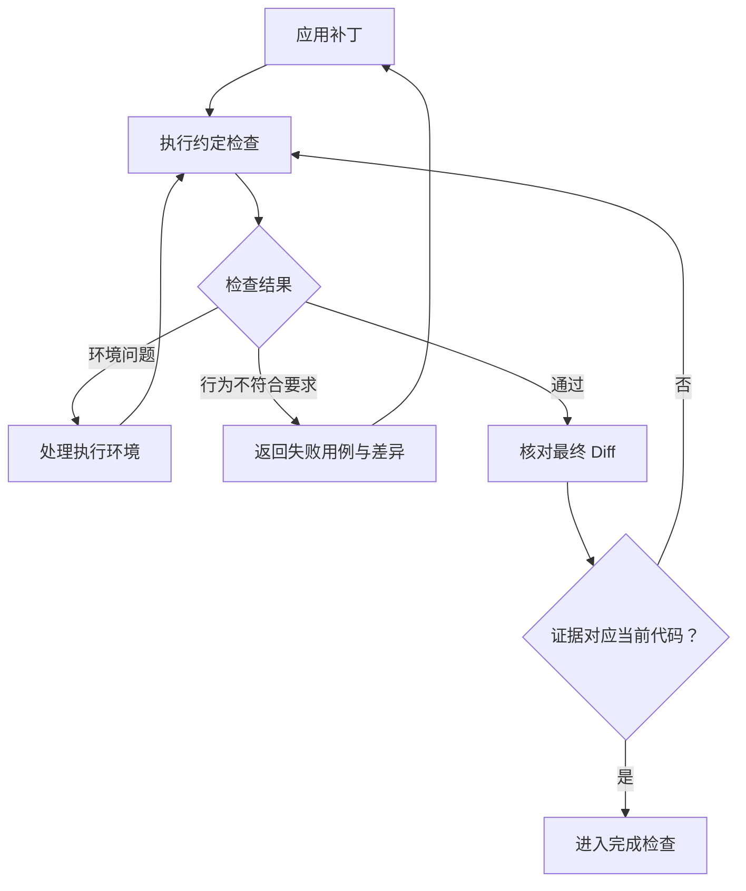
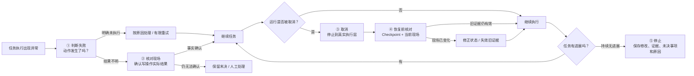
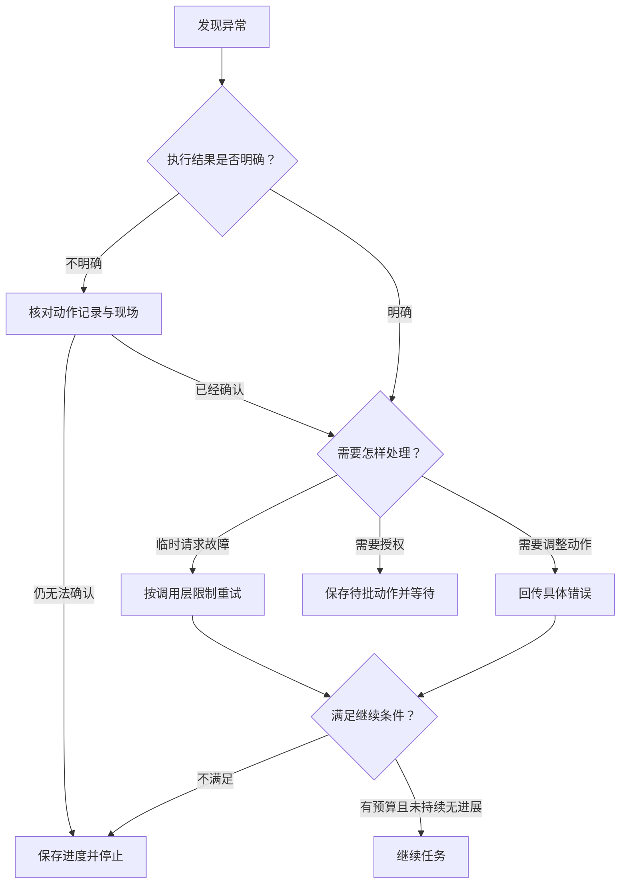
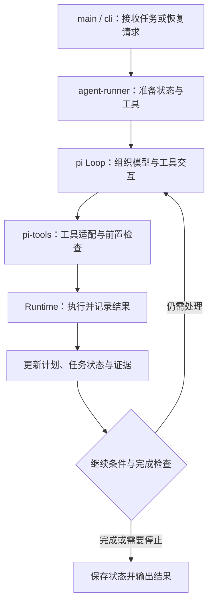
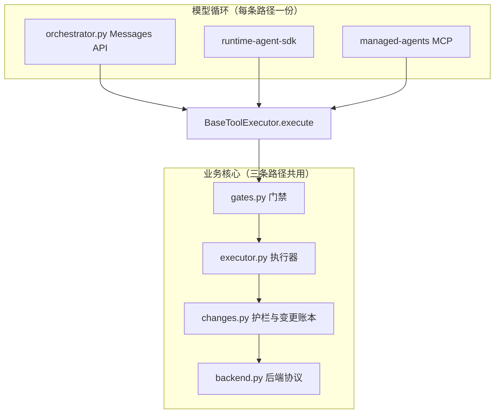
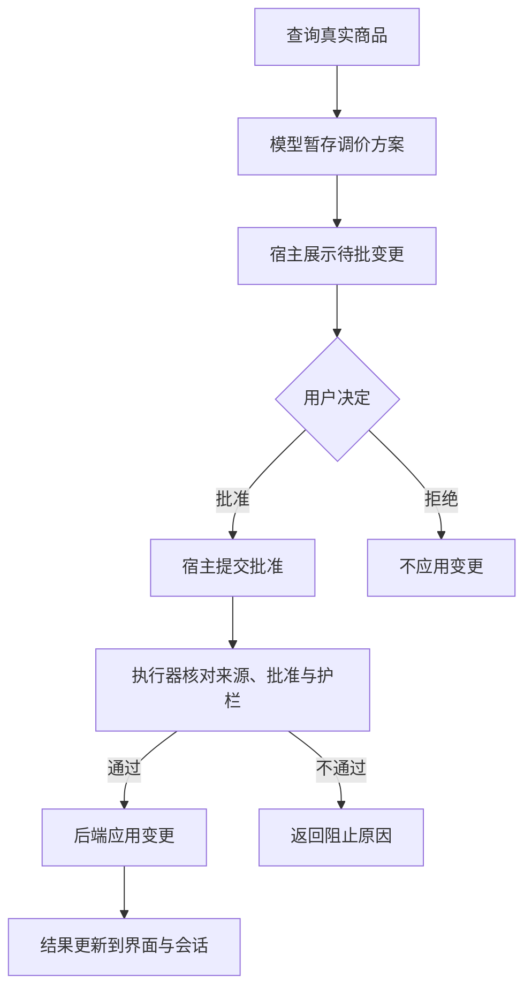

# 3\.5 Harness v8

# 3\.5 Agent Harness：把一次代码修改做完整

前几节，我们已经实现了 Agent Loop、任务规划、状态恢复和 Sandbox。现在的 Agent 能连续调用工具，按计划推进任务，也能保存进度，在限定范围内执行操作。


把这些模块放到一起以后，我们终于可以给它一个完整任务：

> 修复登录会话已经过期，并完成修改、测试和交付说明。


假设 Agent 找到了代码，改好了判断逻辑，跑完测试，最后回复：“问题已修复。”这次任务就结束了吗？

还要看几个事实：它跑的是不是要求的测试？测试通过之后，有没有再次修改代码？中途等待过审批的话，执行时用的还是不是批准过的补丁？如果运行被打断，恢复后会不会把已经完成的修改再做一遍？


这些事情**分散**在模型调用、工具执行、状态管理和运行环境之间。**单个模块写对了，不代表它们接起来以后就能正确工作。**

本节继续以 `planning_agent_demo` 为基础，沿着这次登录修复，把准备、修改、验证、异常处理和交付**串起来**。最后再对照 `commerce-agents` 的 Messages API 实现，看看不用 pi 时，哪些连接需要应用自己完成。

---


## 一、理解 Harness：模型之外，谁来组织任务

### 1\.1 模型提出动作，程序让动作发生

先看一次最普通的文件修改。

模型读到会话校验代码以后，认为日期比较有问题，于是发出补丁工具调用。这个调用表达的是“我想修改这个文件的这段内容”。真正打开文件、检查原文、写入补丁的，是程序。

写入之后，程序还要告诉模型：修改成功了，还是原文没有匹配上？如果成功，改动涉及哪些文件？如果失败，下一步应该重新读取，还是需要人工授权？模型拿到这些信息，才能决定继续修改或运行测试。

在这个过程中，模型负责理解和判断，外围程序负责组织执行。外围程序还要准备上下文、检查权限、保存状态，并决定哪些条件下允许继续。



**这些围绕模型，组织工具、状态、上下文与执行环境的支撑程序，合在一起就是 Harness。**

因此，可以把 Agent 理解为：

**Agent = Model \+ Harness。**

这里的 Model 提供理解、推理和生成能力；Harness 负责组织模型调用，把输出接到实际执行过程。请求配置、响应处理和调用失败处理都属于这套支撑程序，模型内部的权重不属于它。

这也解释了同一个模型接入不同系统，效果为什么可能不同。


例如，测试失败后，一个系统返回失败用例、断言差异和代码位置，另一个只返回“执行失败”。前者让模型知道哪条行为没有满足；后者可能让它反复修改不相关的代码。模型没有换，执行结果的组织方式已经改变了下一步行动。

所以，改善 Agent 时，除了看模型和提示词，也要沿运行过程检查：它看到了什么，动作是否执行，结果有没有返回，发现问题后能不能继续处理。


前几节的 Loop、Runtime、状态保存和 Sandbox，已经在承担这些职责。本节要检查并补齐它们之间的连接，不要求重新实现这些模块。


### 1\.2 Tool、Runtime、Loop 各自负责哪一段

前几节的模块已经在承担 Harness 的职责。本节不要求把它们重写成一个新类，而是看清已有分工。

|模块|本例中的职责|
|---|---|
|Tool|提供读取文件、应用补丁、运行测试等具体能力|
|Tool Runtime|检查调用，管理执行，记录并返回结果|
|Loop|组织模型与工具之间的多轮交互|
|State|保存计划、执行事实、验证证据和未完成事项|
|Sandbox|限制操作实际能够触及的文件、进程或其他资源|
|任务运行层|协调启动、等待、取消、恢复和收尾|

顺着一次补丁调用看：模型提出请求，Loop 把调用交给 Runtime；Runtime 检查参数、路径和授权，通过后才调用工具。工具完成修改，结果经过 Runtime 返回 Loop，再进入下一轮模型输入。这种**分工**直接影响检查应该**放在哪里。**


“这个路径是否允许写入”要放在实际执行入口，让每次修改都经过检查。如果只在 Loop 的某个分支判断，换一条调用路径就可能漏掉。相反，“收到结果后是否继续请求模型”属于运行控制，不应该由补丁工具自行决定。

任务启动和恢复则要协调更多模块。恢复时，程序可能需要同时读取 Checkpoint、核对工作区、确认待批动作，再启动 Loop。这类工作可以称为 Agent Runtime，也就是任务运行层。它与 Tool Runtime 关注的范围不同，但框架未必把两者拆成独立的类。读代码时，按实际职责定位，不必为了名称再增加模块。


### 1\.3 工具结果要同时交给模型和程序

到这里，一次动作已经能够执行。但“测试运行完了”还需要进一步变成“任务推进到哪一步”。

假设到期边界测试失败。模型需要看到失败用例和断言差异，才能修正判断逻辑；程序也要记录失败，确认边界验收项尚未通过。

如果只告诉模型，业务状态没有更新，程序可能仍然允许交付。如果只更新状态，却没有返回失败原因，模型下一轮就缺少修正依据。

因此，同一份执行结果有两个去向：



状态和上下文在这里也有不同用途。状态保存程序需要核对的事实，上下文提供模型本轮需要的信息。模型可以只看到简短的测试摘要，程序仍然需要保留或引用可核对的测试记录。

例如，测试通过以后，代码又被修改。状态中应当反映旧证据已经失效，下一轮上下文则告诉模型哪些检查需要重跑。这样，模型看到的进度与程序执行的完成检查才不会互相矛盾。


理解这条连接以后，我们再把它放进一次完整任务。

---


## 二、跑通登录修复：从要求到交付

### 2\.1 先把“修好了”变成可检查的行为

接下来我想为你展示一下 Harness 是如何把这些模块连接起来的。



本例的缺陷位于 `fixtures/demo-app/src/auth/session-policy.ts`。

其中，`isSessionExpired` 取出日期字符串的前十位，只比较 UTC 日期，没有比较完整时间。因此，同一天内，即使会话已经到期，函数仍可能判断它有效。

仅仅告诉模型“把日期比较改成时间比较”，可以引导它修改代码，却没有充分说明修改以后应该满足什么行为。我们需要先检查三个时刻：到期前、恰好到期、到期后，并明确项目对到期边界的约定。尤其不能遗漏“日期相同，但时间已经超过”的情况，否则原缺陷可能仍然藏在测试之外。

这里不需要让测试真的等待会话过期。函数已经接收 `now: Date`，传入固定时间即可稳定复现。受保护接口如何依据结果允许或拒绝访问，返回码是什么，继续沿用项目约定。

附件已经提供目标测试、边界测试和登录回归测试。先阅读这些用例，确认它们检查了什么；缺少行为覆盖时再补充，避免为同一条路径堆积重复测试。

行为要求明确后，再看程序怎样判断任务完成。现有 `createLoginFixContract` 要求：

- 当前代码版本包含目标文件的 Diff。

- `target`、`boundary`、`regression` 三组验证通过。

- 指定交付产物已经生成。

相同要求也要放入模型的任务说明。模型据此安排工作，程序据此检查实际结果。

这里有两道不同的检查。测试用例判断代码行为是否正确；完成契约判断要求的证据是否齐全、有效。完成契约不会替我们审查每一条断言，如果测试遗漏了同日到期问题，即使记录齐全，也不能说明缺陷已经修好。


### 2\.2 准备工作区，给模型足够的起点

正式修改以前，先检查工作区已有改动，并记录本次允许修改的范围。否则任务结束时，可能分不清哪些是用户原有工作，哪些是 Agent 新增修改；更严重的是，Agent 可能把用户尚未提交的内容覆盖掉。

接着确认执行环境：测试从哪个目录运行、使用哪个运行时、依赖是否就绪、是否需要后台服务。这些信息应来自项目脚本和执行配置。

有些环境问题很小，却会不断误导后续判断。例如，前一次工具调用执行了 `cd`，下一次启动的却是全新 Shell，那么目录不会自动继承。执行器应显式传入工作目录。若使用持久终端，也要确认会话仍然存在，不能看到历史里写着“服务已启动”，就假定进程现在还活着。


首轮上下文可以围绕四项内容组织：

|内容|模型需要知道什么|
|---|---|
|目标|修复什么行为，哪些情况必须满足|
|入口|从哪个文件、函数和测试开始检查|
|边界|允许修改什么，哪些动作需要审批|
|验收|必须完成哪些验证，生成什么交付产物|

README、项目指令文件和模块说明可以补充这些信息，但要确认应用确实加载了它们。文件存在于仓库中，不等于模型已经读到。


首轮也不必塞入整个仓库。给足开始工作的目标、入口和规则，后续代码与日志通过工具按需读取。这样既避免缺少必要信息，也不会让大量无关内容挤占上下文。


### 2\.3 先确认失败，再应用补丁

本例已经给出了目标文件，Agent 可以先读取 `isSessionExpired` 和相关测试，再追踪调用方怎样使用返回值。读取结果保留真实路径、行号和必要片段，便于核对修改依据。

随后运行能够复现缺陷的现有测试。如果测试确实覆盖了“同一天内已到期”，就应观察到与缺陷一致的失败。若它通过，先检查用例是不是绕开了问题，而不是立即进入修改。

这一步让后面的“测试通过”有了比较对象：同一个行为，在修改前失败，修改后通过。

掌握依据后，模型提出针对到期判断的补丁。当前任务范围很小，应优先修改相关逻辑。若诊断表明必须更换会话存储或同时改动多个接口，则需要说明原因和影响，再确认是否扩大范围。

实际写入仍然经过 Runtime。参数、目标路径和授权都通过检查，工具才在 Sandbox 中修改文件。




这里要检查所有写入入口。假如补丁工具有路径限制，通用命令工具却可以执行任意写文件命令，那么约束仍然可以绕过。规则必须覆盖实际能产生修改的路径。

补丁匹配失败时，应返回具体原因，让模型重新读取当前文件。不能自动挑选一个相似位置写入；程序不能替模型猜“它大概想改这里”。成功后，保留可检查的 Diff，并通过 `toolCallId` 将结果与原调用配对，同时更新任务状态。


### 2\.4 让测试结果决定下一步

修改完成后，可以先做相关的类型、语法或 Lint 检查，尽早发现明显错误，再执行契约要求的三组测试。

这三组检查各有用途：`target` 确认目标缺陷，`boundary` 检查到期边界，`regression` 检查原有登录行为。只跑最容易通过的一组，不能满足当前任务要求。

测试失败以后，先分清失败发生在哪一层。

如果依赖缺失，测试进程没有成功启动，程序应明确记录“尚未验证代码行为”。这时需要处理执行环境，不能让模型拿着一条启动错误去修改业务逻辑。

如果测试正常运行，某条断言失败，就把失败用例、预期值、实际值和日志位置交回模型。下一次修改要针对这个行为，而不是重复一句“请继续修复”。



每次测试还要记录它检查的是哪份代码。只保存 Git 提交号不够，因为 Agent 的修改通常尚未提交；应继续使用工作区版本或内容指纹关联受测内容。

假设测试已经通过，Agent 随后又调整了到期判断。旧测试仍然是一条真实记录，但它证明的是修改前的那份代码。程序应识别这种变化，要求重跑相关检查，并把缺项放入下一轮上下文。


**“测试曾经通过”与“当前代码已经验证”，是两个不同结论。** 后面的工程改造会专门补齐这处判断。

### 2\.5 核对最终改动，再宣布完成

三组测试通过后，还要看最终 Diff，包括源码、测试和配置。确认 Agent 修复了到期逻辑，保留了原有鉴权行为，没有通过删除失败用例、放宽断言或跳过检查来获得成功。

退出码为零是一条执行证据，但它无法独自回答“需求有没有满足”。检查范围应跟随实际改动：只改会话判断，就重点看代码和相关测试；还改了登录失效后的界面，就要实际打开页面检查交互。

随后由完成契约核对当前版本的 Diff、三组通过记录和指定交付产物。证据齐全且有效，任务才能进入 `completed`。

在当前工程中，重点检查下面几个时机：


如果还有明确缺项，且预算允许，就把缺项交回模型继续处理；如果无法继续，则保存进度，说明阻塞原因。模型可以提出“我已完成”，最终状态仍由程序依据证据确定。

交付说明不必重复整段聊天。回答四个问题即可：改了什么，实际验证了什么，哪些没有验证，还有什么限制。接口、配置或测试命令发生变化时，同步对应说明；只修正比较逻辑，通常不需要另写一份设计文档。

走到这里，正常路径已经连通。接下来把运行过程打断，看看这条路径还能不能保持正确。


## 三、遇到异常时，让继续执行有依据

正常路径已经跑通，接下来只讨论一件事：**任务被打断以后，Harness 怎样依据真实执行情况决定下一步。**

我们依次处理五种情况：先判断失败能不能重试；结果不明时先核对现场；用户取消时把停止传到真实执行层；再次恢复时重新检查旧结论；如果任务始终没有进展，最终主动停止。先看第一种情况：



### 3\.1 先分清错误，再决定是否重试

同样是“调用失败”，后续动作可能完全不同。


模型请求被限流，没有取得响应，可以交给调用层有限重试；补丁明确报告原文不匹配，需要重新读取文件；补丁发出后连接中断，不知道有没有写入，就必须先查现场。


我的工程经验是：**错误处理首先不是决定“要不要重试”，而是确认“刚才的动作到底有没有发生”。** 没有执行，可以安全重试；明确失败，就针对原因处理；执行结果不确定，就先检查现场。只有把执行事实确认清楚，Harness 才知道下一步应该重试、继续，还是转人工处理。


|发生了什么|程序应怎样处理|
|---|---|
|临时模型请求故障|按调用层规则有限重试|
|补丁明确未匹配、未写入|返回原因，让模型读取后调整|
|缺少授权|保存待批动作，进入等待|
|写操作结果不明|查执行记录与现场，再决定下一步|
|相同动作持续失败且无进展|达到限制后停止，保留未完成事项|

请求重试和工具错误协议继续复用前面章节的实现。本节**关心这些局部机制有没有影响整个任务**。


例如，模型调用层正在退避等待，用户取消任务，取消信号就应打断等待，不能等全部重试结束才生效。工具返回“需要审批”，任务就要进入等待，后续调用不能继续写入文件。

错误信息还应让下一次动作发生变化。“修改失败”没有说明什么；“目标文件存在，但待替换片段没有匹配，请重新读取当前内容”才足以支持下一步。

返回结果时，也要守住事实边界。只有工具确认未写入，才能说“本次没有修改文件”。无法确认的情况，应保留为结果不明，不能为了简化状态处理，把它归为普通失败。

到这里，明确失败已经比较容易处理：知道没执行，就可以根据原因决定是否重试。**真正麻烦的是另一种情况——调用中断了，但我们不知道写操作到底有没有发生。** 这时不能直接重试，而要先恢复执行事实。


### 3\.2 写操作结果不明，为什么不能直接重放

考虑下面这个中断位置：

```Plaintext
补丁提交 → 文件已写入 → 程序退出 → 结果尚未保存
```

恢复时，Checkpoint 仍然显示“等待修改”，文件却已经是新内容。如果根据存档直接重放，可能重复修改，也可能因为旧内容不再存在而再次失败。

这里需要把 3\.3 的执行记录与现场核对接入恢复入口。先看原动作涉及哪些文件，执行前是什么内容，当前发生了什么变化，再决定是否继续。

可以将核对结果分成三种：

- 已确认完整执行：恢复真实结果，继续后续验证，不重复修改。

- 已确认没有执行：满足原有条件后，才可以重新执行。

- 部分执行或仍无法确认：保留未决事项，继续核查或交给人处理。

不能仅凭文件里出现了某段预期代码，就认定整个动作成功。多文件补丁可能只完成一部分，相关测试也可能还没有运行。

恢复消息时同样如此。缺少工具结果，就先查执行记录；找得到真实结果，按协议补回；找不到，就明确记录中断和不确定性。让消息格式完整，不等于已经知道操作发生了什么。


因此，对于写操作，恢复的第一原则不是“把没完成的调用再执行一次”，而是**先确认上一次执行到了哪里，再决定下一步。**

前面讨论的是程序异常退出造成的中断。还有一种更常见的中断来自用户主动取消。区别在于，程序收到了“停止”的要求，但已经发出去的模型请求、测试进程和文件操作，不一定会同时停下来。


### 3\.3 取消任务，要停到真实执行层

用户点击取消以后，界面停止输出，很容易让人以为任务已经结束。但测试进程可能仍在运行，甚至继续写入工作区。

因此，取消要沿调用链传递：任务入口通知模型请求和 Runtime，Runtime 再通知执行器。执行器处理取消后，还要确认相关进程退出。

文件修改则有另一层含义：取消不会自动撤销已经写入的内容。如果补丁完成了，就记录实际修改；如果只完成一部分，或尚不确定，就保留待核查信息。

在进程是否退出仍不明确时，不能立即启动下一次运行修改同一工作区。否则两个任务可能同时操作文件，后续测试和证据都难以解释。

取消后的状态应说明实际发生了什么，而不是把所有记录统一改成“失败”。这份记录既用于恢复，也用于让工程师决定接下来如何处理。

所以，取消解决的是\*\*“怎样真正停下来”\*\*，而不是“怎样回到原来的任务”。

任务一旦暂停或取消，工作区可能继续被用户修改，授权可能变化，旧测试也可能失效。以后再次启动时，就不能简单地从 Checkpoint 指向的位置继续执行。

因此，接下来还要解决另一个问题：**上次保存的进度，到了现在还能不能相信？**


### 3\.4 恢复之前，重新检查旧结论

Checkpoint 找回的是上次进度，不保证上次结论现在仍然成立。

例如，Agent 暂停后，用户手动修改了目标文件。旧测试记录还在，待批补丁也还在，但它们针对的已不一定是当前内容。

恢复入口因此要检查三类信息：

|检查对象|要回答的问题|
|---|---|
|当前工作区|与存档时相比，相关文件是否变化？|
|未决动作|上次调用实际执行到了哪里，是否可能已经产生修改？|
|证据与授权|旧测试和待批动作是否仍适用于当前现场？|

这些检查应发生在重新请求模型和执行工具之前。先核对现场，修正状态，再构建下一轮上下文，而不是把整份旧对话交给模型，让它自己猜哪些内容已经过期。

恢复也不必一律从头开始。没有受到变化影响的步骤，其有效证据可以保留；需要重新检查的是变化涉及的部分。这样才能既保护已有进度，又避免沿用过时结论。

恢复以后，Harness 已经能够基于当前现场继续任务。但“能够继续”不代表“应该一直继续”。

如果恢复后仍然反复执行相同动作、得到相同错误，没有新的代码变化，也没有新的证据产生，那么继续运行已经没有意义。**Harness 除了知道怎样继续，还必须知道什么时候应该停止。**


### 3\.5 任务没有推进时，怎样停下来

即使每次错误都正确返回，Agent 仍可能转圈：连续提交同一份补丁，连续得到同一个匹配错误；反复运行同一组测试，却既没有修改代码，也没有获得新信息。

这些调用都结束了，但任务没有推进。

3\.1 已经提供轮数、时间和重复限制。判断无进展时，可以先比较工具名、参数和结果，再结合代码变化与计划推进情况。不要把模型输出了新的解释，当成任务取得了进展。

还要区分局部重试与任务总限制。前者控制一个临时故障最多尝试几次，后者控制整个任务的轮数和时间。局部恢复成功，不能把整个任务的消耗清零，否则任务可以借助不断重试或恢复一直运行。

停止后，保存已有修改、测试结果、未决动作和停止原因。模型已经持续请求失败时，不必再依赖它生成总结，这些信息应能从状态与执行记录中整理出来。

至此，等待、取消、暂停和完成就有了各自含义。一次运行结束，只说明程序停了；任务是否完成，还要看对应的业务证据。


把本节的处理放在一起，可以得到一条统一的判断路径：




Harness 在异常处理中的重点，就是让“继续”成为有条件的决定：错误信息足够具体，执行结果能够确认，原有证据和授权仍然有效，而且任务还有继续推进的空间。


异常处理的规则已经明确：能否继续，要依据真实结果、当前现场和剩余预算；无法确认时，就保存进度并停止。

这些规则最终要进入代码。比如，取消信号有没有传到测试进程，旧测试结果会不会被误用，进入审批等待后是否还会继续执行，都需要沿着实际调用链检查。


下面回到 `planning_agent_demo`。先确认工程已经实现了什么，再找到尚未接完整的位置，把前面的要求落实到具体模块。


---


## 四、完善 pi 工程：把规则接到实际路径

前面讲的是运行要求，现在回到代码中确定修改位置。`planning_agent_demo` 已包含计划、审批、任务状态和 Checkpoint，本节继续复用它们。

阅读工程时，可以先按三组文件建立认识：


这些文件已经共同承担了 Harness 的职责。发现缺口后，修改对应模块即可。


### 4\.1 先读调用链，再找接入点

可以顺着一次 `run_test` 调用阅读工程，先追踪一次“模型请求运行测试”的过程。

`agent-runner.ts` 准备状态和工具，启动 pi Loop；模型提出调用后，`pi-tools.ts` 将它接入业务执行逻辑；`runtime.ts` 执行测试并返回结果；业务代码更新计划和证据，再决定继续还是停止。



阅读时，先分清哪些代码已完成，哪些连接仍有缺口，不必把所有内容搬进一个新的 `coding-harness.ts`。


读到这里，再看 Hook 就容易了：它们是在这条调用链中插入业务规则的位置。


这里有两个容易接错的地方。

**第一，首轮和后续轮次要分别准备。** 首轮输入由应用构建，不能指望 `prepareNextTurn` 补上。当前 0\.84\.4 Loop 在正常轮次中先发出 `turn_end`，再执行 `shouldStopAfterTurn`，准备继续时才调用 `prepareNextTurn`。因此，完成判断应读取最新业务状态，不能依赖下一轮提示词是否已经刷新。

**第二，不是所有调用都会经过 ****`afterToolCall`****。** 工具不存在、参数校验失败或 `beforeToolCall` 拒绝时，当前实现会直接生成结果，跳过 `execute` 和 `afterToolCall`。如果拒绝记录只写在 `afterToolCall` 中，这些调用就会漏记。应在预检位置或统一结果事件中覆盖它们。


审批也要按实际路径检查：应用保存待批补丁并进入等待；人工通过 CLI 批准后，`approval-flow.ts` 重新核对条件，再执行写入。模型没有批准工具，生成一个 `approved: true` 不会获得授权。

**掌握这些接入点，是为了判断规则有没有覆盖实际路径。** 只看到某个 Hook 里写了检查，还不足以证明所有相关调用都经过它。


### 4\.2 完成检查要读“当前内容的最新结果”

完成检查是本次改造的重点，因为它决定 Agent 能不能把任务交付出去。

现有 `createLoginFixContract` 已从证据中查找测试结果，而不是根据模型最终回复判断。核心逻辑如下：

```TypeScript
const current = evidence.filter(
  (item) => item.artifactVersion === revision,
);

const passedTest = (scope: string): boolean => current.some(
  (item) =>
    item.kind === "test"
    && item.payload.scope === scope
    && item.payload.exitCode === 0,
);
```

这段代码已经解决了一个问题：只跑了 `target`，如果没有另外两组  `boundary` 和 `regression` 的通过记录，就不能完成任务。`verify` 返回缺项，业务控制层再把具体要求交回模型。


但它还可能接受两类不可靠的证据。

**第一类，版本编号没变，内容却变了。**

当前 Runtime 在受控补丁成功后，把版本从 `r0` 推进到 `r1`。这能跟踪经过该入口的修改，但同一次运行中，如果文件被外部编辑，计数不一定变化。

于是可能出现：记录仍属于 `r1`，源码却已经变了，旧测试结果继续被接受。

完善时，要让验证记录关联实际受测内容。可以沿用工程已有的文件摘要机制，明确本任务需要覆盖的源码、测试和相关配置，在验证前后核对；完成检查时，再与当前内容比较。若验证期间相关文件发生变化，这次结果也不能直接作为当前版本的交付依据。

不能只在收尾时比较。


**第二类，早先成功掩盖了后续失败。**

看一个简单序列：

|顺序|受测内容|范围|结果|
|---|---|---|---|
|第一次|相同内容|`boundary`|通过|
|第二次|相同内容|`boundary`|失败|

如果同一版本的 `boundary` 先通过、后失败，早先的通过记录仍可能使检查返回真。

因此，应按验证范围选择当前内容对应的最新有效结果。最新检查失败，就不能继续使用更早的通过记录；缺少结果，就继续列为缺项。

交付文档也遵循同样原则。已有写入记录可以证明当时执行过写入，但收尾时还应检查指定文件是否存在、是否包含要求的内容。

这一步真正完善的是：**完成判断依据当前可以核对的事实，而不是依据历史上曾经发生过一次成功。**


### 4\.3 错误与缺项要准确进入下一轮

完成契约拒绝交付以后，不能只给模型一句“任务未完成”。它需要知道具体缺什么：哪组测试未执行，哪条记录已经过期，或者最新结果为什么不能接受。

测试失败也一样。Runtime 已经返回失败用例和差异，工具适配层就不应把这些信息压成一个模糊的错误标志。程序保留结构化状态，模型获得足够具体的解释，两者来自同一次结果。

这里同时检查拒绝路径。未经授权的调用可能根本没有进入执行器，但它仍是一条需要记录和反馈的结果。否则界面处于等待审批，模型却不知道为什么没有进展。

规则仍然由程序落实。补丁匹配失败，模型可以重新读取后调整；权限不足，不能换工具绕过；测试失败，可以修代码，不能自行删除验收项。

### 4\.4 取消和恢复要遵守已有状态语义

完成检查关注“能否交付”，取消和恢复关注“现在还能不能继续执行”。两者都要求业务状态与实际现场一致。

当前 `main.ts` 收到 `SIGINT` 后会调用 `AbortController.abort()`，普通工具已经把信号传入 Runtime，`run_test` 也传给了 `execFile`。

这些连接可以继续复用。本节要往下追踪尚未覆盖的部分：补丁专用执行路径是否处理取消，测试启动的子进程是否全部退出，以及结果记录是否反映实际完成情况。

检查取消链路时，可以顺着三个问题看：

尤其是文件修改，不能假定取消会撤销已经写入的内容。如果补丁已经完成，就记录实际修改；如果只完成一部分或结果不明，就保留待核查信息，不能为了统一状态而全部标记为失败。

还要区分工程已有的两种停止方式：

- `--pause-after` 在保存后停止，任务保留为 `running`，用于后续恢复。

- `SIGINT` 引发的 `ABORTED` 在当前 runner 中会转为 `cancelled` 终态。

界面、报告和恢复入口都应遵守这一区别，不能把它们都称为“可恢复暂停”。

恢复机制继续复用 3\.3 的实现，重点检查执行顺序：先核对工作区、未决动作和待批补丁，再恢复消息并请求模型。pi 的会话 journal 可以保存交互记录，但不会自动恢复源码或测试进程。


例如，待批期间文件发生变化，恢复入口应将问题交给已有的前置条件检查，不能直接依据旧批准执行补丁。只有现场核对通过，模型才可以继续推进任务。


### 4\.5 把本次改造限制在明确范围内

现在，改造范围已经可以收敛到几项具体连接。已有计划、审批和 Checkpoint 继续使用，下面列出的缺口在对应模块中补齐。


修改时要保留 3\.4 的执行边界。尤其是增加工具或调整适配器之后，应重新检查是否出现绕过 Runtime 的文件和命令入口。

如果借助 Coding Agent 实现，可以把任务写成下面这样：

```Plaintext
继续完善 planning_agent_demo，以当前安装的 pi 版本为准。

先阅读：
agent-runner.ts、pi-tools.ts、runtime.ts、loop-guard.ts、
completion-contract.ts、cli.ts，以及相关现有测试。

保留现有 runAgentLoop / runAgentLoopContinue、计划、任务状态、
审批与 Checkpoint。先列出现有实现和实际缺口，再修改对应模块。

本次重点：
1. 测试证据关联实际受测内容；相关文件变化后，旧证据失效。
2. 各验证范围使用最新有效结果，避免“曾经通过”掩盖后续失败。
3. 取消信号覆盖实际执行路径，核实进程退出并记录已发生的修改。
4. 恢复先核对现场；暂停、取消、等待审批保持各自语义。
5. 将真实错误与具体完成缺项反馈给下一轮。

保持现有 Gateway 配置与 3.4 执行边界，不增加绕过 Runtime 的入口。

验收覆盖：
- 三组测试通过后修改相关文件，任务不能直接完成。
- 同一内容、同一验证范围先通过后失败，任务不能完成。
- 待批期间修改目标文件，旧批准不能直接执行旧补丁。
- 取消运行中的测试，确认相关进程退出并保存实际进度。
- 模型输出“已完成”，不能绕过缺失或失败的验证。

交付最小改动、实际执行的检查、未执行项和仍存在的限制。
```

工程师审查这次改造时，重点看规则是否在正确位置生效：证据能否代表当前代码，取消能否影响真实执行，恢复是否先核对现场，模型能否收到具体的下一步要求。


这些连接补齐后，再用同一组场景验收。接下来先用脚本检查确定的控制规则，再运行真实登录修复任务，最后通过反例确认：即使模型提前结束、文件被外部修改或执行中途取消，程序仍能给出正确的处理结果。

本次改造已经落实到几个具体位置：验证记录要对应当前代码，取消信号要传到实际执行器，恢复前要核对现场，完成缺项要准确反馈给模型。


接下来，不能只看代码里是否增加了这些检查，还要实际触发它们。例如，测试通过后再修改文件，程序是否拒绝使用旧证据？测试运行中取消，进程是否真的退出？

下面分三层验收：先用现有测试和固定动作检查程序规则，再用真实模型完成登录修复，最后主动制造几个反例，确认关键检查确实生效。


## 五、实践验收：看决定，也看实际后果

本次验收有两个对象。

一个是 `planning_agent_demo` 自身。我们要检查它是否正确处理计划、审批、完成判断、取消和恢复。

另一个是被修改的登录应用。我们要检查会话到期以后，应用是否真的拒绝访问，原有登录行为是否正常。


**Agent 自身的测试通过，不代表登录缺陷已经修复；登录测试通过，也不代表 Agent 的取消和恢复机制正确。**

因此，验收分成三层：


三层都围绕第四部分的改造展开。先用可重复的输入检查明确规则，再观察真实模型的运行效果，最后验证容易遗漏的分支。


### 5\.1 用固定动作检查运行机制

以下命令在 `planning_agent_demo/` 下执行。先确认实际依赖，再运行已有测试与构建：

```Bash
npm ls @earendil-works/pi-agent-core @earendil-works/pi-ai
npm test
npm run build
```

这里的 `npm test` 检查的是 Harness 自身的逻辑；Agent 后续通过 `run_test` 执行的 `target`、`boundary`、`regression`，检查的是目标登录应用。记录结果时，要写清测试对象，避免混淆。


现有测试通过后，再用固定动作检查暂停与恢复：

```Bash
WS=$(mktemp -d)

node --import tsx scripts/child-run.ts \
  --scenario ac_full \
  --workspace "$WS" \
  --run-id run-harness \
  --pause-after 6 \
  --auto-approve

node --import tsx scripts/child-run.ts \
  --scenario ac_full \
  --workspace "$WS" \
  --resume run-harness \
  --auto-approve
```

两条命令必须使用同一个工作区。第一次运行在指定轮次保存后暂停，第二次从同一个任务继续。


这项实验使用脚本化模型产生固定动作，方便重复触发同一条路径。检查重点是：

- 暂停时是否留下可读取的 Checkpoint。

- 恢复后是否保留已有计划、执行记录和进度。

- 已完成的修改是否被重复执行。

- 最终状态是否与完成检查结果一致。

**脚本化实验通过，说明固定输入下的运行机制符合预期。它不能证明真实模型能够自己定位缺陷。**


其中，`--auto-approve` 是实验者显式选择的自动放行模式，仍需经过补丁暂存和条件校验。它便于检查后续执行路径，但不能代替默认人工审批流程的验收。


### 5\.2 用真实模型完成登录任务

固定动作已经验证了程序路径，接下来再看真实模型能否利用这些能力完成任务。

复用已经跑通的 Gateway 和当前模型配置，执行：

```Bash
npm start
```

需要反复观察真实模型暂停与续跑时，可以使用已有入口：

```Bash
cd planning_agent_demo
npm run lab:harness   # 固定动作，不依赖 Gateway，每次新建工作区
npm run lab:cycle     # 真实模型，需 Gateway 可用
```

本次任务保持明确：

> 修复会话到期后仍能访问的问题。先检查现有用例，补齐必要的行为覆盖，完成 `target`、`boundary`、`regression` 三组验证，并生成约定的交付说明。


运行前，先记录目标工作区已有改动。运行过程中，不必要求模型严格采用同一条搜索路线，而要检查它是否获得足够依据，并遵守执行和完成要求。

如果目标工作区是 Git 仓库，可以在其中执行：

```Plaintext
git status --short
git diff --stat
git diff
```

这些命令帮助检查修改范围，不能替代行为测试。还要对照开始前的记录，区分原有改动和 Agent 新增的改动。


运行结束后，不只读模型的最终回复，还要核对实际 Diff、测试记录和交付文件。例如，报告写着“三组测试通过”，就应能找到三组对应记录，并确认测试以后没有新的相关修改。

没有执行的检查，记为未执行；环境问题导致测试无法启动，记为尚未验证。**真实运行的验收结果，应当来自执行记录，而不是来自模型对执行过程的描述。**


### 5\.3 主动制造反例，不等待模型偶然犯错

一次成功运行只能说明任务在这次条件下完成了。要确认第五部分的改造有效，还需要主动触发它所针对的问题。

这些检查可以直接构造工具调用或业务状态，无须等待模型恰好犯错。每个场景都应明确：开始时是什么状态，改变了什么，程序应该怎样响应。

这里最容易出现的问题，是只检查日志里有没有一句“拒绝”或“取消”，却没有检查实际后果。


例如，旧批准被拒绝后，还要确认文件没有被修改；取消测试后，还要检查相关进程，而不能只看界面停止输出；过期证据被识别后，还要确认任务没有进入 `completed`。


**验收控制规则，要同时检查程序的决定和实际产生的效果。**


表中列的是预期行为，执行以后再填写实际结果。某项能力尚未实现，就保留为未通过项，不用一段预期说明代替验证。


### 5\.4 失败后，找到第一个断开的连接

如果模型没有收到失败信息，先看 Runtime 是否返回正确结果，再看工具适配与消息回写。若失败已经进入状态，任务却仍能完成，就检查证据筛选和完成契约。


这样定位比不断修改提示词更直接：问题发生在结果回写，就修结果回写；问题发生在状态判断，就修判断条件。

修复以后，先重跑暴露问题的场景，再检查受影响的相邻行为。最终保留运行配置、实际结果、失败原因和未验证项，说明当前版本具备什么能力、还存在哪些限制。


经过这三层验收，我们才能确认 pi 版本中的 Harness 是否接完整。接下来再对照不使用 pi 的实现：框架替我们完成了哪些连接，去掉框架以后，哪些职责需要应用自己承担。

经过程序规则检查、真实任务运行和反例验证，我们已经能够判断：pi 版本中的工具、状态、证据和运行控制，是否真正接在了一起。


最后再换一个角度：如果不用 pi，直接通过模型 API 编写 Agent，哪些代码需要自己写，哪些业务规则仍然可以复用？

下面借助 `commerce-agents` 的商家案例进行对照。任务从修改源码变成修改商品价格，但我们仍然检查同几件事：模型依据什么提出动作，程序依据什么允许执行，结果怎样返回，以及运行结束是否意味着业务完成。

---


## 六、手动实现全套 Harness

`commerce-agents` 是 Anthropic 的一个电商 Agent，基于 python 语言和 Claude code 开发。它通过 Anthropic 模型客户端 SDK 调用 Messages API，由应用自己组织模型与工具之间的循环。

代码中提供了多条运行路径。本节只看最典型的 `runtime-messages-api`：它的工作过程主要是使用 Anthropic 模型客户端 SDK 调用 Messages API，由应用自己组织模型与工具之间的Loop 与 Harness。

为了看清分工，先将工程理解为三部分：

同一份 core 还被 `runtime-agent-sdk`、`managed-agents` 两条路径复用。这正是本节要看的接缝：



这个划分的价值是：模型循环可以更换，业务执行规则仍能复用。我们重点检查两者通过什么接口连接，而不是记住另一套目录结构。


为了更好的理解怎么从头构建的 Harness ，我们现在基于一个具体任务来分析代码：

> 把这件商品的价格下调 10%，先给我确认。

源码修改与商品调价的验证方式不同，但都需要真实对象、受控执行、授权和结果确认。这个对照用于看清框架与业务的边界，不再展开缓存和流式性能优化。

完成任务至少需要经过查询商品、计算并暂存变更、展示待批内容、批准后执行这几个步骤。

模型可以帮助选择查询方式、整理变更方案，但商品 ID 要来自实际查询结果，批准要来自宿主入口，最终是否修改成功要以执行结果为准。

这与登录修复中的分工相对应：

这里只对应工程职责，不把两套检查机制视为完全相同。源码修改还需要测试验证行为，商品调价则需要确认后台业务状态；各自的证据必须符合任务要求。

阅读源码时，可以顺着这条执行路径定位：


### 6\.1 模型循环可以更换，业务规则继续复用

在 pi 版本中，框架负责多轮模型调用与工具反馈，应用负责计划、授权、证据和恢复。去掉 pi 后，应用要自己接收工具调用、分发执行、整理结果，再按模型协议发起下一轮请求。


`commerce-agents` 将业务门禁、执行器和变更记录放在可复用的 `core` 中。Messages API、Agent SDK 等运行路径连接同一套业务能力。

循环与执行器之间的连接点只有一个：循环把「工具名 \+ 参数字典」交给 `BaseToolExecutor.execute()`，拿回一个 `ToolOutcome`。

```Python
# commerce-common/commerce_common/execution.py
@dataclass
class ToolOutcome:
    result_text: str                    # 给模型看的内容
    events: list[AgentEvent] = field(default_factory=list)   # 给宿主看的事件
    is_error: bool = False              # 工具真的失败了
    blocked: str | None = None          # 被哪道门禁拦下
```

`result_text` 给模型阅读，`events` 给宿主处理界面和业务事件。它们来自同一次执行，但仍需保证内容一致；仅仅放在同一个对象里，不会自动消除表达上的矛盾。

`is_error` 表示工具执行失败，`blocked` 表示被某道业务门禁阻止。例如，参数错误可以调整后再调用；缺少批准则应等待用户，不应该不断尝试绕过。

这样拆开以后，可以更换模型循环，而不用在每条运行路径重新实现一套调价规则。


接下来就沿着一次调用往下看：先把消息循环接完整，再看真正写入时由谁放行。


### 6\.2 手写 Loop，要把调用与结果准确配对

在 pi 版本中，框架负责处理大量消息与工具交互细节。Messages API 路径需要由应用完成这些连接。

一次工具调用的基本顺序是：

1. 宿主准备身份、会话状态、上下文和可用工具。 

2. 请求模型，取得包含 `tool_use` 的响应。 

3. 保存模型消息，将工具调用交给执行器。 

4. 执行器检查条件，执行或拒绝调用。 

5. 使用原调用 ID 构造 `tool_result`，放入下一轮消息。 

**工具结果不仅要返回内容，还要明确它对应哪一次调用。**

下面的片段展示了工程如何将结果交给宿主，同时回填模型消息：

```Python
calls = list(zip(tool_uses, outcomes, strict=True))
settled = {block.id: outcome for block, outcome in calls}

for block, outcome in calls:
    for event in outcome_events(block.name, block.id, outcome):
        yield event

messages.append(
    {
        "role": "user",
        "content": [
            tool_result_block(block.id, outcome)
            for block, outcome in calls
        ],
    }
)

settled = {}
```


这里有三个值得看清的地方。

首先，`strict=True` 检查数量是否一致，但数量一致还不够，执行器也必须保持正确的对应顺序。`block.id` 则让模型知道每个结果对应哪次调用。

其次，假如模型一次查询两个商品，一个成功、一个失败，只把输出合成“一个成功，一个失败”，模型就无法可靠判断应该重试谁。因此，工具结果应按协议配对，而不是退化成一段普通聊天。

最后，同一份 `outcome` 同时生成宿主事件和模型消息。宿主据此更新界面，模型据此继续判断，这与登录修复中结果同时进入状态和上下文是相同的连接方式。

这两个去向在源码里就是 `ToolOutcome` 的两个字段：


```Python
# commerce-common/commerce_common/streaming.py
@dataclass
class ToolOutcome:
    """One tool call's product: ``result_text`` for the model, ``events`` for the host.
    ``blocked`` names the gate that held the call; ``is_error`` marks a failure."""

    result_text: str
    events: list[AgentEvent] = field(default_factory=list)
    is_error: bool = False
    blocked: str | None = None
```


```Python
# commerce-common/commerce_common/turn.py
def tool_result_block(tool_use_id: str, outcome: ToolOutcome) -> dict[str, Any]:
    return {
        "type": "tool_result",
        "tool_use_id": tool_use_id,
        "content": outcome.result_text,
        "is_error": outcome.is_error,
    }

def outcome_events(tool: str, tool_use_id: str, outcome: ToolOutcome) -> Iterator[AgentEvent]:
    """The host events for one finished tool call: the outcome's own events (``ui``
    events stamped with the call id), then its ``tool_result``."""
    for event in outcome.events:
        ...
```


`tool_result_block` 只读 `result_text` 和 `is_error`；界面事件全部来自 `outcome.events`。两个函数接收同一个 `outcome`，因此不可能出现一边说成功、一边说失败。

错误也通过这条链路返回。工程区分了门禁阻止、执行失败和工具输入无法解析等情况。输入无法解析时，不运行工具；业务条件不满足时，返回被阻止的原因；实际执行失败时，返回错误结果。


```Python
# commerce-common/commerce_common/execution.py
async def execute(self, name: str, tool_input: dict[str, Any] | None) -> ToolOutcome:
    try:
        return await self.dispatch(name, dict(tool_input or {}))
    except InvalidArguments as invalid:
        return ToolOutcome.error(invalid_arguments_text(name, invalid.invalid))
    except Exception as error:  # a tool failure must not end the turn
        if (outcome := self.domain_error(error)) is not None:
            return outcome
        logger.warning("tool %s failed and is reported as unavailable", name, exc_info=True)
        return ToolOutcome.error(self.unavailable_text.format(name=name))
```


输入无法解析时，不运行工具；业务条件不满足时，返回被阻止的原因（`ToolOutcome.held(gate, text)`）；实际执行失败时，返回错误结果。


模型收到的反馈越准确，下一轮才越容易采取合适动作。但程序不能为了让消息格式完整，就编造一次执行成功。

工程在收尾时会处理尚未配对的工具调用，避免历史中遗留没有结果的 `tool_use`。这解决的是消息完整性；远端动作有没有发生，仍需依据执行记录或业务查询确认。

```Python
# commerce-common/commerce_common/turn.py
def close_open_tool_uses(
    messages: list[dict[str, Any]], settled: Mapping[str, ToolOutcome] | None = None
) -> int:
    """... the call's real outcome when ``settled`` has it (a write that finished is
    reported as done, not as one to repeat), else an error naming the interruption."""
```


`settled` 为空时才写「被打断，需要就再调一次」。如果这次写入其实已经完成，就必须按实际结果回答——否则模型会重放一次已经生效的写操作。这与恢复章节里「结果不明不能自动重放」是同一条规则。


#### 每轮请求是怎么组装的


在 pi 版本里，上下文由框架按 Hook 组织。手写 Loop 时，请求体要自己拼：


```Python
# merchant-agent/runtime-messages-api/merchant_agent_runtime/orchestrator.py
for round_index in range(self.config.max_tool_iterations + 1):
    force_text = round_index == self.config.max_tool_iterations
    if force_text:
        tool_choice: dict[str, str] = {"type": "none"}
    elif round_index == 0 and forced_tool:
        tool_choice = {"type": "tool", "name": forced_tool}
    else:
        tool_choice = {"type": "auto"}

    request_messages = build_request_messages(
        messages,
        rolling_breakpoint=(
            self.config.rolling_conversation_cache and tool_choice["type"] == "auto"
        ),
    )
    request: dict[str, Any] = {
        "model": self.config.model,
        "max_tokens": self.config.max_tokens,
        "system": system,
        "tools": self._tools,
        "tool_choice": tool_choice,
        "messages": request_messages,
        **self.config.thinking_request_fields(),
    }
```


这里有三点值得记住。


**提示词分两块，跨回合稳定。** `system` 由静态文本和每回合上下文两个块组成，缓存断点打在静态块末尾：


```Python
# commerce-common/commerce_common/prompt_assembly.py
def build_system_blocks(static_text: str, context: str) -> list[dict[str, Any]]:
    """The system prompt: the static text carrying the cache breakpoint, then the
    per-request context behind it. Nothing per request goes in the first block; a byte's
    change there would re-read the tool array and the static text on every call."""
    return [
        {"type": "text", "text": static_text, "cache_control": {"type": "ephemeral"}},
        {"type": "text", "text": context},
    ]
```


购物车、页面、时钟、记忆事实都放进第二个块；第一个块只放不随请求变化的内容。如果每轮把当前时间写进第一块，整个工具数组和静态提示词每轮都要重算。这也是 pi 版本用 `prepareNextTurn` 替换计划快照、而不是重写整个提示词的原因。


**发送的是副本，历史保持原样。** `build_request_messages` 返回的是浅拷贝，并且会先清掉上一次调用留下的标记：


```Python
def build_request_messages(messages, *, rolling_breakpoint=True):
    """The outgoing request's messages: a request-shaped copy of ``messages`` with the
    rolling cache breakpoint on the newest persisted content block.
    ...
    Applied per call, to the outgoing request only: the returned list shallow-copies the
    touched message and blocks, strips the marker any earlier call placed, and never
    mutates the host's persisted history."""
```


标记只加在「最新的持久化内容块」上，不落进存档。否则改一下请求装配，就会污染会话历史。


**`tool_choice`**** 不同，缓存断点的位置也不同。** 带 `tool_choice` 的请求里，这个字段决定 `messages` 的缓存区间；强制轮写下的缓存条目，后续 `auto` 轮读不到。所以代码只在 `auto` 轮加滚动断点。


#### 轮次上限怎么收尾


```Python
if not tool_uses or force_text:
        if remind and not force_text:
            remind = False
            messages.append(reminder())
            continue
        break
```


`range(max_tool_iterations + 1)` 多出的那一轮，`force_text` 为真、`tool_choice` 是 `none`，模型只能给出自然语言回答，随后 `break`。


再看停止原因怎么记录：


```Python
stop_reason = final.stop_reason if final else "tool_use"
```


到达上限时，`stop_reason` 是模型这次返回的 `end_turn`，不是「超限」。宿主如果只看这个字段，会以为任务正常收尾。所以循环结束以后，还得由宿主判断业务究竟走到哪一步——也就是 7\.5 要处理的问题。


手写第一版时，可以先串行执行“查询商品、读取详情”，把调用与结果配对跑通，再增加写操作。工程提供的提前分发能力可以作为后续阅读内容；本节先掌握一个条件：**只有参数完整并通过检查的调用，才具备执行资格。**


```Python
class EagerDispatcher:
    """Tool execution started mid-stream. When a ``tool_use`` block's buffered JSON
    parses at ``content_block_stop``, the call's arguments are final — the loop starts
    executing then, while the model writes the rest of the round, so tool time overlaps
    generation time. ``collect`` is the post-stream join: started calls are awaited,
    anything the stream path missed (unparseable buffer, dispatch off) executes from the
    final message's canonical args, and every call runs exactly once."""

    def __init__(
        self, execute: Callable[[str, dict[str, Any]], Awaitable[ToolOutcome]], enabled: bool
    ) -> None:
        self._execute = execute
        self._enabled = enabled
        self._tasks: dict[str, asyncio.Future[ToolOutcome]] = {}

    def dispatch(self, name: str, tool_use_id: str, args: dict[str, Any] | None) -> bool:
        """Start ``name`` on ``args``; False when it did not start (dispatch off, already
        started, or no parsed args) and the join executes it later."""
        if not self._enabled or args is None or tool_use_id in self._tasks:
            return False
        self._tasks[tool_use_id] = asyncio.ensure_future(self._execute(name, args))
        return True
```


这是性能优化，不是正确性要求。本节先掌握一个条件：**只有参数完整并通过检查的调用，才具备执行资格。** 提前执行缩短的是等待时间，不能减少检查。


### 6\.3 调价先暂存，批准由宿主提供

模型能够查询商品和提出调价方案，不等于它有权立即执行。

商家案例将暂存与应用分开：先查询真实商品，暂存调价方案，宿主展示待批内容；用户批准以后，再通过执行器应用变更。





暂存时，程序检查商品来源和价格等业务规则。应用时，再检查变更来源、当前规则和宿主批准。

这三道检查写在同一个函数里，顺序也有意义：

```Python
# merchant-agent/core/merchant_agent/gates.py
def check_apply_change(
    state: MerchantSessionState, config: MerchantAgentConfig, change_id: str
) -> ToolOutcome | None:
    """Provenance, then the guardrails under the current config, then the host's
    approval mark when the deployment requires one."""
    known = state.seen_changes.get(change_id)
    if known is None:
        return ToolOutcome.held(
            PROVENANCE_GATE,
            f"change_id {change_id} was not staged or listed in this session. Stage "
            "the change (or call get_pending_changes) first, preview it, and apply it "
            "only after the operator approves it.",
        )
    if violations := check_guardrails(known.kind, known.items, config):
        return ToolOutcome.held(GUARDRAIL_GATE, apply_guardrail_message(violations))
    if config.require_host_approval and change_id not in state.approved_change_ids:
        return ToolOutcome.held(
            APPROVAL_GATE,
            f"change {change_id} has not been approved through "
            f"{config.approval_surface}. Tell the operator it is staged and "
            f"waiting for their approval on {config.approval_surface} — "
            "approving it there is what applies it.",
        )
    return None
```

这条路径中的来源记录由宿主持有。`MerchantSessionState` 保存工具实际返回过的商品和变更，以及宿主记录的批准。模型可以提交一个 ID，但不能仅靠提交参数就把它变成可信对象。

执行 `apply_change` 前，`check_apply_change` 依次检查：

1. 变更 ID 是否存在于本会话的来源记录中。

2. 已暂存的内容是否符合当前护栏配置。

3. 开启 `require_host_approval` 时，宿主是否记录了批准。

顺序有实际意义。未知 ID 没有可信内容可供检查；护栏读取的是已经暂存的方案，模型不能在本次调用中换一段描述，就改变被检查的内容。


具体实现是：

先查来源、再查护栏、最后查批准，是因为后一步都依赖前一步的记录：`change_id` 不在 `seen_changes` 里，就没有可检查的 `items`；护栏检查读的是**当时暂存的**内容，而不是本次调用传进来的参数。


这也解释了一个常见误判：护栏读 `state.seen_changes` 里的记录，所以模型即使重新提交一份「看起来合规」的参数，也改变不了要检查的内容。授权和业务规则检查的都不是本次请求的描述，而是已经登记的事实。


默认开启 `require_host_approval` 时，模型在聊天中说“用户已经同意”，不会产生批准标记。展示预览卡片，也不等于获得批准。

示例宿主的批准入口会设置批准标记，并通过同一个执行器调用 `apply_change`。因此，用户批准后，不必再让模型决定是否执行；确定的操作可以由宿主直接推进，结果再回到界面和后续会话中。

**这段设计最值得借鉴的是：模型负责提出方案，宿主接收人的决定，执行器落实规则。**

检查放在执行入口，模型调用与宿主调用才能遵守同样的条件。如果宿主批准按钮直接绕过执行器访问后端，原来的业务检查就可能失效。

应用时重新检查也有实际原因：暂存与批准之间可能隔了一段时间，价格护栏等配置可能已经改变。暂存时允许，不能直接推出应用时仍然允许。

但还要看清现有检查的范围：

例如，第一次调价已经成功，但响应丢失。第二次请求被拒绝为“已经应用”，可以防止再次执行，却不等于系统已经向调用者恢复了第一次的完整结果。

这部分主要逻辑代码是：


批准标记由宿主写入，而且只在这次点击的范围内有效：


```Python
# examples/demo_common/merchant.py
async def change_action(change_id: str, action: str, record: MerchantRecord) -> dict:
    """... A click on the preview card is the host's own approval or dismissal, so the id is
    marked before the executor runs; neither mark outlives the click, whatever the
    outcome, so a later chat turn cannot spend one."""
    if action == "apply_change":
        record.state.approved_change_ids.add(change_id)
    else:
        record.state.host_action_change_ids.add(change_id)
    executor = MerchantToolExecutor(
        backend=backend, config=agent.config, skills=agent.skills,
        session=context(record), state=record.state, memory=agent.memory,
    )
    execution = await executor.execute(action, {"change_id": change_id})
    record.state.host_action_change_ids.discard(change_id)
    record.state.approved_change_ids.discard(change_id)
```


注意顺序：**先标记，再通过执行器执行，最后无论成败都撤销标记。**


标记必须在执行前加，否则 `check_apply_change` 看不到批准；撤销必须在执行后做，否则批准会留在状态里，被后面某一轮对话「消费」——模型只要提到这个 `change_id`，就等于动用了人点过的那次批准。


宿主批准后，不必再让模型决定是否执行：


```Python
@router.post("/changes/{change_id:path}/apply")
async def apply_change(change_id: str, record: CurrentSession) -> dict:
    return await change_action(change_id, "apply_change", record)
```


**这段设计最值得借鉴的是：模型负责提出方案，宿主接收人的决定，执行器落实规则。**


检查放在执行入口，模型调用与宿主调用才能遵守同样的条件。如果宿主批准按钮直接绕过执行器访问后端，原来的业务检查就可能失效。


应用时重新检查也有实际原因：暂存与批准之间可能隔了一段时间，价格护栏等配置可能已经改变。暂存时允许，不能直接推出应用时仍然允许。


最后一道检查来自后端自己，而不是护栏配置：


```Python
# merchant-agent/core/merchant_agent/executor.py
async def _apply_change(self, tool_input: dict[str, Any]) -> ToolOutcome:
    change_id = str(tool_input.get("change_id", ""))
    if held := check_apply_change(self._state, self._config, change_id):
        return held
    try:
        applied = await self._backend.apply_change(self._session, change_id)
    except GuardrailViolation as violation:  # the backend's own rules are stricter
        return ToolOutcome.held(GUARDRAIL_GATE, apply_guardrail_message(violation.violations))
    self._state.remember_change(applied)
    return ToolOutcome(
        applied_confirmation(change_id, applied.kind.value, self._session.operator),
        [AgentEvent.change_update(_record(applied))],
    )
```


后端协议明确区分了「暂存」和「写入」两种方法：


```Python
# merchant-agent/core/merchant_agent/backend.py
class MerchantBackend(ABC):
    """Reads are free to call; ``stage_*`` methods record a proposal without touching live
    state; only ``apply_change`` mutates anything: it performs the platform write, and
    only for a change that is currently staged. Every method calls the merchant's
    systems server-side with the credential the host holds for the session; the model sees
    results, never a token."""
```


暂存不动线上状态，只有 `apply_change` 会真正写入，而且只对当前处于 `staged` 的变更生效。业务规则在两侧各查一次：护栏配置管住通用上限，后端负责自己更严格的规则。


但还要看清现有检查的范围：


例如，第一次调价已经成功，但响应丢失。第二次请求被拒绝为“已经应用”，可以防止再次执行，却不等于系统已经向调用者恢复了第一次的完整结果。


这一点从 `ChangeLedger` 的状态流转上看得最清楚：


```Python
# merchant-agent/core/merchant_agent/changes.py
def apply(self, change_id: str, actor: str) -> StagedChange:
    change = self._require_staged(change_id, "apply")
    # Config may have tightened since the change was staged.
    violations = check_guardrails(change.kind, change.items, self._config)
    if violations:
        raise GuardrailViolation(violations)
    updated = change.model_copy(
        update={
            "status": ChangeStatus.APPLIED,
            "applied_at": datetime.now(UTC),
            "applied_by": actor,
        }
    )
```


重复应用会得到 `ChangeNotApplicable`，文本是「change chg\-0042 is applied, not staged — nothing to apply」。这拦住了第二次写入，但调用方拿不到第一次应用时的完整结果——比如实际生效的价格、生效时间。这类「写入已成功、回执已丢失」的情况，只能由业务侧提供查询接口来补齐。


我总结的一个工程经验就是：

当默认要求宿主批准时，模型在对话中声明“用户已同意”，不产生批准标记；展示预览亦不构成批准。用户须通过宿主入口确认。确认后，若动作已确定，宿主可直接交由执行器执行，无需模型再判断是否执行。

宿主仍须经由同一执行器。批准按钮不得绕过门禁直连后端，否则规则未覆盖所有写入入口。暂存至批准期间配置可能变化，应用时须重新检查护栏；后端亦须校验业务规则及可应用状态。

阅读 Harness 时，先准确说明代码检查了什么，再判断业务还需补充什么。


### 6\.4 防止重复写入，不等于恢复了丢失结果

继续以调价为例。假设第一次应用已经成功，但响应丢失；此时如果调用方再次提交同一变更，后端发现该变更已经应用，就应拒绝第二次写入。

拒绝重复应用可以保护业务状态，却不一定能把第一次生效后的完整结果交还给调用方。调用方仍需通过业务查询确认实际状态，而不能把“第二次被拒绝”理解为“第一次失败”。

这与“补丁已经写入、回执尚未保存”的情形相同。结果不明时，应先核查实际副作用，再决定下一步。

此外，还要区分 Loop 结束与业务完成。该 Messages API 实现在达到工具轮次上限 `max_tool_iterations` 后，会安排一轮不使用工具的回答，然后交回控制权。这可以限制工具调用继续增长，但不能证明调价任务已经完成。最后一段自然语言回答，也不能替代业务状态。

宿主仍需区分以下几种状态：

- 方案已暂存，正在等待批准。

- 变更已批准，但应用失败或结果不明。

- 后端已明确返回应用成功。

- 任务因轮次限制结束，但仍有工作未完成。

这些状态不是从 `turn_complete` 推断出来的，而是从业务记录里读出来的：

```Python
# merchant-agent/core/merchant_agent/changes.py
def pending(self) -> list[StagedChange]:
    return [c for c in self._changes.values() if c.status is ChangeStatus.STAGED]

def applied(self) -> list[StagedChange]:
    return [c for c in self._changes.values() if c.status is ChangeStatus.APPLIED]

def resolved(self) -> list[StagedChange]:
    """Applied and discarded changes, for a portal's audit view."""
    return [c for c in self._changes.values() if c.status is not ChangeStatus.STAGED]
```


一个变更需要同时带有 `status`、`applied_at`、`applied_by`，界面才能回答“谁在什么时候批准、执行了什么”。这些也是审计所需的字段。
这与 pi 版本中的结论一致：运行结束只说明本次执行停止了；任务完成还需要有相应的业务证据。

进一步看恢复能力，也不能只看工程是否保存了 messages。示例 `SessionStore` 使用内存状态和对话字典，虽然带有版本比较，但不能据此获得进程崩溃后的持久恢复能力。
如果在应用变更后进程退出，下次启动时需要查询该变更的实际状态。仅恢复消息、再次调用 `apply_change`，不足以处理这种情况。

参考工程展示了循环、门禁和宿主交互的连接方式。演示不会真实修改线上商品，示例路由也没有生产级身份认证。若要接入真实后端，应优先补齐这些明确接口上的能力：

这些条件与是否使用 pi 没有直接绑定。框架可以减少消息、调度和事件处理代码，但真实身份、业务授权和副作用确认，仍然需要由应用连接后端来落实。


### 6\.5 用几项检查，确认自己理解了手写 Harness

这部分的学习目标，是能沿源码解释并验证关键规则。可以用下面几项受控场景检查，不必等待模型随机犯错：

这些检查对应的，仍是前面学过的对象依据、授权来源、结果回传和停止条件。涉及真实模型的运行，可在隔离演示环境中另行验证；但不应把源码中的预期行为直接记为已经通过的实验结果。

最后回看两个工程，差异就清楚了：

`planning_agent_demo` 复用 pi 的模型与工具循环，在应用层接入计划、证据、审批和恢复；`commerce-agents` 的 Messages API 路径则自己组织消息与执行器，同时把业务门禁放在可复用的 core 中。

选择哪种实现，改变的是通用运行代码由谁提供。工程师仍然需要核对同一条链路：**依据从哪里来，动作在哪里检查，执行结果怎样记录，下一步为什么可以继续。**


## 本节小结

本节从前几节已有的 Loop、Planning、State 和 Sandbox 出发，理解了 Harness 的整体作用：组织模型、工具、状态、上下文和执行环境，让它们围绕同一个任务共同工作。上下文与工具支持行动，约束限定执行条件，验证负责检查结果，纠正则把发现的问题带回后续处理。

通过登录修复案例，我们把这些职责落实到准备、修改、验证、恢复和交付。工程师的重点是检查各环节连接是否正确：工具结果是否回传，证据是否对应当前代码，批准是否仍然有效，取消是否影响真实进程，以及完成判断是否依据实际结果。代码可以交给 AI 协助编写，但这些规则需要由人明确，并通过运行和反例来验证。

对照 Messages API 实现后，也能看到这些判断并不依赖某个框架。使用 pi，可以复用通用循环；自己编写 Loop，则需要承担更多消息和调度细节。两种方式都需要把业务条件落实到执行入口，把实际结果接回状态和下一轮判断。

下一节进入 **LangGraph 与 Agent 编排。**当任务出现多个分支、指定暂停点和人工介入时，我们会用显式的图组织这些路径，继续观察状态如何传递、条件怎样决定下一步，以及恢复之后从哪里继续。这样，就能把本节的运行规则进一步落实到可检查的编排结构中。


