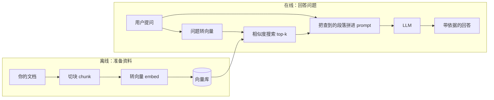

# 4\.4 RAG

# 4\.4  RAG 

## 开篇：资料多了，怎样找到回答需要的证据

大家好。上一节，我们把项目知识写成了外部文件。新任务开始时，程序读取相关记录，把内容放进模型输入，模型才能使用这些知识。


资料少的时候，按文件名查找就够了。但如果登录项目积累了几百份文档、大量源码和几年的故障记录，怎样从中找到这次任务需要的内容？


比如用户问：“增加退出登录功能，需要改哪些文件？验收标准是什么？”


把所有资料都发给模型，既增加成本，也容易让无关内容干扰回答；只给几份文件，又可能漏掉真正写着修改位置和验收要求的记录。


我们需要先从资料中找到相关证据，再把证据交给模型。这就是 RAG*，***RAG 是 Retrieval\-Augmented Generation 的缩写，中文一般译成"检索增强生成"。** 一句话：**先查资料，再让模型带着资料回答，而不是指望模型把知识全背在参数里。**


这条链路分成两个阶段。




第一阶段：建立索引


**先建立索引。** 程序读取文件，切成分块，用 Embedding 模型生成向量，再把向量、文本和来源信息存入 Milvus。以后提问时，就能查询这些分块，不必每次重新处理全部资料。


这一步有四小步：

1. 文档解析。 就像你把书上看到的视觉信息理解成文字一样，RAG 应用也要先把知识库文档加载、解析成大模型能处理的文字。

2. 文本分段。 你不会为了做一道题把整本书翻一遍，而是先大致分段、再找相关的那几段。RAG 也这样：解析完先切块，后面才能快速找到最相关的内容。

3. 文本向量化。 用 Embedding 模型把段落和问题分别转成向量，再比相似度。这个"转成向量"的过程就叫文本向量化。

4. 存储索引。 把向量存进向量库。这样每次回答就不用重跑前面三步，响应速度是这么来的。


第二阶段：检索与生成


程序把用户问题转换成向量，查找相关分块，筛选后加入模型输入。模型根据这些证据回答，并标出来源。


RAG 不需要通过修改模型权重来更新项目知识。不过，文档修改后，也要更新对应的分块和索引，下一次检索才能使用新内容。


找到证据，也不代表答案一定正确。程序可能只找到话题相关的段落，没有找到答案；模型也可能拿着证据，仍然补出资料里没有的内容。因此，我们既要检查检索结果，也要检查回答是否得到证据支持。


**一句话记住：RAG 就是给 LLM 开卷考试。**


考得好不好，不在于这个学生多聪明，而在于**他能不能翻到对的那一页**。检索错了，再强的模型也答不对——**这就是这一节把主要力气花在数据准备和检索上，而不是先去换个更贵的模型的原因。**


```Markdown
# demo.py
*from* pathlib *import* Path

*# 跳过 NLTK 下载，避免网络问题导致的示例变慢或失败*
*import* os
os.environ["LLAMA_INDEX_DISABLE_NLTK"] = "1"

*# 消除 WARNING 警告信息，避免干扰阅读；生产环境按需设置日志级别*
*import* logging
logging.basicConfig(level=logging.ERROR)

*from* llama_index.core *import* Document, VectorStoreIndex

*# 复用项目里已经接好的 MiniMax embedding 与 LLM*
*from* rag.minimax *import* MiniMaxEmbedding, build_llm

print("正在解析文件...")
*# 直接读取 corpus/docs 下的 Markdown 文档，加载为 Document 对象*
docs_dir = Path(__file__).resolve().parent / "corpus" / "docs"
documents = [
    Document(
        text=path.read_text(encoding="utf-8"),
        metadata={"file_path": str(path.relative_to(docs_dir.parent.parent))},
    )
    *for* path *in* sorted(docs_dir.glob("*.md"))
]

print("正在创建索引...")
*# from_documents 方法包含切片与建立索引步骤；embedding 用 MiniMax embo-01*
index = VectorStoreIndex.from_documents(
    documents,
    embed_model=MiniMaxEmbedding(model_name="embo-01"),
)

print("正在创建提问引擎...")
query_engine = index.as_query_engine(
    *# 设置为流式输出*
    streaming=True,
    *# LLM 用 MiniMax-Text-01（OpenAI 形状接口，api_base / key 已在 build_llm 里配好）*
    llm=build_llm(),
)

print("正在生成回复...")
streaming_response = query_engine.query("登录会话的有效期是多久？到期边界应该怎么判定？")
print("回答是：")
*# 采用流式输出*
streaming_response.print_response_stream()
print()

```


这一节使用 LlamaIndex 组织读取、分块和检索，用 Milvus 保存向量，仍然围绕登录会话项目展开。我们按五步完成：

1. 先用 Markdown 跑通最小闭环，观察证据怎样进入回答。

2. 完善解析和分块，避免答案在入库前就被丢失或切断。

3. 改进召回，让需要的证据进入候选结果。

4. 对候选重排、筛选和压缩，让模型看到更合适的证据。

5. 用同一组问题比较质量、成本和延迟，判断改动有没有效果。


先看第一步。


---

## 第一步：最小检索闭环

这一步暂时不追求最佳效果。我们先让读取、分块、入库、检索、装配、回答和校验全部走通，并保留每个环节的输出。

这样答错时，就能查清楚：资料没有读进来，关键段落没有被检索到，还是模型看到了证据却答错了。


我们用两道题观察这条链路：

- 简单题：登录会话的有效期是多少分钟？

- 复杂题：增加退出登录功能，需要改哪些文件？验收标准是什么？

简单题只需要一条明确规则。复杂题需要找到修改位置和验收要求，更容易暴露证据遗漏的问题。


### 读取文档，保留来源

先读取 Markdown 和 Python 源码。Markdown 的标题和正文容易检查，适合先定位读取与分块的问题；PDF、HTML 和表格留到第二步处理。

安装依赖后，运行第一步脚本：

```Shell
pip install -r rag44/requirements.txt
python scripts/step1_min_loop.py
```

读取代码主要看两件事：是否遍历了语料目录，以及是否为每份资料保留了路径和类型。路径用于引用，类型用于后续过滤。

```Python
EXT_TO_TYPE = {".md": "doc", ".py": "code", ".html": "web", ".csv": "table", ".pdf": "pdf"}

def load_markdown_and_code() -> List[Document]:
    docs = []
    for path in sorted(CORPUS.rglob("*")):
        if path.suffix not in {".md", ".py"}:
            continue
        docs.append(_doc_from_path(path, path.read_text(encoding="utf-8")))
    return docs
```

这里的 `_doc_from_path` 把文本包装成 LlamaIndex 的 `Document`，并补上 `file_path`、`doc_type` 等元数据。


运行记录显示：

```Plaintext
[解析] 读到 9 个文档（Markdown/代码/历史记录）
```

这 9 个对象来自 4 份文档、3 个源码文件和 2 份历史记录。数量能帮助我们发现漏读，但不能证明正文完整。还要抽查内容，确认项目规则和需求记录确实被读入。

资料读进来后，下一步要把整份文件拆成可以单独检索的片段。


### 2\. 按标题分块，让结果定位到具体小节

用户问“会话有效期是多少”，需要的是“有效期长度”这一节。如果把整份规则文件当成一个检索单位，就会把续期、不适用范围等内容一起带入。


所以，Markdown 先按标题切成小节；某个小节过长，再按句子拆分。下面看两层分块器各负责什么。

```Python
# rag/ingest.py :180
parser = MarkdownNodeParser()
inner = SentenceSplitter(chunk_size=384, chunk_overlap=0)
for node in parser.get_nodes_from_documents([doc]):
    for sub in inner.get_nodes_from_documents([node]) or [node]:
        nodes.append(_decorate(sub, doc))
```

`MarkdownNodeParser` 负责按标题组织分块，`SentenceSplitter` 控制长小节的长度，`_decorate` 为分块补上来源等元数据。源码文件的处理要看代码分支，不能把这段 Markdown 逻辑当成代码 AST 分块。


分块记录节选如下：

```Plaintext
[分块] 策略=按标题  得到 30 个节点
       app/auth.py                            § (整文件)
       app/config.py                          § (整文件)
       app/session.py                         § (整文件)
       docs/faq.md                            § 常见问题（FAQ）
       docs/faq.md                            § 常见问题（FAQ） > 用户反馈"登录状态老是掉"
       docs/faq.md                            § 常见问题（FAQ） > 能否把有效期改长一点
       … 其余 24 个
```


LlamaIndex 把分块对象称为 `Node`。这里得到 30 个节点，每个节点都能对应到文件或小节，后面才能说清楚“检索到了哪段内容”。


`chunk_size=384` 使用的是分块器的 Token 计数口径，不是 384 个汉字。最终模型输入还包含问题、来源和提示词，因此不能直接拿这个数当作整次请求的 Token 用量。


还有一个边界：**分块入库，只表示资料可以被检索。只有被选中并装配进本轮输入的内容，模型这次才看得到。**


### 3\. 向量化并检索，检查关键证据有没有出现

分块完成后，怎样让用户的问法与文档的写法匹配？比如用户说“登出”，资料写的是“退出登录”，只按字面匹配可能漏掉相关段落。


Embedding 模型把问题和文本转换成向量，让程序能够按语义相似程度查找候选。


原稿演示使用 MiniMax `embo-01`，记录中的向量维度是 1536。适配层分别处理文档和查询的向量化，再把结果交给 LlamaIndex。课堂上先看清这两个入口，不展开 HTTP 请求的全部实现。

```Python
# rag/minimax.py :50
class MiniMaxEmbedding(BaseEmbedding):
    batch_size: int = 8

    # _embed 里省掉的是拼请求体、发 HTTP、重试和计时的部分
    def _embed(self, texts, kind):
        # kind="db" 用于入库，"query" 用于查询，两边必须一致
        ...

    def _get_text_embedding(self, text):   # 单个文档
        return self._embed([text], "db")[0]

    def _get_text_embeddings(self, texts): # 批量文档
        return self._embed(texts, "db")

    def _get_query_embedding(self, query): # 查询
        return self._embed([query], "query")[0]
```

文档和查询要使用相互匹配的模型及配置。这里的 `db` 和 `query` 表示各自的用途，并不是要求两边传同一个字符串。也不能因为两个模型都输出 1536 维，就认为它们的向量可以直接比较。


接下来，把节点存入 Milvus。演示使用 Milvus Lite 的本地数据库文件。代码重点看存储位置、集合名称和维度。

```Python
# rag/ingest.py :350
store = MilvusVectorStore(
    uri=MILVUS_URI,               # milvus_login_demo.db
    collection_name=COLLECTION,   # login_demo_chunks
    dim=EMBED_DIM,                # 1536，必须和 Embedding 输出维度一致
    overwrite=overwrite,
    similarity_metric="COSINE",
)
index = VectorStoreIndex(nodes, storage_context=StorageContext.from_defaults(vector_store=store),
                         embed_model=embed_model)
```

`dim` 必须与实际返回的向量长度一致。更换 Embedding 模型时，要重新确认维度，并重建对应的文档向量；初始化时也要确认 `overwrite` 是否会覆盖已有集合。


输出为：

```Plaintext
[入库] collection=login_demo_chunks  dim=1536
       embedding 7 次请求 / 31 条文本 / 4.3s；入库共 5.0s
```

这些数据描述的是这次运行，不能直接当作其他数据量和环境下的性能结论。

索引建好后，用同一套 Embedding 配置检索，先保留三个候选：

```Python
# scripts/step1_min_loop.py :182
retriever = index.as_retriever(similarity_top_k=3)
hits = retriever.retrieve(QUESTION)
```


先看简单题。原稿返回的三个小节是：

```Plaintext
[q_easy] 登录会话的有效期是多少分钟？
[检索] top_k=3  耗时 505ms
       [1] score=0.8289  docs/session-rules.md § 登录会话有效期规则 > 不适用范围
       [2] score=0.8257  docs/session-rules.md § 登录会话有效期规则 > 续期
       [3] score=0.8141  docs/session-rules.md § 登录会话有效期规则 > 有效期长度
```

真正包含答案的“有效期长度”排在第三，但仍然进入了候选。只要装配时保留它，模型就有机会回答正确。

这说明检查召回时，不能只看第一名，也不能只看分数。要直接检查：**回答需要的证据，是否在返回结果里。** 三个分数接近，并不足以单独证明排序不稳定，更不能把分数当作事实可信度。


再看复杂题：

```Plaintext
[q_hard] 如果我要给 login_demo 增加退出登录功能，需要改哪些文件？验收标准是什么？
[检索] top_k=3  耗时 541ms
       [1] score=0.9454  history/2026-10-06-logout-request.md § 需求讨论 2026-10-06：增加退出登录功能
       [2] score=0.9396  docs/session-rules.md § 登录会话有效期规则 > 有效期长度
       [3] score=0.9320  history/2026-10-06-logout-request.md § 需求讨论 2026-10-06：增加退出登录功能 > 背景
```

这次检索找到了相关话题，却漏掉了回答所需的修改位置。分数再高，也不能补上缺失的内容。


我们先记下这个问题，继续检查：这些候选怎样进入模型输入，模型面对证据不足又会怎样回答。


### 4\. 证据筛选与上下文装配

检索返回的是节点和分数。模型需要的是证据文本，以及能够追溯这些文本的来源。


先看原稿中的筛选规则：

```Python
kept = [h for h in hits if h.score >= 0.30]
```

这次所有候选都超过 0\.30，因此一条也没有被删除。“有效期长度”虽然不能回答修改位置，也被保留了。

这说明这个阈值在本次问题上没有区分作用。是否采用分数阈值，需要用标注问题集校准，不能把一个固定数字套到所有模型和语料上。


筛选后，我们给每条证据编号，并写上路径和标题。下面的代码只展示基本装配：

```Python
def assemble(hits, max_chars=None):
    parts = []
    for i, hit in enumerate(hits, 1):
        text = hit.node.text.strip()
        parts.append(f"[{i}] 来源：{label(hit)}\n{text}")
    context = "\n\n".join(parts)
    if max_chars is not None and len(context) > max_chars:
        context = context[:max_chars]
    return context
```

这样，模型回答中的 `[3]` 就能对应到本轮第三条证据，程序也能反查原文。


如果上下文超过预算，要按完整证据筛选或压缩，再检查是否保留了关键条件。直接截断整段字符串，可能把规则后半句或来源切掉，让装配后的内容失去原意。


到这里，模型收到的输入已经确定。接下来检查它是否按这些内容回答。


### 5\. Citation：回答引用来源

我们希望模型回答项目事实，而不是用通用开发经验补齐缺失信息。提示词需要讲清楚依据、引用方式，以及资料不足时怎么处理。

```Python
PROMPT_TEMPLATE = """你是 login_demo 项目的助手。
规则：
1. 只能依据下面的证据回答，不允许使用证据之外的知识。
2. 每条结论后面用 [编号] 标出它来自哪条证据。
3. 证据里没有写的内容，直接回答“证据里没有写”，不要猜。

证据：
{context}

问题：{question}
"""
```

这些要求指导模型怎样回答，但是否遵守，仍然要检查输出。


第一题的回答：

```Plaintext
[回答]
登录会话的有效期是 30 分钟 [3]。
[用量] prompt=793 completion=11 耗时=1.356s
[引用] 编号=[3]  越界=无  判定=通过
       [3] → docs/session-rules.md § 登录会话有效期规则 > 有效期长度
```

模型使用了第三条证据。这次回答的数字与对应小节一致，引用也能定位到原文。


复杂题则出现了另一种结果。回答建议修改“登录页面或导航栏”“JavaScript 文件”“会话管理模块”和“路由文件”，并加上引用编号。

这些说法没有给出需求记录中明确列出的三个文件。即使它们在其他项目中可能合理，也不能据此认定为当前项目的修改范围。


原稿的编号检查却判定通过，原因是引用都落在 `[1]` 到 `[3]` 的范围内。


**编号检查只说明引用指向了本轮存在的证据，不说明那条证据支持对应结论。** 因此，界面上应写“引用编号合法”，不能直接写“答案通过”。


要判断回答是否有依据，还需要核对回答内容。


### 6\. 校验回答内容，明确自动检查覆盖了什么

先实现一个便于观察的检查器：从回答中提取文件路径、常量名、数字与单位、命令和布尔值，再核对它们是否出现在对应证据里。


下面重点看检查范围。这些正则只能识别特定写法，不能理解全部自然语言结论。

```Python
PATTERNS = [
    ("file",    re.compile(r"[A-Za-z_][\w/.-]*\.(?:py|md|html|csv|pdf|json)")),
    ("const",   re.compile(r"\b[A-Z][A-Z0-9_]{3,}\b")),
    ("number",  re.compile(r"\d+\s*(?:分钟|秒|小时|天)")),
    ("command", re.compile(r"python -m pytest[^\n，。；]*")),
    ("bool",    re.compile(r"\b(?:True|False)\b")),
]
```

简单题中的“30 分钟”能被提取，并在证据中找到。这个结果说明数字有字面依据。

但复杂题里的“登录页面或导航栏”“路由文件”等笼统说法，不符合这些模式，会被跳过。回答中即使只有一个数字能对上，也不能据此认定其他结论正确。


原稿记录了这样的检查结果：（原样抄自 `runs/step1.txt`）：

```Plaintext
[一致性] 有依据 1 个 ['30 分钟']
         无依据 0 个 []
```

这个回执只能说明：检查器提取的一个实体找到了依据。它没有检查到的结论，仍然需要核对。


所以，自动检查要区分几种状态，避免把“没检查到”写成“正确”：

```Python
if not citations:
    verdict = "无引用"
elif bad:
    verdict = "引用越界"
elif not supported and not unsupported:
    verdict = "无可核对实体"
elif unsupported:
    verdict = "存在无依据实体"
else:
    verdict = "通过"
```

最后一种状态也只是局部检查通过。比如“可以修改测试”和“不能修改测试”，都包含“修改测试”，但含义相反。实体出现，只能作为检查线索，不能证明整条结论成立。

后续还要把回答拆成可核对的结论，逐条检查对应证据是否支持它，并检查是否回答了用户要求的全部内容。复杂题既问修改文件，也问验收标准，遗漏其中一项，答案仍然不完整。


### 从跑通链路，转向提高质量

第一步结束后，我们已经能沿着输出定位问题。

简单题中，“有效期长度”进入候选，模型使用它回答了“30 分钟”，引用也对应到原文。


复杂题中，修改位置没有进入候选，这是召回遗漏；模型随后给出了证据不足的修改建议，这是生成阶段的问题；编号和实体检查没有拦住这些建议，则暴露了校验范围的限制。


这三个问题需要分别处理：先让正确证据进入候选，再让模型依据证据回答，最后检查结论是否得到支持。只调整提示词，不能补回没有检索到的资料；只增加引用编号，也不能证明答案正确。


下一步，我们先回到数据准备，检查“需要改的地方”和验收要求是否完整保留、是否切得合适、来源是否清楚。确认入库内容没有问题后，再改进检索，让这些关键证据进入模型输入。

---

## 第二步：完善数据准备

第一步，我们已经跑通了检索和回答。但用户问“增加退出登录功能，需要改哪些文件、怎样验收”时，关键证据没有进入候选。


接下来，先不急着换检索方法。我们要检查：相关资料有没有读进来，解析有没有丢掉规则，分块有没有把完整信息切开。


因为检索只能查询已经准备好的内容。如果文件没有加载，或者“恰好到期”与“判定无效”被拆得无法对应，后面调高 Top\-K，也不能直接解决这些问题。


这一步仍然使用登录会话项目，运行数据准备脚本：

```Markdown
python ./scripts/step2_data_prep.py
```

运行前，先明确看什么。脚本依次展示五项结果：格式解析、文档元数据、分块对比、Overlap 和节点元数据。我们沿着这五项输出，检查资料怎样从文件变成可检索的分块。


### 文档解析：PDF、HTML、表格与结构化文档解析

资料不只有 Markdown 和源码。这次还加入了 PDF、HTML 和 CSV。解析不仅要得到文字，还要保留标题、条件与结果的对应关系。


解析的目标，不只是提取文字，还要保留文字之间的关系。比如 PDF 中有一张边界测试表：

|情况|期望|
|---|---|
|到期前|True|
|恰好到期|False|
|到期后|False|

如果解析结果变成“到期前、恰好到期、到期后、True、False、False”，条件与结果的对应关系就不清楚了。检索即使命中“恰好到期”，也不能可靠判断它对应哪个结果。


所以，不同格式需要检查不同的关系：

加载器成功返回，只能说明程序拿到了数据。解析是否正确，还要抽查关键内容。


#### PDF：先看文字能否正确抽取

演示使用 `pypdf` 逐页提取文本。下面重点看：文字来自哪一页，以及没有提取到文字时返回什么。

```Python
# ./scripts/step2_data_prep.py

def load_pdf(path: Path) -> str:
    reader = PdfReader(str(path))
    pages = []
    for i, page in enumerate(reader.pages, 1):
        text = (page.extract_text() or "").strip()
        pages.append(f"<!-- page {i} -->\n{text}")
    return "\n\n".join(pages)
```


实际回执：

```Plaintext
[PDF ] 原始抽取 488 字符，开头：<!-- page 1 --> /
       login_demo 产品需求说明 v2.5.0（草稿） / …
[PDF ] 清洗后 472 字符，开头：
       login_demo 产品需求说明 v2.5.0（草稿） / …
```

这个结果说明抽取到了文本，不能证明页面内容完整。还要对照原页检查边界规则、表格和符号。扫描件需要 OCR，复杂版式也可能需要专门的解析方式。


这里的页码注释只是临时标记。后续如果清洗时删除它，必须先把页码保存到对应页面或分块的元数据中；否则，回答虽然能引用文件，却无法准确定位页面。


#### HTML：保留标题，让后续能够按小节分块

HTML 的正文混在标签中。我们先抽取标题和段落，并把标题转换成 Markdown 形式，后续就能复用按标题分块的逻辑。


下面看标题是怎样保留下来的：

```Python
def load_html(path: Path) -> str:
    soup = BeautifulSoup(path.read_text(encoding="utf-8"), "lxml")
    lines = []
    for tag in soup.find_all(["h1", "h2", "h3", "p", "li"]):
        text = tag.get_text(" ", strip=True)
        if not text:
            continue
        if tag.name.startswith("h"):
            lines.append(f"{'#' * int(tag.name[1])} {text}")
        else:
            lines.append(text)
    return "\n\n".join(lines)
```

关键在最后那个 `return`：把标题还原成 `#` 形式，下一步的"按标题切"才能用上同一套逻辑。实际回执：

```Plaintext
[HTML] 原文含标签 532 字符
[HTML] 解析后 272 字符，开头：
       # login_demo v2.4.0 发布说明
       发布日期：2026-09-20。本次发布调整了登录会话的到期判定。
       ## 变更内容
       到期时刻改为判定为无效，…
```

这次解析保留了发布说明正文，并把标题转换成 `#`、`##` 的形式。后续按标题分块时，就能利用这些小节边界。


字符从 532 减少到 272，只能说明解析后的文本更短，不能证明删掉的都是无用内容。还要对照原页面检查：测试命令、代码块和关键限制有没有遗漏。


发布说明描述的是某个版本的变更。回答当前代码是否已经修复时，还要核对源码和测试，不能把发布说明直接当成当前运行结果。


#### 表格：列名与值已绑定，但表达还有改进空间

CSV 本身保留了行列结构。为了让单行成为可独立检索的文本，演示把列名与值写在一起。


下面重点看：每个值是否仍与原来的列名绑定。

```Python
def load_table(path: Path) -> str:
    rows = list(csv.DictReader(io.StringIO(path.read_text(encoding="utf-8"))))
    return "\n".join(
        "；".join(f"{k}是{v}" for k, v in row.items() if v) + "。" for row in rows
    )
```

实际回执：

```Plaintext
[CSV ] 原文 5 行，第 1 行：
服务,会话类型,有效期,可续期,到期边界处理,负责人

[CSV ] 解析后 4 句，第 1 句：
服务是login_demo；会话类型是登录会话；有效期是30 分钟；
可续期是是；到期边界处理是恰好到期视为无效；负责人是认证组。
```

原文件包含一行表头和四行数据，程序把四行数据转换成四条文本记录。每个值都带上列名，因此单独看到“30 分钟”时，也能知道它指的是登录会话有效期。


当前格式是“列名是值”，所以出现了“可续期是是”“可续期是否”这样的表达。它保留了原值，但口语上不自然。后续可以改成“可续期：是”“可续期：否”，不过你本次执行的程序还没有输出这种格式。


这张表还有 `pay_gateway` 的支付会话。如果用户问登录会话，支付会话的“五分钟”可能成为干扰。后面不能只找到“有效期”三个字，还要检查服务范围。


也不能因为文本带了“服务是login\_demo”，就认为每个表格分块都已经有 `service` 元数据。正文中的字段和值，与程序可用于过滤的元数据，是两个不同的位置。


到这里，三个新增格式都有文本输出。接下来检查：程序给这些文档添加了哪些标签。


### 文档清洗、元数据提取

清洗有一条红线：**可以去噪声，不能去限定词。**


**清洗造成的信息丢失，后面的模型补不回来。**

```Python
def clean_text(text: str) -> str:
    text = re.sub(r"<!--\s*page\s*\d+\s*-->", "", text)   # 去掉页码注释
    text = text.replace("\u3000", " ")                    # 全角空格换半角
    lines = [line.rstrip() for line in text.splitlines()] # 去行尾空格
    text = "\n".join(lines)
    text = re.sub(r"\n{3,}", "\n\n", text)                # 连续空行压成一个
    return text.strip()
```


元数据里除了项目、版本、来源，还要有一个字段标明这条记录属于哪一类，或者至少让文件路径本身能区分——`docs/` 是规范，测试回执是回执，`history/` 是历史。


我们的做法是在 Markdown 顶部写 YAML 头信息，解析时读进元数据，正文里不留：

```Markdown
---
service: login_demo
topic: session-expiry
owner: 认证组
updated: 2026-10-01
---
```

```Python
def parse_front_matter(text: str) -> tuple[dict, str]:
    if not text.startswith("---"):
        return {}, text
    ...
    meta[key.strip()] = value.strip()
    body = "\n".join(parts[end + 1:]).lstrip("\n")
    return meta, body
```


输出列出了 12 个文档。它们的构成是：

```Plaintext
② 元数据：每个文档带上什么标签
=====================================================================
共 12 个文档
  app/auth.py                            doc_type=code   source=py
  app/config.py                          doc_type=code   source=py
  app/session.py                         doc_type=code   source=py
  docs/faq.md                            doc_type=doc    source=md
  docs/payment-session.md                doc_type=doc    source=md
  docs/session-rules.md                  doc_type=doc    source=md
  docs/testing-guide.md                  doc_type=doc    source=md
  history/2026-09-12-expiry-bug.md       doc_type=doc    source=md
  history/2026-10-06-logout-request.md   doc_type=doc    source=md
  pdf/PRD-login-2.5.0.pdf                doc_type=pdf    source=pdf
  tables/session-matrix.csv              doc_type=table  source=csv
  web/release-notes-2.4.0.html           doc_type=web    source=html
```

这里先区分两个字段：`doc_type` 用来划分资料类型，`source` 记录文件格式。它们不能直接说明资料是否可信、是否仍然有效。


比如规则文档和历史记录，在这份清单里都是 `doc_type=doc`、`source=md`。但它们的用途不同：

- 规则文档说明项目要求怎样实现。

- 历史记录说明过去发生过什么问题。

- 测试回执说明某次执行得到了什么结果。

历史修复通过，不能证明当前代码仍然通过；PDF 草稿提出要求，也不能证明要求已经实现。


因此，读取资料时，还要保留这些区别。后续可以增加记录性质、版本、验证来源等字段，但当前回执并没有展示 `record_type` 或 `version`，不能把这些字段讲成已实现。


清洗也要遵守同一原则：可以清理格式噪声，不能删掉“草稿”“当前版本”“不得”“仅限”等限定信息。它们决定一条记录何时、对谁适用。


资料和标签确认后，下一步检查分块是否保留了回答需要的完整内容。


### 分块（Chunking）对比：完整性和粒度都要看

现在到了第二步的重点：怎么切。

切分决定了检索的**最小单位**。单位太大，一个节点里混着好几个话题，检索命中以后模型要自己挑；单位太小，一句话被切成两半，谁都没法回答。这一节我们不再空谈，把六种切法放在同一批文档上直接比。

先看长度方案。无重叠与重叠 24 都是 `6/10`，说明这次增加重叠后，完整包含的函数数量没有变化。不能看到“开了 Overlap”，就认定代码完整性已经改善。

再看按标题方案。函数完整是 `10/10`，但最长节点达到 2460 个字符。下一行输出说明，它来自 `app/auth.py`，标题是“整文件”。

这说明源码被整份保留了，所以函数没有被切开。但回答具体函数问题时，检索粒度可能过粗。完整性提高，不等于已经得到合适的检索单位。

最后看 AST。三个源码文件被切成 14 个节点，10 个函数都被完整包含，平均长度为 180 个字符。它同时保留了函数结构，并提供了比整文件更细的单位。

不过 AST 这一行只统计源码，不能拿它的 14 个节点，与覆盖全部资料的其他方案直接比较总量。它识别的也是语法结构，不是调用链。找到会话判断函数后，仍可能要补读调用者、会话存储和配置。

还有两个输出值得检查。

第一，“按段落 ≤200 字符”的最长节点是 383 字符。因此，脚本标签里的 200 不是本次输出的严格上限。需要查看超长段落有没有二次拆分，不能向学员承诺所有分块都不超过 200 字符。

第二，“带标题”少不等于来源丢失。节点可能仍然有文件路径，只是缺少小节位置；带标题多，也不证明节点包含了正确答案。

这张表提供的是分块结构的观察，不是召回效果排名。我们可以据此选择下一轮方案：规则和需求记录优先利用标题结构，源码利用 AST；然后用同一组问题检索，验证关键证据是否更容易找到。


### Chunk Overlap

Overlap 解决的是边界问题。看一个具体例子。取 `session-rules.md` 的"到期边界"这一节，132 个字符，窗口设成 40：

```Plaintext
[无重叠 overlap=0 ] 切出 4 块，第 1 块结尾：'当前时刻恰好等于到期时刻时，会话必须判定为无效。'
                    含“不要写成 `now <= expires_at`”？否
[有重叠 overlap=15] 切出 6 块
                    含“不要写成 `now <= expires_at`”的块是第 5 块：'s_at`，不要写成 `now <= expires_at`。\n'
```

这次加入重叠后，目标句出现在一个完整分块中。说明重叠缓解了这个例子的边界问题。

但第 5 块开头仍是 `s_at`，它不是一个完整语义段落。能完整包含目标句，不代表这一块已经包含全部条件、适用范围和背景。还需要检查检索到它后，是否足以回答问题。

随后，脚本换成另一份 366 字符的正文，观察分块数量：

```Plaintext
换到真实的 docs/session-rules.md 正文（366 字符，已去掉 front-matter）：
  overlap=0  切成 7 块，块数 × 窗口 = 420 字符
  overlap=20 切成 10 块，块数 × 窗口 = 600 字符
```

重叠增加后，块数从 7 变成 10。重复文本通常也会增加，因此后面要关注向量化成本与检索去重。

但 420 和 600 是“块数乘以窗口大小”，不是实际存储字符数，更不是数据库占用。不能据此说存储量增加了 43%。要测真实代价，需要统计所有分块的实际长度、Embedding 用量和索引大小。

因此，Overlap 的调整顺序是：先找到被切断的规则，再增加适量重叠，最后检查完整性和重复程度。不要只根据一个固定比例设置，也不要把字符演示中的 15、20，直接套到 Token 分块参数里。


### Chunk Metadata

最后说元数据。一个节点带什么字段，直接决定后面能不能过滤、能不能引用。

```Plaintext
{
  "id": "4c670033-7c1c-40d7-8cde-c5fbf258fac3",
  "metadata": {
    "file_path": "docs/testing-guide.md",
    "doc_type": "doc",
    "source": "md",
    "service": "login_demo",
    "topic": "testing",
    "owner": "认证组",
    "updated": "2026-09-20",
    "heading": "login_demo 测试指南 > 测试入口",
    "header_path": "/login_demo 测试指南/"
  },
  "text_chars": 173
}
```

这份输出说明：至少这个节点已经带上了项目、主题、维护人、更新时间，以及文件和标题位置。

这些字段各有用途。`service` 帮助限定项目范围；`topic` 标记主题；`file_path`、`heading` 和 `header_path` 帮助定位原文；`id` 用于程序反查节点。`owner` 与 `updated` 帮助了解维护信息，但不能单独证明正文正确或仍然适用。

这里没有 `record_type`、源码版本或验证回执。我们不能说当前程序已经通过这些字段区分了规范、历史与验证事实，也不能凭一个节点就认定全部 12 个文档都有相同标签。


代码节点则展示了另一种定位方式：

```Plaintext
{
  "metadata": {
    "file_path": "app/auth.py",
    "doc_type": "code",
    "source": "py",
    "heading": "(模块变量)",
    "kind": "assign",
    "lines": "16-16"
  },
  "text": "_TOKEN_STORE: dict[str, dict] = {}"
}
```

这说明当前 AST 分块保留了模块变量，并记录它来自 `app/auth.py` 第 16 行。`kind=assign` 表示赋值节点，不能把这个示例讲成函数节点。

行号帮助我们回到源文件查看代码，不代表这里就是应该修改的位置。模型还要结合问题、读取当前源码，再判断是否需要修改。源码发生变化后，也要重新核对位置。


### 从数据准备进入检索优化

第二步结束后，我们确认了几件具体的事：12 份资料进入加载结果；新增格式有文本输出；不同分块方案的完整性和粒度可以对比；示例节点能够通过路径、标题或行号定位原文。

同时，也留下了需要检查的地方：PDF 清洗后的页码定位、表格分块的项目标签、超长段落处理，以及资料性质和版本的区分。

这次运行没有展示召回率、答案正确率或 Milvus 入库结果。因此，它验证的是数据准备的部分过程，还不能说检索质量已经提高。

进入第三步前，先确认退出登录的修改位置和验收要求完整存在于待索引分块中，再检查所需过滤字段是否覆盖相关资料。然后建立或更新索引，用同一组问题比较向量检索、关键词检索和混合检索，观察关键证据能否进入候选。


---

## 第三步：检索（解决召回问题）

第一步，用户问“退出登录需要改哪些文件”，程序找到了需求背景，却没找到修改清单。


模型没拿到关键资料，回答就缺少依据。所以这一步先改检索，让需要的资料进入结果，再交给模型回答。


仍然用登录会话项目，运行两个脚本：

```Markdown
python scripts/step3_retrieval.py
```

先看检索方法，再看用户问题怎样处理。这次固定使用 9 份 Markdown 和源码、30 个分块、八道题，方便比较不同配置。第二步新增的 PDF、HTML、CSV，以及 AST 分块，暂时没有接入这组实验。


### 先看懂三个指标

每道题都标了正确证据，代码里叫 `gold`。比如“用哪条命令验证”，对应测试指南中的“测试入口”。

检索结果包含这个文件和小节，程序就记为命中。最终保留三条结果，也就是 Top\-3。

一道题有两处证据，找到一处，召回率是 0\.5；找到两处才是 1。只找到一处，也算“命中”，但不算“完全命中”。

这一步只检查资料位置，没有检查最终答案。因此，命中不等于答对。


### 先测两路检索，看看各漏了多少

**向量检索按语义找资料，BM25 按词匹配。**先分别跑一遍，再决定怎样改。

当前向量配置只找齐两道题的证据，BM25 找齐四道。说明这批问题里，关键词匹配补到了向量漏掉的部分资料。


接下来先换 Embedding 模型，看看向量这一路能不能找得更准。


### Embedding：换模型后，重新建库再比较

Embedding 把问题和分块转换成向量，程序再比较它们的相似程度。模型不同，找到的结果也可能不同。


这次分块和问题都不变，只比较三个向量配置：

BGE 的召回率提高到了 0\.688，找齐证据的题数从两道增加到五道。所以后面的实验使用 BGE 作为向量模型。


这说明它更适合本次问题集，不代表换到其他项目也一定更好。


256 维截断后的汇总指标没有下降，只能说明这次没测出差异，不能说其余维度没有作用。维度也不是越高，检索就越准。


表里的时间要讲准：脚本虽然打印“建库秒”，实际计时包含建库和八道题的检索评估。这次 BGE 总耗时更短，但不能把它全部解释成建库速度。


模型更换后，文档向量要重新生成。文档和问题必须使用匹配的模型及处理方式，否则两边的向量无法正确比较。


### Vector Database：Milvus 建库和查库分开

前面一直在用 Milvus，这里把它单独拿出来说清楚。

大纲提到 FAISS、Milvus、Chroma 三个，要求"至少实操一种"。我们只装 Milvus，因为**这三个不是同一层的东西，没必要为了对比同时装三套**：

- **FAISS 是一个向量搜索库。** 它把"给定查询向量，快速找出最近的 k 条"这件事做到极致，但它是库不是服务——持久化、并发、元数据过滤、权限，都要应用自己配套。

- **Chroma 更像一个集成式的向量存储。** 上手快，适合原型和中小规模，和 Python 生态贴得紧。

- **Milvus 是一个向量数据存储与检索服务。** 向量、标量字段、索引、过滤、部署形态都在它的管辖范围内，从单文件一直能长到分布式集群。

我们选 Milvus，理由跟这一节的讲法有关：**要把"向量 \+ 分块正文 \+ 元数据过滤"放在同一条链路里演示，Milvus 的三样都有。** 而且它能从 Lite 单文件起步，讲完课不用换概念就能讲生产部署。

**为什么需要专门的向量库。** 30 个节点的时候，把向量装进 NumPy 数组、写个循环算余弦相似度，完全够用。节点涨到十万、百万，全量比对就不行了。向量库做的事是：**用近似最近邻索引，把"和查询最像的 k 条"从全量比对变成索引查找**，同时负责持久化、并发和元数据过滤。

**Milvus 的关键概念只有一个：collection。** 一个 collection 就是一张表，有固定的向量维度、固定的距离度量、一组标量字段。我们建的这个：

```Python
store = MilvusVectorStore(
    uri=MILVUS_URI,                    # milvus_login_demo.db，Milvus Lite 单文件
    collection_name="login_demo_chunks",
    dim=1536,
    overwrite=True,
    similarity_metric="COSINE",
)
```

不同模型使用不同集合，避免混入不匹配的向量。`dim` 与模型输出维度一致；本次实验用 `overwrite=True` 重建集合。


**Milvus 有三种部署形态，选哪个看阶段。** 开发调试用 Milvus Lite，就是一个本地文件，不用起服务；测试和生产用 Standalone，Docker 或单机部署；数据量到十亿级别、要求高可用，用分布式集群。我们的整个实验都跑在 Lite 上，因为这一节要验证的是检索逻辑，不是吞吐。

两种库的对比：

||本地文件（Milvus Lite / FAISS）|服务化（Milvus Standalone / 集群）|
|---|---|---|
|启动|进程内，一个文件|独立服务，要运维|
|并发写入|单进程|多客户端|
|元数据过滤|支持，能力有限|完善，有标量索引|
|适用|开发、验证、小规模|生产、团队共用|


日常查询使用 `load_index()` 打开已有索引，不再传入节点。因为当前 `build_index()` 即使设置 `overwrite=False`，仍会提交节点，不能把它当作“只打开库”。重复提交、又生成新 ID，就可能留下重复内容。


库准备好后，我们再看关键词这一路怎样工作。


### BM25

用户说“登出”，资料写“退出登录”，需要语义匹配；用户直接写 `SESSION_TTL_SECONDS`，则可以利用这个名字查找代码。


BM25 是关键词检索里的经典算法。它给每个词算一个权重，思路是两点：**这个词在本文档里出现得多，分数高；这个词在整个语料里越稀有，权重越大。**

第二点尤其重要。"的""是""会话"这些词到处都是，区分度低，权重就该小；而 `SESSION_TTL_SECONDS` 只在一个文件里出现，它一出现，几乎就能定位到那个文件。


用 `rank_bm25` 实现，只有几行：

```Python
class BM25Retriever:
    def __init__(self, nodes):
        self.nodes = list(nodes)
        self.corpus = [tokenize(n.text) for n in self.nodes]
        self.bm25 = BM25Okapi(self.corpus)

    def retrieve(self, query, top_k=5):
        scores = self.bm25.get_scores(tokenize(query))
        order = sorted(range(len(scores)), key=lambda i: scores[i], reverse=True)[:top_k]
        return [NodeWithScore(node=self.nodes[i], score=float(scores[i])) for i in order]
```

**中文必须先分词，否则 BM25 会失效。** 


BM25 按"词"统计，中文句子没有空格，整句会被当成一个词，那就什么也匹配不到。我们用 jieba：

```Python
def tokenize(text: str) -> List[str]:
    return [t for t in jieba.lcut(text.lower()) if t.strip()]
```

用户说“登出”，资料写“退出登录”，需要语义匹配；用户直接写 `SESSION_TTL_SECONDS`，则可以利用这个名字查找代码。


### Elasticsearch 的定位与适用场景

BM25 在真实系统里通常不是一个 Python 类，而是 Elasticsearch。

先分清一个容易混的地方：**BM25 是评分方法，Elasticsearch 是承载全文检索能力的系统，两者不在同一层。** 你可以用 `rank_bm25` 在进程里跑 BM25，也可以用 Elasticsearch 跑 BM25，打分的数学是一样的，差别在工程能力。

**Elasticsearch 是什么。** 它建立在 Lucene 之上，核心能力是倒排索引和 BM25 打分，外加分布式分片、副本、聚合分析。同一个索引里，多个字段可以各自配置分析器。这一节没有实际部署 Elasticsearch，下面说的是它的定位，不是这次跑出来的结果。

**它和向量库的分工。**

- 日志、审计记录、工单、商品属性这类**以精确匹配为主**的数据，Elasticsearch 是主场。它能做范围查询、聚合统计、字段级权重，还能对中文配分词器。

- 语义相似、跨措辞的检索，向量库是主场。

- 两个都要，就让 Elasticsearch 做关键词那一路。它在 7\.0 之后就有了 `dense_vector` 字段类型，8\.0 之后又加了原生的 kNN 检索，可以在同一个引擎里同时做 BM25 和向量检索，再自己融合。也可以用 Milvus 做向量那一路，用 Elasticsearch 做关键词那一路，在应用层融合。

**什么时候不要上 Elasticsearch。** 团队已经在用它做日志，顺手把 RAG 的关键词路也放上去，这是合理的。反过来，如果只是为了一个几百份文档的知识库，专门维护一套 ES 集群，运维成本会超过收益。这种场景下，进程内跑 BM25（就像我们上面那样），或者用 Milvus 自带的稀疏向量，都够用。

一句话：**Elasticsearch 的定位是"工程化的检索与分析引擎"，不是"向量库的替代品"。**


### 混合检索（Hybrid Search）：向量 \+ BM25

两路检索各有各的强项，混起来就该更好——但怎么混，是个技术问题。

**不能把两边的分数直接相加。** 向量给的是余弦相似度，0 到 1 之间，在这批数据上集中在 0\.78 到 0\.95，第一名和第三名常常只差 0\.01；BM25 给的是无上界的实数，一篇文档里一个词都没出现就是 0，出现得多就能到十几。两路分数不能直接相加，因为打分方式和尺度不同。


通用做法是 RRF（Reciprocal Rank Fusion，倒数排名融合）：**丢掉分数，只看名次。**

```Python
def rrf_fuse(result_lists, top_k=5, k=60, weights=None):
    fused, keep = {}, {}
    for weight, results in zip(weights, result_lists):
        for rank, item in enumerate(results, 1):
            key = item.node.node_id
            fused[key] = fused.get(key, 0.0) + weight / (k + rank)
            keep.setdefault(key, item.node)
    order = sorted(fused.items(), key=lambda kv: kv[1], reverse=True)[:top_k]
    return [NodeWithScore(node=keep[key], score=score) for key, score in order]
```

**的差距不至于过于悬殊。**

同一个节点出现在两路里，就按 ID 累加。排得越靠前、所在路的权重越高，贡献越大。这里的 `k=60` 是融合参数；最终返回数量另设为三条。

先混合原来的 MiniMax 向量与 BM25同一批 8 道题，先量两路各自单独用的表现，再量三种混法：

```Plaintext
配置              召回率   命中率   完全命中题数
  向量              0.312   0.375   2/8
  BM25            0.625   0.75    4/8
  RRF等权候选3        0.375   0.5     2/8
  RRF等权候选10       0.5     0.625   3/8
  RRF加权候选10       0.562   0.625   4/8
```

增加候选有帮助，但融合结果仍不如 BM25 单独使用。因为最终只留三条，一路的排序可能把另一路的正确证据挤出去。混合不保证提升。


换成 BGE 后，再比较：

```Plaintext
BGE 单独                 召回率=0.688   命中率=0.75    完全命中=5/8
  BGE+BM25 等权候选10        召回率=0.75    命中率=0.875   完全命中=5/8
  BGE+BM25 等权候选20        召回率=0.75    命中率=0.875   完全命中=5/8
  BGE 70% + BM25 30%     召回率=0.812   命中率=0.875   完全命中=6/8
```

最后一项效果最好，所以查询处理脚本采用它：每路先取二十条，融合后留三条。


权重和候选数量都要用问题集测，不能照抄。候选从十条增加到二十条，等权结果就没有变化。


当前 BM25 在进程内运行。如果以后需要服务化的全文检索，可以评估 Elasticsearch。BM25 是评分方法，Elasticsearch 是检索系统。本次没有部署它，也没有调用 Milvus 内置全文检索。


### 元数据过滤（Metadata Filter）：对象确定了，再排除无关资料

语料里有登录会话，也有支付会话。用户查登录会话，支付资料就不应混进来。


如果项目上下文已经确定是 `login_demo`，可以加过滤条件：

```Plain Text
filtered = index.as_retriever(
    similarity_top_k=5,
    filters=service_filter("login_demo"),
).retrieve(q)
```

这次过滤演示返回五条。不过滤时，第四条是支付会话；过滤后，它被排除，前三条没变。


因此，这次验证的是排除了其他服务的资料，不是 Top\-3 召回率提高。


范围必须按问题确定。比较登录与支付时，两边资料都要保留；用户只说“会话”，上下文又没有明确服务，就先问清楚。


当前过滤是独立演示，尚未接入混合检索。后续接入时，两路都要按相同范围筛选，否则 BM25 仍可能把无关服务的资料带回来。


### 检索不准时怎么改进：把用户问题改写成更适合检索的问题

前面，我们用过滤限定了资料范围。但范围选对了，仍然可能找不到答案：用户问“用哪条命令验证”，资料标题写的是“测试入口”。


这时可以调整查询，让用户的问法更容易匹配资料。


下面仍用退出登录任务，比较重写、分解、多路改写和术语扩展，再看什么时候需要追问用户。


运行前，先明确比较条件：向量使用 BGE，关键词使用 BM25，RRF 权重为 0\.7 和 0\.3。每个查询在两路各取二十条候选，最后融合成三条结果。

```Plain Text
python scripts/step3b_query_rewrite.py
```

原问题直接检索时，召回率是 0\.812，八道题中六道找齐证据。q4“退出登录改完以后，用哪条命令验证”，没有找到标注的“测试入口”。我们就观察这些方法能不能补回它。


#### 实验一：查询重写（Query Rewrite）——换成更适合检索的表达

查询重写先让模型整理问题，再拿新问题查库。它可以补充术语，但不能改变用户要查的对象，也不能直接回答。

提示词重点看两条要求：保留原意，只输出查询。

```Python
REWRITE_PROMPT = """把下面的用户问题改写成一句更适合检索的查询。
要求：
- 保留原意，不要回答问题。
- 补上可能使用的正式术语和英文/符号名。
- 去掉不影响含义的口语成分。
- 只输出改写后的查询。

用户问题：{q}
"""
```

这是提示词的精简示意，具体实现见项目中的 `rag/rewrite.py`。


本次 q4 被改成：

```Plaintext
原问题：退出登录改完以后，用哪条命令验证？
改写为：验证退出登录 logout 修改后的命令
```

程序测试了两种方式：只查改写后的问题，以及原问题与改写问题分别检索后融合。两种方式的召回率都是 0\.812，完全命中都是 6/8，q4 仍然没找到测试入口。


**这次表达变了，证据覆盖没有提高。** 单条重写还用了约 0\.8 到 1\.9 秒，所以不能因为句子更正式，就认定优化有效。


保留原问题，能减少原始表达被丢掉的风险，但不能保证融合结果不变差。最终只能留三条，新查询会改变排名，原来的正确证据也可能被挤出去。


因此，原问题与改写问题都要记录，再检查对象、符号和限制是否保留。比如“可能是缓存问题”，不能改成“Redis 故障怎么修”，把一个猜测变成确定前提。


#### 实验二：查询分镜（Query Decomposition）——多个需求分别查

如果问题需要多处资料，可以拆成子问题，分别检索后合并。


比如用户问：“登录会话和支付会话在有效期、能不能续期上有什么区别？”这包含两类会话、两个比较维度。


本次模型输出：

```Plaintext
登录会话的有效期是多少？
登录会话是否可以续期？
支付会话的有效期是多少？
```

这里漏掉了“支付会话是否可以续期”。所以，拆完不能直接用，要先检查原问题的要求是否全部保留。


本次分解后的召回率仍是 0\.812，完全命中仍是 6/8，没有补回 q4。


这个结果只能说明本次分解没有提高汇总指标。要定位原因，还得查看子查询各自找到了什么、合并后哪些证据被保留；不能直接断定是融合丢掉了收益。


简单问题也不必硬拆。用户只问有效期是多少，再增加“定义是什么”“设置在哪里”，会增加查询工作，也可能带入无关资料。


#### 实验三：多路改写——同一个需求，换几种问法

分解是把不同需求拆开；多路改写则是用不同表达查同一个需求。


q4 本次生成了三种问法：

```Plain Text
退出登录功能验证命令
退出登录命令验证代码
如何验证退出登录修改后的功能
```

程序分别检索这些查询，再融合结果。脚本标题写“并行”，但当前代码使用循环依次执行，没有实现并发。


结果是：

```Plain Text
原问题：             召回率=0.812，完全命中=6/8
多路改写：           召回率=0.750，完全命中=5/8
多路改写加原问题：   召回率=0.750，完全命中=5/8
```

**这次增加问法后，证据覆盖反而下降。即使保留原问题，也没有避免下降。**


多查询会累加各路排名分数，最终仍只留三条，因此它可能改变原有证据的位置。具体哪条证据被挤出，需要完整候选记录才能确认。


这说明多路改写要靠结果决定是否启用。不能只看查询数量增加，还要看正确证据是否增加，以及多出的模型调用和检索耗时是否值得。


#### 实验四：术语扩展——保留问题，补上项目用词

前面几种方法让模型生成新查询。这次换一种更直接的办法：保留原句，按项目词表补充检索词。


下面重点看“命令”对应哪些资料用词：

```Plain Text
# 项目词表节选。
GLOSSARY = {
    "登出": ["退出登录", "logout"],
    "命令": ["测试入口", "python -m pytest"],
    "多久": ["有效期", "分钟"],
    "改哪些文件": ["需要改的地方"],
}
```

程序发现问题里有“命令”，就追加“测试入口”和命令片段；已经出现的词不重复追加。这一步按词表处理，不调用模型生成查询。


q4 扩展为：

```Plain Text
退出登录改完以后，用哪条命令验证？ logout 测试入口 python -m pytest
```

新查询保留了用户的要求，也补上了更接近测试指南的词。重新检索后，召回率提高到 0\.938，完全命中增加到 7/8，q4 找到了“测试入口”。


各组结果放在一起看：

命中率 1\.0 表示八道题都至少找到一条标注证据，不表示八道题都找齐，更不表示答案全部正确。


q4 还有一个值得看的细节：扩展前后，第一名都是需求记录的“验收标准”，但召回率从 0 变成 1。按照这道题的 gold，说明“测试入口”进入了第二或第三位。


**第一名不变，整组结果仍然可能变好。** 检查召回要看全部三条，不能只看第一名。


本次结果支持的是：追加这组项目术语后，q4 的正确证据进入了最终结果。没有两路的详细候选，不能进一步断言向量与 BM25 都同时命中了它。


这份词表是在当前项目和问题集上调整的。后续要用新问题验证，并根据失败查询更新词表，不能把本次提升当成所有项目都适用的结论。


### 查询澄清：如果对象没说清，先确定对象

还有一种情况，改写解决不了：用户只问“会话多久过期”，但资料里既有登录会话，也有支付会话。


如果当前上下文不能确定服务，就先问清楚，再带着明确范围检索。


本次输出是：

```Plain Text
会话多久过期？
→ 需要澄清：请问是哪个服务的会话？

登录会话的有效期是多少分钟？
→ 明确

SESSION_TTL_SECONDS 是多少？
→ 需要澄清：请明确是 login_demo 还是 pay_gateway 服务？
```

前两条体现了对象是否明确的区别。第三条则需要先查符号：如果它能在当前项目范围内唯一定位，就可以直接检索；如果多个对象都使用这个名字，再追问。


不能仅凭模型说“需要澄清”，就认定必须打断用户。也不能把查错对象的风险说成“最多回答含糊”：它可能导致采用另一服务的规则。


当前脚本只打印澄清判断，没有接收用户补充后再检索。这是一个独立演示，还不是完整的追问流程。


### 这一节怎样用在项目里

先判断漏掉证据的原因，再选择动作：

- 对象不明确，先澄清。

- 对象明确，但用户用词与资料不同，尝试重写或术语扩展。

- 一个问题有多个信息需求，分解后检查是否覆盖完整。

- 同一需求需要不同检索表达，尝试多路改写，并检查它是否改善最终结果。


处理后的查询要重新查库。当前 `hybrid()` 对每个查询重新执行向量和 BM25 检索，再融合；如果只在旧候选中重排，就找不到原来没进入候选的证据。


这批问题中，术语扩展改善了召回，多路改写反而降低了召回。下一步使用独立问题集，并一起记录质量、成本和延迟，再决定哪些处理进入正式流程。


关键证据进入前三，只是让模型拿到了资料。下一步，我们继续检查证据怎样筛选、压缩，以及回答是否与证据一致。


---

## 第四步：检索后处理（解决结果质量问题）——选好证据，再检查回答

第三步，我们调整检索和查询，让更多正确证据进入结果。接下来要解决：候选里已经有需要的资料，怎样把它选出来，减少无关内容，并检查模型有没有用对？


仍然看退出登录任务。用户问“用哪条命令验证”，正确证据是测试指南的“测试入口”。这次它进入了二十条候选，却排在最后，直接取前三仍然看不到它。


所以，第四步按三件事展开：重排候选，压缩证据，检查回答和引用。


先运行主脚本，观察候选位置和三种处理结果：

```Plain Text
python scripts/step4_postprocess.py
```

这次继续使用九份资料、三十个节点和八道题。检索是 BGE 与 BM25 加权融合：每路先取二十条，再融合成二十条候选。没有接入第三步的术语扩展，因此最终前三的召回基线仍是 0\.812，不是 0\.938。


### 先检查候选：正确证据到底在不在

主脚本先打印每道题的 gold 位置。重点看 q4：

```Plain Text
q4 候选20召回=1.0  候选20命中=1.0  候选3命中=0.0
   gold 所在位置：[20]
```

二十条候选中有测试入口，但前三没有。这个问题可以尝试重排：让程序重新判断哪些候选能直接回答“用哪条命令验证”。


如果正确证据根本没有进入候选，重排就没有东西可选。补充脚本专门对比这两种情况：

```Plain Text
python scripts/step4b_rerank_limit.py
```

这里要区分两个结果。


候选只有三条时，测试入口不在里面，重排无法补回它，需要回到检索改进召回。


候选有二十条时，测试入口已经在里面，重排有机会选中它，但这次没有选中。此时还要检查重排看到的文本、排序方法和问题表达。


**不在候选里，是重排做不到；在候选里但没选中，是这次排序没做好。** 不能把排在第20位说成“重排够不着”，因为它就在输入候选中。


### Rerank：重新判断哪条证据能回答问题

向量检索找语义相近的内容，BM25 找词语匹配的内容。但“话题相关”与“能直接回答问题”还有差别。


“退出登录验收标准”与用户问题相关，却不一定写着测试命令。重排就是在已有候选中，再做一次更具体的判断。


#### LLM 重排：让模型返回候选顺序

下面看提示词要求模型做什么：排序，不生成答案；返回编号，方便程序取回原文。

```Plain Text
RERANK_PROMPT = """你在给检索结果重排。下面是用户问题和 {n} 条候选证据。
按“这条证据能直接回答用户问题”的程度从高到低排序。
只输出一个 JSON 数组，元素是候选编号（从 1 开始）。
不要解释，不要代码块；无关证据放在末尾。

用户问题：{q}

候选证据：
{items}
"""
```

这是原提示词的精简展示。程序解析编号，过滤越界项，再补上模型漏掉的编号，最后取前三。如果 JSON 解析失败，当前实现恢复原有顺序。


还需要注意两个实现细节。第一，模型重复输出的编号没有被去重，可能让同一节点占用多个位置。第二，兜底只处理编号解析，模型请求异常不在这段代码的处理范围内。


还有一个会影响排序的地方：当前 LLM 重排只看到每段正文的前220个字符。候选虽然进入了列表，回答需要的内容却可能在截取范围之外。因此，重排没选中正确证据时，要先检查它实际看到了什么。


这次 q4 重排后的前三包含“验收标准”“关键用例”和“忘记测试命令怎么办”，但没有 gold 指定的“测试入口”。它换入了相关资料，仍然没选中标注证据。


#### Cross Encoder：对问题和候选成对打分

另一种方式是 Cross Encoder：把问题与一段候选一起输入模型，得到相关性分数，再按分数排序。


它需要对候选成对评分，通常放在初步检索之后使用。本课把同样的二十条候选交给本地重排模型：

```Plain Text
python scripts/step4c_cross_encoder.py
```

核心调用看两个输入：原问题，以及候选正文。

```Plain Text
from fastembed.rerank.cross_encoder import TextCrossEncoder

ce = TextCrossEncoder("BAAI/bge-reranker-base")
scores = list(ce.rerank(question, [h.node.text for h in hits]))
```

程序按返回分数取前三。分数用于排序，不是“答案正确的概率”。


本次结果是：

Cross Encoder 找齐了更多标注证据，但 q4 仍然没命中。它把测试指南的“关键用例”排到第一，文件相关，小节却不是“测试入口”。


这说明重排不保证选对。还要看每道题真正需要的证据，而不是只看是否出现了相关文件。


时间也要一起看：

```Plain Text
Cross Encoder：合计137.10秒，平均17.14秒/题
LLM 重排：合计31.0秒，平均约3.9秒/题
```

本次环境下，本地 Cross Encoder 更慢。模型加载的2\.1秒另行记录，不包含在这组重排计时中。具体为什么慢，需要检查硬件、推理和候选长度，不能仅凭“本地”判断速度。


两种方法虽然使用同一批候选，但输入方式不完全一样：LLM 只收到每段前220字符，Cross Encoder 调用传入候选正文。这个对比是当前实现的效果，不是完全相同文本输入下的纯模型能力比较。


### 上下文压缩：少给无关内容，保住规则条件

选出三条后，还可能有很长的代码和背景。比如用户只问常量值，却拿到整份源码。


压缩的目标是保留回答需要的内容，减少无关文本。当前实现让模型逐段摘录相关句子。


提示词重点看“逐字摘录”和“不要补充”：

```Plain Text
COMPRESS_PROMPT = """从下面这段证据里，只摘出能回答用户问题的句子。
要求：
- 逐字摘录，不要改写，不要补充原文没有的内容。
- 保留小标题和代码符号。
- 无关时只输出：无相关内容。

用户问题：{q}

证据：
{text}
"""
```

模型输出“无相关内容”，或文本短于八个字符，当前程序就丢弃这一段。其余文本保留来源元数据，供后面引用。


这两个规则仍需检查。很短的常量定义也可能是有效证据；提示词要求逐字摘录，也不代表模型一定没有改写。


q6 的实际结果是：

```Plain Text
压缩前3022字符，压缩后保留2段、136字符。
```

上下文明显缩短了，但这道题压缩后的无依据实体从1个增加到2个。**文本更短，不代表回答更可靠。** 当前回执没有展示完整摘录和答案，不能直接确定是删错、改写，还是最终回答导致了问题。


压缩时尤其要保留范围、版本、否定和条件。比如“旧版本使用 `<=`，导致恰好到期仍有效”，删掉“旧版本”，就可能被理解成当前实现仍然有这个问题。


如果资料冲突，先核对适用范围和版本；无法确认就说明冲突，不要替两份资料编出一条新规则。这是后续需要增加的检查，当前脚本没有自动解决冲突。


### 三种处理一起看：收益有没有抵过代价

主脚本比较三条链路：

- A：检索结果直接取前三，生成回答。

- B：先 LLM 重排取前三，再生成回答。

- C：使用同一份重排结果，再压缩，最后生成回答。


这次汇总如下：

先看三组“8/8”。脚本把它打印成答案正确率，实际检查的是：`required_facts` 是否出现，`forbidden_facts` 是否没有出现。


比如 q3 只要求出现 `app/auth.py`，没有要求列齐全部修改文件；q7 要求出现30分钟和5分钟，没有完整检查续期比较。因此，这个8/8不能说明回答全部完整、正确。


再看无依据实体。本次重排后从4个降到1个，但压缩后又增到3个。说明不同指标可能一升一降，要一起看，不能只根据上下文变短就开启压缩。


最后看时间与Token。压缩让最终回答输入从7721降到5926，减少约23%；但计入耗时从62\.0秒增加到93\.5秒。


原因是当前压缩会对每段证据依次调用模型。省下的是最终回答的输入长度，额外增加的是压缩请求。


而且，这张表没有统计重排和压缩请求的Token，不能据此说总费用省了23%。时间也不包含前面的建库、候选检索和校验，是各链路计入的生成与后处理时间。


所以，要决定是否开启重排和压缩，还要统计完整调用用量与延迟，并用更完整的问题标注判断质量。本次实验没有证明某条链路在质量、费用和速度上全面更好。


### 5\. Citation：编号合法，只是引用检查的第一步

回答中的 `[1]`、`[2]`，要能对应到本轮装配的证据。


程序先检查编号有没有出现、是否越界，再核对回答中的内容。这次“引用合格率”都是8/8，但仍然出现了无依据实体，两者显然不是同一种检查结果。


q4 就能看到区别：

```Plain Text
A：事实检查通过，存在1个无依据实体。
B：事实检查通过，未发现无依据实体。
C：事实检查通过，存在1个无依据实体。
```

这说明必备关键词出现了，也不代表引用支持全部内容。当前日志没有打印具体答案和实体，不能断言是哪一句出了问题，需要回看完整记录。


引用的作用，是让用户和程序能回到原文核对。编号正确，不能代替内容核对。


### 6\. 一致性校验：检查覆盖了什么，也说明没覆盖什么

现有检查器提取文件路径、常量名、数字与单位、命令、布尔值，再检查证据中是否能找到这些实体。


这适合发现一些明显问题：编出的文件路径、没有来源的数字、资料里没有的命令。


但它主要做字面比对，不理解全部结论。比如“可以修改测试”和“不能修改测试”用到了相同词语，含义却相反；只检查词是否出现，还不够。


也会有另一种情况：证据写30分钟，回答换算成1800秒。数字没有逐字出现，不一定就是幻觉，需要区分三件事：

1. 原文明确写出的事实。

2. 能从原文可靠推导的结果，例如单位换算。

3. 原文不足以证明的项目判断，例如据此断定某个代码常量当前就是1800。


第三种需要源码证据，前两种则可以分别展示原文与推导过程。不能把“字面未找到”直接等同于“结论错误”。


因此，校验状态应明确说明范围：

“无可核对实体”不是通过，“检查通过”也不是整段答案正确。对重要结论，还要检查引用是否支持它，以及是否回答了用户的全部要求。


压缩又增加了一层检查：摘录是否忠于原始文本。只核对答案与压缩文本，可能漏掉压缩时产生的错误，因此要保留原始节点引用，再核对来源。


当前脚本做到的是检查并打印结果，没有自动修正答案，也没有实现校验失败后的发布门禁。后续若接入产品，要明确未通过检查的回答怎样处理。


如果界面直接显示流式内容，整段校验完成前，用户可能已经看到答案。可以选择先生成、检查后发布；也可以先显示并标注待校验，再明确更新结果。采用哪种方式，要结合交互需求设计，不能把事后校验说成已经阻止错误展示。


### 接下来，验证整条链路的效果

第四步讲清了三件事：重排从已有候选中选证据，压缩减少无关内容，引用与校验帮助发现回答问题。


这次重排在部分指标上改善了结果，压缩缩短了最终输入，但也增加耗时和未通过实体检查的数量。因此，重排和压缩先保留为可比较的方案，不凭单个数字决定全部开启。


下一步补齐问题的正确证据和回答要求，用同一组统计口径比较召回、答案完整性、证据支持、全部调用成本和延迟，再决定项目采用哪条链路。


---

## 第五步：验证效果

前面，我们调整了检索、重排和压缩。现在用同一组问题检查：资料找得更准了吗，回答符合要求了吗，多花的时间和调用值不值得？

这一节不用先背指标。我们运行脚本，先看一张总览，再读几道题，最后决定采用哪个方案。

```Plain Text
python scripts/step5_evaluate.py
```

运行前，只记住四组配置：

四组使用相同的九份资料、三十个分块和八道题。分块与最终回答提示词不变，我们比较的是这些配置的效果。


### 先看总览：哪些改动值得继续检查

输出很长，先看质量相关的五列：

先读出三个现象。

V0到V1，标注证据找回得更多，答案检查从四题通过变成八题通过。检索优化在这组题上有效。

V1到V2，加重排后，召回率反而下降。说明多加一个环节，不保证结果更好。

V2到V3，答案检查仍是8/8，引用检查有所改善。但仅凭这一点，还不能决定开启压缩，要继续看用量和时间。


接下来把各列的含义讲清，再检查具体题目。


### 用一道题理解召回率与命中率

问题集里的 `gold`，是工程师标出的正确证据位置。程序按文件路径和小节标题判断它是否进入结果。


q2问：“会话恰好到期的那一刻，应该算有效还是无效？”标了两处证据：规则文档的“到期边界”，以及历史故障记录的“结论”。


V1的逐题输出是：

```Plain Text
q2：召回率=0.5，答案检查=√，引用判定=无可核对实体
```

先只看0\.5：两处gold找到了一处，所以这一题召回率是二分之一。因为至少找到一处，它也计为命中；但没有找齐，不算完全命中。


总览里的召回率，是把八道题的召回率相加，再除以八。不是把所有证据混在一起计算。


这也解释了V1为什么命中率是1\.0，召回率却是0\.938：八道题都至少找到一处证据，但q2只找到一半。


**命中率看有没有找到，召回率看找回了多少。** 两者不能互相替代。


### 逐题表怎么读：三个判断分开看

逐题输出中的每一格，依次是：

```Plain Text
召回率 / 答案检查是否通过 / 引用判定
```

它们分别检查资料、回答要求和证据支持，不一定同时通过。下面看三个具体例子。


#### q2：答案检查通过，但没有找到标注证据

V0的结果是：

```Plain Text
q2：0.0 √ 通过
```

0\.0表示两处gold都没进入结果；√表示回答满足了当前关键词检查；最后的“通过”表示引用与实体检查没有发现问题。


为什么还能出现两个通过？因为答案检查只要求出现“无效”等标注内容，引用检查也不要求一定引用gold。模型可能使用其他资料，也可能补出了结论。没有完整答案和上下文，不能确定是哪一种。


因此，这一格不能读成“系统完全正确”，也不能读成“模型一定答错”。它提示我们：**回答检查通过了，但指定证据没有覆盖，需要复核依据。**


#### q4：重排后，测试入口没有留在结果里

q4问：“退出登录改完以后，用哪条命令验证？”gold是测试指南的“测试入口”。

```Plain Text
V0：0.0 × 通过
V1：1.0 √ 通过
V2：0.0 √ 通过
V3：0.0 √ 通过
```

逐行读：

V0没找到测试入口，也没写出必备命令，但引用检查没有发现问题。这说明“引用通过”不检查回答是否完整。


V1找到测试入口，答案也满足关键词要求。


V2加重排后，测试入口不再留在结果里，答案却仍然出现必备命令；V3也是如此。这可能来自其他有效资料，也可能有别的生成来源，必须回看正文才能确认。


下一步要检查本轮候选和重排输入：测试入口是否在候选里，重排看到了哪些文本，为什么最终没选它。不能仅凭最终结果就把原因全部归给初始检索。


还要检查其他来源是否也能支持答案。如果能，应完善可接受证据的标注；如果不能，答案关键词通过，也不能替代证据支持。


#### q6：标注来源命中了，引用检查仍然没有通过

q6问 `SESSION_TTL_SECONDS` 的值。V1、V2、V3都是：

```Plain Text
q6：1.0 √ 存在无依据实体
```

这表示指定文件进入了结果，回答满足了“1800”等关键词要求，但检查器仍有部分实体没在核对文本中找到。


此时应打开回答、抽取的实体和对应证据，检查是单位表达、引用范围、资料不足，还是模型补出了内容。日志没有给出具体实体，不能直接判断哪一句错误。


**来源命中，不代表模型一定引用正确；答案出现标准数字，也不代表整段解释都有依据。**


### 4\. 再看汇总：哪些数字是怎么来的

读过三道题后，总览就容易理解了。


V0答案检查是4/8：q1、q2、q7、q8通过，其余四题没通过。归因表却只有q1、q7、q8被列为“通过”，因为q2没有命中gold。


V1引用检查是6/8：q2属于“无可核对实体”，q6属于“存在无依据实体”，两题都不计为通过。


V2又多了q3的无依据实体，因此引用通过是5/8；V3的q3恢复通过，因此是6/8。


“含无依据实体”则只统计至少出现一个这类实体的回答。例如V2有q3、q6两题，因此是2/8。它不是实体数量，也不是全部幻觉的比例。


这两列也不能相加或互相替代。“无可核对实体”不属于“含无依据实体”，但同样不计为引用检查通过。


最后，再看召回变化。V1到V2，q4从1变成0；q2从0\.5提高到1，q7从1降到0\.5。后两项相互抵消，所以汇总主要表现为少了q4这一份完整证据：召回率从0\.938降到0\.812。


这样逐题核对，就能知道平均数背后究竟变了什么，而不是只记住“下降了”。


### “正确率”与“失败归因”要按代码理解

脚本把一列叫“答案正确率”，实际使用的是关键词检查：必备事实都出现，禁用事实都没有出现，就记为通过。


所以8/8表示通过当前验收项，不是证明答案全面正确。比如q3只要求出现 `app/auth.py`，没有检查三个修改文件是否列齐；q7检查两个时长，没有完整检查续期比较。


要评估完整回答，工程师要补齐验收要求，或用人工标注检查结论与引用。


归因标签也有自己的规则：

```Plain Text
if f["correct"] and gold_in:
    failure = "通过"
elif not gold_in:
    failure = "检索失败"
else:
    failure = "生成失败"
```

这里 `gold_in` 只要求任意一处gold进入最终节点。没有命中gold，即使答案检查通过，也会标成“检索失败”。


因此，生成失败为空，只能说明当前规则没有检出这一类，不能总结为“检索到了就一定答对”。


要定位具体原因，按三层检查：

检查前先确认原文、解析和分块正确。每发现一个具体问题，再改对应环节，避免同时换模型、换分块、换提示词，最后不知道哪项起了作用。


### 质量之外，怎样读时间与用量

先看本次记录：

V1比V0记录的在线耗时更短，最终输出Token也更少。说明这次检索优化没有靠更长的回答换取关键词通过。


但不能只用输出长度解释速度：查询Embedding路径、服务等待和生成波动也影响时间。要分析原因，需要分段计时。


V3比V2最终输入少了2308个Token，约27%。这说明压缩减少了最终回答输入，但还不能说总费用省了27%，因为重排与压缩调用的Token没有计入这张表。


#### 两个8\.3秒，计时范围却不同

V2的计时包含检索、融合、重排和最终回答。


V3直接复用V2选好的节点，计时只包含压缩、装配和最终回答，没有包含检索和重排。


所以，V2与V3平均都是8\.3秒，不能读成“加压缩没有增加端到端等待”。V3没有从问题开始独立计时，两列不能直接这样比较。


要公平比较，就让每条链路从接收问题开始，分别记录检索、后处理、生成和校验。也不要直接把V2与V3相加，因为这样会重复计算两次最终回答。


#### 建库时间与在线时间分开

本次开头显示：

```Plain Text
[建库] V0：6.0秒；V1—V3的BGE索引：2.8秒
MiniMax Embedding：14次请求、38条文本、9.1秒
```

6\.0秒和2\.8秒是脚本计时范围内的向量索引构建，不包含前面已经完成的资料读取、分块和BM25初始化。


MiniMax的14次请求覆盖本次建库与查询，不能全部当作每次回答的在线成本。


费用要分开记：资料准备与索引更新一组，在线查询、重排、压缩和回答一组。本地模型没有远程API费用，也仍然占用计算资源。


当前脚本把缺失usage填成0，正式报告应改为未知。没有用量或单价，不能把“没测到”写成“零费用”。


### 这次结果支持什么选择

在这八道题上，V1标注证据覆盖最好，答案检查全部通过，记录的在线耗时也较短，可以先作为候选默认方案。


V2没有提高答案检查通过率，召回和引用检查反而下降。V3相对V2减少了最终输入，并改善了一项引用结果，但完整费用与整条链路延迟尚未统计，不能仅据此决定启用。


下一步用新问题验证V1，并完善三件事：回答验收项、无答案题、候选到最终输入的完整记录。


无答案题要单独检查是否正确说明资料不足。当前八题都有答案，且空gold仍会被计入召回分母，不能直接追加后就沿用现有平均值。


最后，单项实验尽量一次只改一个变量；端到端比较整套方案时，要写明配置差异，并对齐计时与费用范围。


这样，评估就不只是打印一张表，而是能回答：哪个环节改善了，哪个问题还没解决，以及下一次具体改什么。


---


## 小结

这一节，我们用登录会话项目和八道题，跑通了 RAG，并逐步检查它的效果。


**第一步，先跑通链路。** 从读取资料、分块、向量化和入库，到检索、装配、回答和校验，每一步都保留输出。这样答错时，我们能查到模型拿到了哪些资料，而不是只看最终答案猜原因。


**第二步，准备好资料。** 解析要保留条件与结果的对应关系，清洗不能删掉否定词和适用范围，分块要保留完整规则与代码结构。再用元数据记录来源，支持后续过滤和引用。


**第三步，改进召回。** 在这批问题上，换成 BGE、加入 BM25 和加权融合，再补充项目术语，召回率从0\.312提高到0\.938。但多路改写也出现了下降，所以每次改动都要测，不能因为方法更复杂，就认为效果更好。


**第四步，处理候选并检查回答。** 重排从已有候选中选证据，压缩减少无关内容，引用帮助回到原文，校验检查回答是否有依据。重排补不回候选之外的资料；压缩让最终输入变短，也可能丢掉条件，还会增加调用。


**第五步，按统一口径比较。** 证据是否找到、答案是否完整、引用是否支持结论，要分别检查。定位问题时，先看候选里有没有，再看最终输入里有没有，最后看模型有没有用对。成本统计全部调用，延迟使用相同计时范围，数字才有可比性。


这节课要带走的，是这套工作方法：

> **先跑通，记录结果；找到问题，改对应环节；用相同问题和口径重测，再用新问题验证。**
> 
> 


做单项实验时，尽量一次只改一个变量；比较整套方案时，要写清配置差异。这样，结果变好能解释原因，结果变差也知道从哪里查。


---

## 附录：配套代码怎么跑


```Plaintext
# 目录
corpus/              语料：docs/(md) app/(py) history/(md) web/(html) tables/(csv) pdf/
eval/questions.json  8 道问题，每题带权威出处、必备事实、禁止事实
rag/                 公共库：解析入库、检索、查询改写、装配校验、指标口径
scripts/             按步骤分开的七个脚本 + 三个补充实验脚本
runs/                每次运行的标准输出
```

```Bash
# 执行代码
python scripts/step1_min_loop.py        # 第一步：最小闭环
python scripts/step2_data_prep.py       # 第二步：解析、清洗、六种分块对比
python scripts/step3_retrieval.py       # 第三步：向量/BM25/Hybrid/过滤/模型与维度
python scripts/step3b_query_rewrite.py  # 第三步补充：重写、分解、澄清、术语扩展
python scripts/step4_postprocess.py     # 第四步：重排、压缩、引用、一致性校验
python scripts/step4b_rerank_limit.py   # 第四步补充：重排的边界
python scripts/step5_evaluate.py        # 第五步：四种配置端到端评估

# 第四步补充：Cross Encoder 重排，和 LLM 重排对比
python scripts/step4c_cross_encoder.py   # 首次运行会下载bge-reranker-base（约 1GB）

# Milvus 的两个坑要分三个进程跑，输出拼成一个文件
python scripts/extra_milvus_pitfalls.py build
python scripts/extra_milvus_pitfalls.py again
python scripts/extra_milvus_pitfalls.py noload

# 补充技术点：空块、稳定 ID、资料内注入、无答案题、元数据、分词、Embedding 稳定性
python scripts/extra_technical_checks.py
```


