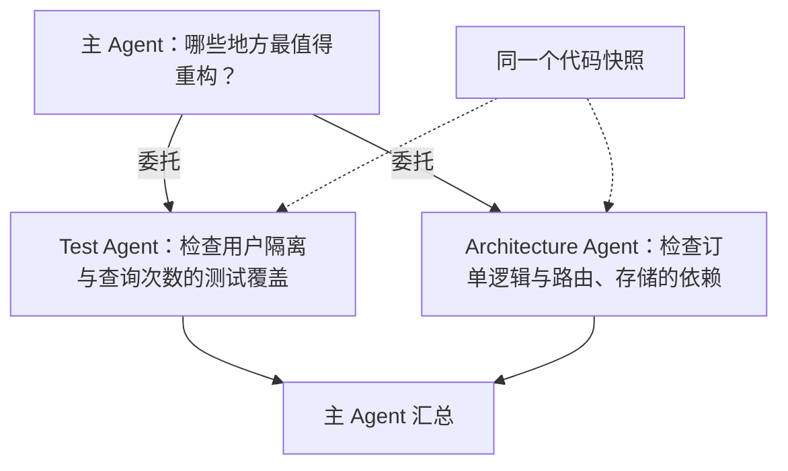
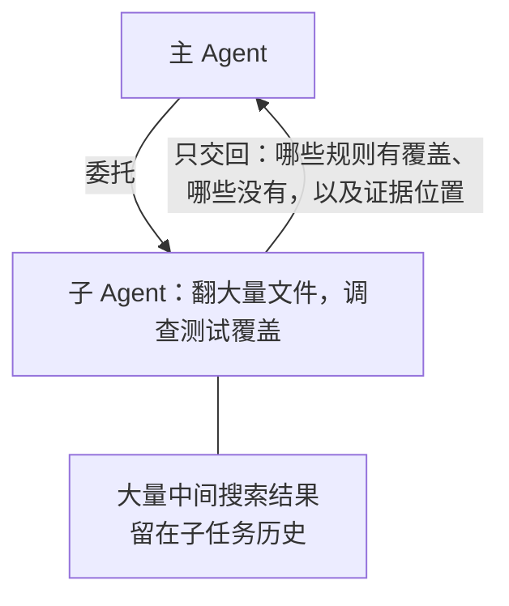
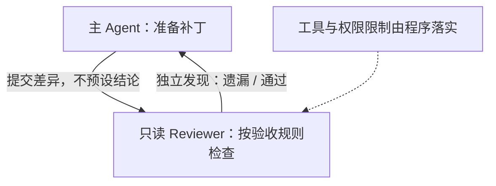
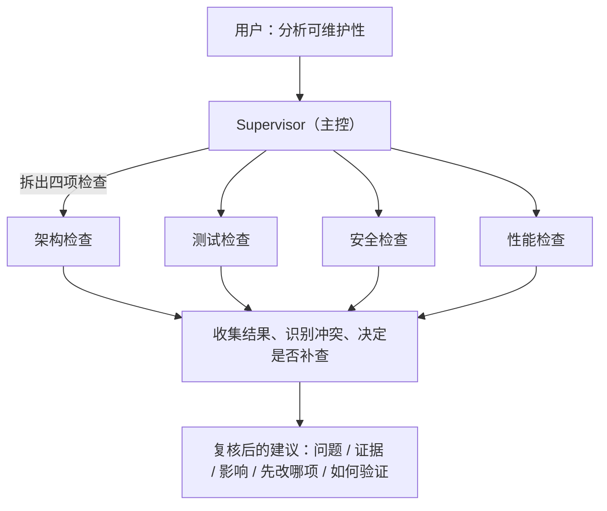
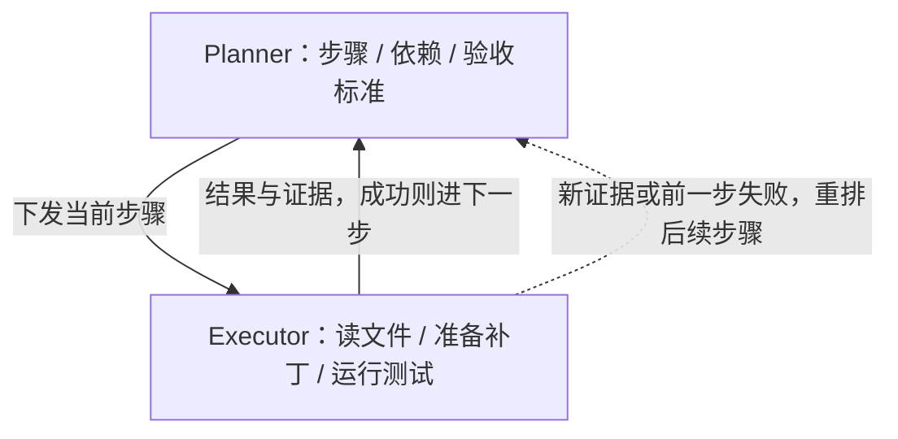
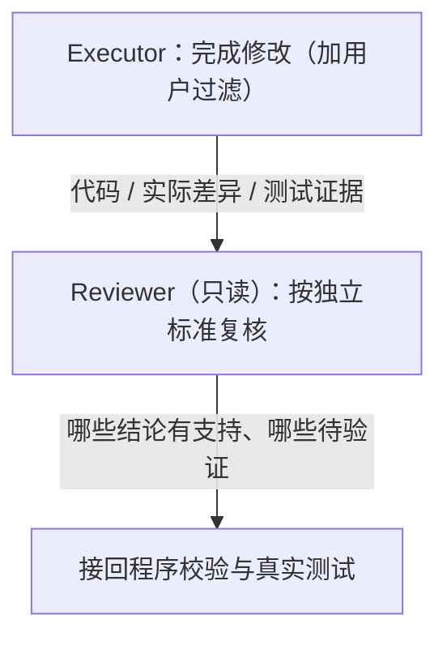

# 5\.1\-Multi\-Agent与Subagent

# 5\.1 Multi\-Agent 与 Subagent

## 开篇：一个 Agent 已经能改代码，为什么还要增加 Agent

大家好。第四章我们解决了信息怎么用的问题——搜代码、读取文件、改代码、运行测试这类任务，一个 Agent 就能完成。

但是，当用户换一个要求：“请分析这个项目的可维护性，并给出可执行的重构建议。”时，单靠读取代码就不够了。我们还要看模块依赖、测试遗漏、鉴权边界和性能问题。

这时，如果让同一个 Agent 检查所有方面，它可能把大量文件和日志堆进同一段上下文。容易出现两种情况：一是上下文里出现"测试通过"字样，就容易过早结束；二是上一阶段已经形成一个“决策依据”，后面的分析极可能围绕它展开，从而漏掉另一个角度的问题，结论也就不完整。

那是不是可以换个思路：既然一个 Agent 兼顾所有方面容易互相干扰，就把不同方面拆开，交给多个 Agent 各自独立检查，最后再汇总。这样每段检查的上下文更聚焦，一个方向的判断也不容易被另一个方向带偏。这正好能解决上面提到的问题。

但是，多 Agent 不是万能的，Agent 的数量不是能力指标，任务完成质量才是。

所以**只有任务确实存在可以独立处理的部分，而且分工收益超过协调成本，才值得增加 Agent。**

首先，我们要判断一个任务能不能用单 Agent 完成，再决定要不要拆分成多个 Agent。

## 一、先判断能否用单 Agent 完成

为了让你更好理解多 Agent 的适用逻辑，我用一套订单项目代码举例。

这套代码本身很小，但把真实项目里常见的问题压缩在了一起。

它的核心是一个订单查询函数 `list_orders`，接口按用户查询订单列表，每条订单再带上商品明细。
数据放在两张表里：`orders` 记录订单号和所属用户，`order_items` 记录订单下的商品。业务规则写在 `docs/current.md`：只能返回当前用户的订单，订单和明细合计最多查询两次且不随订单数增长，查询参数必须绑定；同时规定审查阶段只读，修复只允许修改 app/orders\.py，不得改动现有测试。
项目里还有一份测试 `tests/test_orders.py`，以及一份已经废弃的旧规则文档，不能作为验收依据。

我们看下面几类任务，哪些需要单 Agent，哪些需要多 Agent：

第一个任务是“给订单查询补上当前用户过滤，并通过相关测试”。这件事有明确目标，相关上下文集中在源码和测试中，工具链也很短：读取、修改、测试。

这种场景就不适合拆成多个 Agent。如果你拆成三个 Agent，一个读源码，一个修改，一个测试，它们需要不断交接源码版本和执行结果。修改 Agent 还得等读取结果，测试 Agent 还得等补丁成功。没有增加多少可并行的工作，却增加了交接次数。这种情况下，单 Agent 更合适。

同样的，文件多也不等于需要多 Agent。比如 “解释订单查询调用链”这类任务，需要依次查路由、中间件、Service 和数据访问。虽然会读多个文件，但这些文件围绕一条调用链，一名 Agent 沿着引用关系查就可以。

所以判断是否用多个 Agent 时，需要回答三个问题：

1. 子任务能否独立产出结果？

2. 各自需要的信息是否明显不同？

3. 最后的结果能否按统一规则合并？

只要有一个答案是“否”，就说明拆分不成立，没必要用多 Agent 机制，先把单 Agent 的流程和工具做好，再考虑拆分。

还有一种情况：任务步骤固定，不需要模型根据结果选择下一步。比如依次运行格式检查、类型检查和单元测试，程序直接调度三个命令即可。**三个并行命令不是三个 Agent**。只有每个执行单元自己根据观察选择工具、更新状态和决定是否继续，才有必要讨论 Agent 协作。

到这里，判断的只是“整个任务要不要拆”，还没有涉及拆开之后具体怎么分工。而且有一点要先说清楚：需要协作，并不等于要同时启动多个 Agent。很多场景里，主 Agent 一个就够，只是其中某一小块工作值得单独委托出去。下一节，我们就来看这种更常见的做法——把子任务交给 Subagent。

## 二、什么时候把子任务交给 Subagent

上一段讲的是任务能不能拆。现在再问一步：什么任务值得单独启动一个 Subagent？

Subagent 是主 Agent 委托的子 Agent。那它和 Multi\-Agent 又是什么关系呢？

先把两个词分开看：
Multi\-Agent 是一种协作形态：一个任务拆成几块，多个 Agent 分别承担、互相配合。
Subagent 是这种形态里最典型的一种关系，它强调主从——主 Agent 负责整体目标和最终结论，把范围明确的部分委托给子 Agent；子 Agent 有自己的运行历史和工具循环，把这件事查清楚后交回结果。

一句话：Multi\-Agent 是“多个 Agent 一起工作”，Subagent 是其中“主 Agent 委托子 Agent”这种关系。

Subagent 接到一个范围明确的任务，在自己的运行历史里读取信息、选择工具、继续查证，最后把结果交回主 Agent。主 Agent 继续负责整体任务。

还是以订单项目的综合审查为例。用户的问题是“分析这个项目的可维护性，并给出可执行的重构建议”，主 Agent 要先回答“哪些地方最值得重构？”，其中一项工作就是检查测试覆盖。

这时子 Agent 可以自己查测试文件、追踪被测代码，再返回缺失项和文件证据。而主 Agent 不必一步步告诉它下一条搜索哪些文件、运行哪些测试、断言哪些条件。这种**能单独查清、交回明确结果的工作**，才适合考虑委托——它不需要主 Agent 逐步指挥，结果也能独立验证。

要不要启用 Subagent，取决于它能不能带来三种实质收益。

第一种是能**让互不依赖的调查同时进行**。



比如，委托两个 Agent：一个 Test Agent 检查用户隔离与查询次数的测试覆盖，另一个 Architecture Agent 检查订单逻辑与路由、存储之间的依赖。工作时，让它们读取同一个代码快照、各自开始，最后由主 Agent 汇总。这里有实际可并行的工作，而不只是给每个步骤起一个角色名。

第二种是把大量中间信息留在子任务里。



比如，检查测试覆盖需要翻很多文件，主 Agent 最终只需要知道**哪些规则有覆盖、哪些没有，以及证据在哪**。把这段调查交出去，可以避免主任务历史里堆满搜索结果。即使只启动一个子 Agent，主 Agent 等它返回，这种委托也可能值得做。Subagent 不要求多个一起运行，也不要求并行。

最后一种是需要单独的检查视角或工具范围。



主 Agent 准备了补丁，可以让只读 Reviewer 按验收规则检查当前差异，不把主 Agent 的“我已经修好了”当作结论。独立检查可能发现遗漏，但同一个模型仍可能重复犯错；工具和权限限制也要由程序落实。

反过来，如果只是补一个查询条件，读源码、修改和测试都围绕同一处代码，主 Agent **直接完成**通常更省事。如果子 Agent 每走一步都要问主 Agent，或双方必须不断交换最新文件，交接成本也可能超过收益。

也就是说，只需要运行一个确定的测试命令，就直接调用工具，不必为它再启动 Agent。

给子 Agent 写提示词也有技巧：委托说得越清楚，它越可能一次做对。

启动前先把委托说完整：“检查哪些文件、回答什么问题、可以使用哪些工具、交回什么证据、什么时候停止。”再比较它节省的等待时间、减少的上下文负担或增加的检查价值，是否值得额外的调用和复核成本。连预期结果都说不清，就先留在主 Agent 里处理。

在这个案例里，给 Test Agent 的提示词可以是：“检查用户隔离与查询次数是否有测试覆盖，找出缺失项，并提供测试名称、文件位置和未验证事项。只读，不修改文件，不运行命令。”给它当前需求、源码和测试入口、代码快照就够了，不必附上用户过去讨论过的所有架构方案。某些框架允许继承主 Agent 的历史，但是否继承、继承多少，要看子任务需要。

当然，这些子 Agent 可以使用同一个模型，也可以使用不同模型。判断它是不是 Subagent，要看是否有单独运行的任务状态和工具循环，不能只看模型名称或角色名称。

判断标准清楚了，接下来要解决的是委托之后怎么组织——主 Agent 和子 Agent 之间如何分工，谁负责统筹、谁负责执行。

## 三、三个常见模式分别解决什么问题

第一种，Supervisor Pattern，也就是主控模式。



在我们的案例中，用户提出的是“分析这个项目的可维护性，并给出可执行的重构建议”。Supervisor 接收这个需求，拆出架构、测试、安全和性能四项检查。它安排哪些检查可以同时开始，收集每项结果，识别冲突，并决定是否需要补查。

这样设计的好处是，它的输出不是四份报告的直接拼接，而是一份经过复核的建议——哪里存在问题，证据是什么，影响是什么，先改哪一项，以及改完怎样验证。主控负责统筹，不意味着所有步骤都必须由它调用模型完成。状态更新、预算扣减和结果校验可以交给普通程序。

第二种，Planner / Executor Pattern，也就是计划与执行分工。



假设审查之后，用户又要求逐步重构：先明确数据读取职责，再调整调用方，最后补回归测试。这时 Planner 可以生成步骤、依赖和验收标准，Executor 按当前步骤读取文件、准备补丁、运行测试。

计划不是一次写完就永远不变。如果 Executor 发现调用方依赖了旧接口，就要把新证据返回 Planner，重新评估后续步骤。不能因为计划写了“第二步修改路由”，就忽略第一步已经失败。

也要注意，Planner 和 Executor 不一定是两个独立 Agent。同一 Agent 的两个阶段也能实现这种分工。只有需要独立上下文、单独权限或单独评价时，才考虑分别运行。

第三种，Reviewer Pattern，也就是执行之后增加复核。



Executor 加上用户过滤，Reviewer 检查是否仍完整返回当前用户订单，是否修改了禁止修改的现有测试，以及通过记录是否对应当前补丁。

Reviewer 的价值，是按独立标准检查结果。仅仅让同一个模型再说一次“我认为没问题”，无法保证错误减少。我们应当给 Reviewer 当前代码、实际差异和测试证据，并要求它指出哪些结论有支持，哪些仍待验证。

Reviewer 也可能误判。同模型之间还可能重复相同错误，所以审查结论要接回程序校验和真实测试。它是一个检查环节，不是质量保证的最终凭证。

这三种模式可以组合，但不要一开始就堆起来。如果涉及完整的代码审查流程，可以先用 Supervisor 完成只读审查，再用 Reviewer 复核发现；用户授权修复后，才进入计划与执行。

## 四、并行要看依赖，隔离要靠程序

上一节讲的是怎么分工，但分工要跑起来，还取决于两个前提：任务之间的依赖关系决定谁能并行、谁必须等待；多个 Agent 之间的上下文、工具和权限需要真正隔开。这两点光靠约定不行，得由程序保证。所以单独用一节讲清楚。

架构和测试检查可以同时开始，因为它们都读取同一个快照，不需要先拿到对方结论。Report Agent 必须等结果返回，才能生成报告。修复之后的测试必须等补丁成功，才能验证修改后的代码。

因此，并行依据是依赖关系，不是角色数量。把有依赖的任务同时启动，可能出现测试 Agent 测的是旧代码，修改 Agent 刚好又写入新代码。最后两份结果都写“已完成”，主 Agent 却无法说明它们对应哪个版本。

并行解决的是“能不能同时做”，接下来要解决的是“同时做时怎么互不干扰”，也就是隔离。

隔离要分三层理解。

上下文隔离，是每名子 Agent 使用独立消息历史，不把未经复核的其他结论默认当成自己的依据。需要交接时，传递带来源的摘要，而不是随意共享全部历史。

工具隔离，是每名子 Agent 只获得任务需要的工具。测试检查可以读取测试和申请运行受控测试；报告整理只需要读取结果和引用。报告 Agent 没有理由获得任意 Shell 执行能力。

权限隔离，是执行时继续检查允许的路径、命令、网络和写入范围。只在 Prompt 里写“只读”，并不能阻止一个具备写权限的工具修改文件。

“运行测试”也不天然只读。测试可能创建文件、访问网络、执行插件。我们要在隔离环境里运行，并对命令和外部访问设限制。工具名称不能代替安全边界。

如果多个执行者确实需要修改代码，应使用独立工作目录或工作树，分别保留补丁与被测快照，最后再按顺序合并和测试。不要让它们在同一个可变目录里同时改同一个文件。

## 五、预算和冲突决定系统能否可靠结束

前面讲了怎么分工、怎么隔离，但一个多 Agent 系统能不能可靠收尾，还取决于一个容易被忽略的因素：资源。

分工以后，成本会增加。每名子 Agent 都要接收任务上下文、调用模型、使用工具，再输出结果；主 Agent 还需要复核和整理。并行可能缩短等待时间，却不意味着 Token 消耗下降。

所以，每个子任务都要设置最大执行时间、最大模型调用次数、最大工具调用次数和 Token 上限。主任务还要有全局预算，不能允许每个子任务分别不超限，合起来却远超总额。

比如，前面这个审查任务允许四项检查，总预算必须包含主控和报告整理。某个检查方向证据不足时，可以返回“未完成，缺少哪些材料”，而不是一直搜索到预算耗尽。

超时后，还要停止实际执行。仅仅停止等待一个异步结果，不一定会终止后台命令。Harness 要向模型流、子进程和工具执行传递取消信号，并记录哪些操作已经结束、哪些状态尚不确定。

资源讲完了，接下来看另一种会让系统停不下来的情况。


接着看冲突。Test Agent 说现有测试通过，Security Agent 却发现查询没有按用户过滤。主 Agent 不能投票，也不能看谁说得更肯定。

先核对同一快照和用例。现有测试只检查列表不为空，不能证明数据隔离；安全角色的源码发现提供了一个需要实际验证的线索。下一步使用两名用户的订单调用接口，确认普通用户是否看到了他人订单。

如果返回了他人订单，就确认行为缺陷。性能角色发现逐单读取明细，还需要记录真实 SELECT 次数，确认是否随订单数量增长。因此，一个探针的结果不能代替所有安全与性能检查。

如果业务资料对管理员与普通用户的范围规定不同，先核对当前身份与接口用途。不能把管理员能力套给普通用户；要求仍有冲突时，向有权确认规则的人交接，并保留未完成项。

## 六、直接运行 pi：观察委托与并行

接下来我以 pi 框架自带的 subagent 为例，为你讲解它的用法，你主要需要观察主 Agent 怎样委托两项只读检查。先看实际工具调用，再解释设计。

终端准备下面的变量。`PI_SOURCE` 必须改成已经检出的官方 pi 源码目录，`PROJECT_DIR` 改成第三章教学工程的绝对路径。不要把示例路径原样当成自己的路径。

```Bash
export PI_SOURCE="/absolute/path/to/pi"
export PROJECT_DIR="/absolute/path/to/order-project"
mkdir -p ~/.pi/agent/agents
cat > ~/.pi/agent/agents/course-scout.md <<'EOF'
---
name: course-scout
description: 只读检查订单源码或测试，返回可核对的发现。
tools: read, grep, find, ls
---
按委托范围读取文件。结论附文件位置与原文摘要。
不修改文件，不执行命令。不把未测试写成测试通过。
EOF
cd "$PROJECT_DIR"
pi --version
pi -e "$PI_SOURCE/packages/coding-agent/examples/extensions/subagent/index.ts"
```

进入 pi 并切换到订单项目后，输入下面这段指令：

```Plaintext
使用 subagent 工具的 parallel 模式，委托两个 course-scout：
第一个检查 app/orders.py 是否按当前用户过滤；
第二个检查 tests/test_orders.py 是否覆盖用户隔离、明细完整性和查询次数。
共同规则：只返回当前用户订单，完整返回明细，SELECT 最多两次。只读取，不修改，不运行命令。
每项返回：已读取文件、具体发现、证据、没有验证的事项。
主 Agent 收集后解释两份发现能否互相支持，不得声称已经修复。
```

运行之后，重点不是看它答得好不好，而是看它有没有按委托真的执行。

重点看三个位置：1\. 主 Agent 是否真的调用了 `subagent`；2\. 参数是否采用 `tasks` 数组；3\. 返回结果是否分别保留两项检查。模型只说“我会并行”，不能证明并行发生。

如果没有调用，补充一句“请实际调用 subagent 的 parallel 模式”；如果工具根本没有注册，先检查扩展加载错误，不把普通回答当演示成功。任务较慢时，使用课前真实录制的过程讲解，保留执行记录和版本。

这次演示只证明委托、独立上下文和结果返回。只读工具列表不等于操作系统 Sandbox；没有测试工具，也不能证明接口验收通过。

观察完行为，再看一眼它的实现，就能把现象和原理对上。

最后打开示例 `index.ts`，搜索 `runSingleAgent`、`spawn` 和 `mapWithConcurrencyLimit`。先看单次委托怎样创建独立 pi 子进程，再看并行怎样限制同时运行数量，最后看取消怎样终止子进程。这里只讲函数职责，不需要背源码。

记住三条经验：子任务要独立状态，并发要有上限，退出和取消要有回传。不过示例只是示例：证据复核、全局预算、权限隔离还得靠 Harness 补上，不能因为它能并行，就以为平台已经完整。

## 小结

今天我们建立了一个边界：目标集中、依赖紧密的任务，先用单 Agent；存在独立检查方向、信息范围不同而且结果可以汇总的任务，再考虑分工。

Subagent 帮主 Agent 执行明确的子任务。Supervisor 管拆解和决策，Planner 与 Executor 区分计划和执行，Reviewer 检查结果。程序负责状态、隔离、预算和取消，证据决定结论能否成立。

一句话收尾：多 Agent 不是越多越好，而是该拆才拆、拆了还能管得住，才值得。

