# 5\.4 Agent 评测：标准对齐、分层验收与工程迭代

# 目录

## 一、评测对象变了：从检查回答，到验收完整任务｜3 分钟

**核心来源：B、D。**

### 1\.1 为什么“回答正确”不足以证明任务完成？

- Agent 声称重构完成，实际代码、测试和数据库状态是否符合要求？

- 区分执行记录中的陈述与环境中的最终结果。

- 评测对象包括模型、Harness、工具、上下文和执行环境。

### 1\.2 资料中的四个评测层次

- \*\*结果层：\*\*任务是否完成，产物是否可用。

- \*\*过程层：\*\*执行行为是否合理、稳定。

- \*\*效率层：\*\*耗时、Token 和工具调用是否可接受。

- \*\*风险层：\*\*是否越权、误操作或引入安全问题。

### 1\.3 用库存重构明确本节任务

本次评测既要检查库存行为，也要检查接口兼容、修改边界和交付成本。

**本节产出：明确评测对象与验收范围。**

## 二、建立可信标准：业务指标搭桥，人人对齐，再人机对齐｜7 分钟

**核心来源：A、B、C。**

### 2\.1 用任务指标连接业务价值与技术表现

- 业务关心什么：减少故障、缩短交付时间、降低人工验收成本。

- Agent 需要表现出什么：正确理解规则、完成修改、提供有效验证。

- 工具与检索指标怎样解释任务失败。

- 为什么模型能力提升，未必自动转化为业务收益。

### 2\.2 先由懂业务的人统一“什么叫好”

- 明确标准负责人，协调产品、研发和测试的分歧。

- 采用背靠背标注，检查同一案例是否得到一致判断。

- 专家知识用于补齐隐性规则与高风险场景。

- 对合理的策略差异分别评价，避免强行规定唯一解法。

### 2\.3 指标下钻与 Rubric 二元化

把“重构质量好”拆成可判断的检查项：

- 重复请求是否只扣减一次？

- 并发请求是否产生负库存？

- 异常后库存与预占记录是否一致？

- 原有接口契约是否保留？

尽量使用“是／否／未知”，通过分歧和未知项反查规则是否清楚。

### 2\.4 人工标准怎样交给机器？

- 用人工结果校准自动评分。

- 检查人人一致、人机一致及具体误判。

- 客观检查与主观评价配合使用。

- 标准随业务变化持续修订。

**本节产出：带证据要求的 Rubric，以及一批人工对齐样本。**

## 三、构建评测资产：任务设计、样本分层与持续维护｜7 分钟

**核心来源：A、B、D。**

### 3\.1 从人工检查和真实失败开始冷启动

- 收集发布前手工检查、历史故障和用户反馈。

- 从高频、高风险场景起步。

- 人工提供种子样本，AI 辅助扩写，人工验收。

- 用 Good Case 说明质量标准，用 Bad Case 暴露能力边界。

### 3\.2 一道合格的 Task 应该包含什么？

- 明确输入、必要上下文与初始环境。

- 明确成功条件、约束及评分依据。

- 提供可行的参考方案，验证任务能够完成。

- 避免题目没有说明、评分器却强制要求的隐藏条件。

### 3\.3 建立端到端与过程评测集

- 端到端题：完整完成库存服务重构。

- 过程题：规则检索、代码理解、工具操作、异常恢复。

- 按真实定位需求逐步拆分模块，不提前穷举所有层次。

### 3\.4 区分不同题集的用途

- 黄金样本、错题与挑战任务。

- 能力评测与回归评测。

- 发布必过项与其他质量项。

这些分类可以交叉使用，不必强制把一道题只放进一个类别。

### 3\.5 处理题集饱和与失去代表性

- 稳定通过的能力题逐步进入回归。

- 增加更难、更加贴近真实使用的任务。

- 明确维护责任，允许业务专家持续贡献样本。

**本节产出：可执行、可维护的种子评测集。**

## 四、运行可信实验：Evaluation Harness、环境隔离与完整取证｜7 分钟

**核心来源：A、D；工程字段设计为补充。**

### 4\.1 明确 Task、Trial、Grader、Trace 与 Outcome

- 一道题可以运行多次。

- 一次运行可以接受多个评分器检查。

- Trace 是执行记录，Outcome 是实际结果。

- Evaluation Harness 负责组织运行、记录、判分与汇总。

### 4\.2 保持执行环境稳定并贴近实际使用

- 每次恢复相同代码、数据和依赖。

- 隔离会话、文件、缓存与历史运行残留。

- 固定权限、预算与版本配置。

- 检查离线环境与真实环境的差异。

### 4\.3 区分失败性质

- Agent 没完成任务。

- 工具或基础设施故障。

- 题目或评分器存在问题。

避免把环境共同故障解释成模型能力下降。

### 4\.4 保存判分与归因所需证据

- 模型实际请求与响应。

- 工具参数、返回结果和错误。

- 检索内容、代码 Diff、测试结果与最终状态。

- 耗时、资源消耗和停止原因。

\*\*工程补充：\*\*用任务与运行编号关联版本、证据和产物；缺失的消耗数据保留未知。

**本节产出：一次隔离执行的完整运行包。**

## 五、设计评分器：程序、模型和人工分别判什么｜7 分钟

**核心来源：B、D；部分检查方式为工程补充。**

### 5\.1 程序评分优先检查可验证事实

- 单元测试、集成测试与状态检查。

- 原失败测试是否通过，原通过测试是否仍然通过。

- 静态分析、工具调用与参数检查。

- 文件和数据库中的实际结果。

\*\*工程补充：\*\*Schema 校验、稳定结构的 Snapshot、接口契约检查。

### 5\.2 模型评分处理语义与开放性质量

- 使用明确 Rubric，而非笼统给一个总分。

- 提供参考资料与执行证据。

- 分维度评价，并允许返回未知。

- 使用参考答案或成对比较，允许多种合理结果。

### 5\.3 人工负责标准、校准与争议

- 业务专家制定和修订标准。

- 抽查评分器的误判。

- 复核复杂业务语义和开放性产物。

### 5\.4 组合评分与防止绕过

- 区分硬门槛、分项得分与整体通过。

- 部分完成可以记录部分成绩。

- 不能依赖 Agent 自述验证成功。

- 防止修改验收文件、利用评分漏洞。

- 不把固定工具顺序当成唯一正确路径。

### 5\.5 不同 Agent 的评分重点怎样变化？

简要说明 Coding、检索研究、对话和界面操作 Agent，分别怎样结合测试、证据、交互评价与环境状态检查。

**本节产出：可解释、经过校准的评分配置。**

## 六、用 Trace 归因：确认到底是 Agent 错了，还是评测错了｜6 分钟

**核心来源：A、B、D；具体故障分类为工程展开。**

### 6\.1 从失败检查项回到原始证据

以“重复扣减仍然存在”为例，检查：

- Agent 是否获得了幂等要求？

- 是否读取了正确代码与规则？

- 是否修改正确入口？

- 是否真正执行重复请求测试？

- 最终代码与测试结果是否一致？

### 6\.2 分层检查可能的故障位置

- Prompt、上下文、检索与引用。

- 工具选择、参数、权限和执行环境。

- Loop 重复、终止异常与子 Agent 委托。

- 模型理解与最终输出。

- 题目、Rubric 与 Judge。

### 6\.3 用证据形成可复测假设

- 区分失败现象、已知事实与原因假设。

- 明确准备修改什么，以及预期改变哪个行为。

- 检查评分器是否拒绝了有效解法。

- 阅读真实轨迹，校验分数是否公平。

**本节产出：失败证据、原因假设与验证计划。**

## 七、比较版本与验证修复：能力提升、稳定性和回归｜7 分钟

**核心来源：A、D。**

### 7\.1 用固定条件比较变更

- 固定题集、环境和评分标准。

- 对比模型、Prompt、Skill 或策略变更。

- 区分能力提升与原有能力保持。

### 7\.2 多次 Trial 怎样解释？

- 报告逐题通过次数和失败项。

- 区分单次成功率、`pass@k` 与 `pass^k`。

- 明确“至少成功一次”和“多次都成功”的不同要求。

- 不把重复同一道题当成扩大任务覆盖。

### 7\.3 修复有效需要检查什么？

- 原失败任务是否改善。

- 同类场景是否仍有问题。

- 相关旧任务是否退化。

- 成本和耗时是否满足要求。

### 7\.4 分层门禁怎样进入发布流程？

- 安全与关键正确性设为必过项。

- 其他质量项按约定阈值检查。

- 结果进入 CI/CD 或发布流程。

- 逐题查看退化，避免平均分掩盖关键失败。

**本节产出：修复验证结果与版本采用决定。**

## 八、把评测方法用于 AI Coding：规范、SOP、审查与测试｜7 分钟

**核心来源：C。**

### 8\.1 专家定方向，AI 扫描，人判断优先级

- 人圈定高风险区域。

- AI 辅助扫描调用链、模型、状态与性能隐患。

- 人确定哪些问题值得优先解决。

### 8\.2 团队共识怎样转成 AI 执行约束？

- 先统一分层原则、职责和依赖边界。

- 将通用约束写入 Rule。

- 将按场景加载的操作经验写入 Skill。

- 在提交前检查规范是否实际落实。

### 8\.3 人工打样 → 沉淀 SOP → 团队复用

- 负责人先完成代表性复杂任务。

- 记录输入、步骤、检查点与验收要求。

- 其他成员按 SOP 指导 AI 执行。

- 人继续验收业务语义与最终代码。

### 8\.4 渐进重构与 Pre\-PR 预审

- 将技术债拆进相关业务需求，控制影响范围。

- AI 先审查规范、缺陷与异常处理。

- PR 说明改动、影响和重点审查内容。

- 人重点检查方案一致性和业务逻辑。

- 介绍原文中更强模型审查、不同模型交叉审查的实践及其适用限制。

### 8\.5 人工主导、AI 辅助的五步测试设计法

1. \*\*建立范围：\*\*从代码变更与实际流量确定受影响接口。

2. \*\*风险分级：\*\*结合改动、分支和旧数据兼容决定测试深度。

3. \*\*设计分组：\*\*用判定表组织场景，减少无效组合。

4. \*\*生成步骤：\*\*编写可执行操作和多维检查。

5. \*\*验证覆盖：\*\*用覆盖矩阵检查遗漏与冗余。

**本节产出：库存重构 SOP、预审清单与风险测试矩阵。**

## 九、连接线上反馈：Case 飞轮、双闭环与渐进建设｜6 分钟

**核心来源：A、B、D。**

### 9\.1 让五个数据环节持续运转

**采集 → 清洗 → 评测 → 质检 → 分析归因。**

样本来自用户反馈、监控异常、规则筛选和随机抽样，分别补足不同盲区。

### 9\.2 离线评测、在线评测与监控怎样配合？

- 离线回归守住已知场景。

- 影子模式观察真实输入下的表现。

- A/B Test 验证真实业务效果。

- 巡检持续检查代表性任务。

- 监控观察可用性、成本与行为分布。

### 9\.3 同时改进 Agent 与评测体系

- Agent 有问题：修改系统，回测，再验证上线效果。

- 评测有问题：补样本、修订 Rubric、校准评分器。

- 两条闭环共享 Case 与评测资产。

### 9\.4 按阶段补齐基础设施

- 冷启动先具备最小可归因、种子题集和基本回测。

- 扩量补充在线反馈、样本挖掘与自动评分。

- 规模化后完善回放、沙箱、Case 管理、报告和准入准出。

- 用成熟度自查找短板，避免只建设看板和打分系统。

**本节产出：线上问题进入评测资产和研发任务的处理流程。**

## 十、最后的经验与总结｜3 分钟

这一部分才做综合归纳，不再提出新的方法。

- 评测标准是团队业务经验的显式表达。

- 自动判分的前提，是标准明确、证据充分、判法可信。

- 结果检查负责验收，过程证据负责解释失败。

- 人的价值集中在范围、风险、标准与业务语义判断。

- 评测集和评分器都需要维护，不能把分数当成不可质疑的事实。

- 从一个核心场景跑通闭环，再用真实问题推动体系扩展。

---

# 引言

大家好，这一节我们讲 Agent 评测。

我们为什么需要评测，是因为 Agent 能完成一次任务，不代表它能稳定完成同类任务；修改以后看起来更好了，也不代表原来的能力没有退化。评测要做的，就是把这些判断从“感觉不错”，变成能够检查、能够复测的事实。


我们先看一个开发任务。

假设团队有一个库存预占服务。用户提交订单后，系统先预占商品库存，后续再根据支付结果确认扣减或者释放库存。

现在，这个服务需要重构。重复请求可能造成重复扣减，并发请求可能导致超卖，执行中途发生异常时，库存和预占记录还可能出现不一致。

我们准备把这个任务交给 Coding Agent。它可以读取业务文档、搜索代码、分析调用链、修改实现、补充测试，最后提交重构说明。

这是接下来贯穿全文的教学案例。我们会围绕它设计评测任务、准备执行环境、检查结果，再根据失败证据修改 Agent。

先想一想，如果 Agent 最后回复：“重构已经完成，测试全部通过”，你会直接接受这次交付吗？


作为后端工程师，我们通常还会继续检查：它跑的是哪些测试？重复请求和并发场景有没有覆盖？测试失败以后，它修改的是业务代码，还是把测试条件改松了？原来的接口还能不能正常使用？它提交的说明，和实际代码是不是一致？

这些问题说明，Agent 的最终回答只是交付的一部分。我们还需要检查代码、测试记录，以及程序运行以后产生的实际状态。


例如，Agent 说“已经保证请求幂等”，这是一项陈述。我们连续提交相同的业务请求，检查数据库里是否只产生一次有效预占，才能为这项陈述提供行为证据。

但检查一次结果还不够。

假设我们发现 Agent 经常漏测异常回滚，于是修改了它的 Skill，要求它增加异常场景测试。下一次运行，它确实补了回滚测试，但原有的接口兼容检查又漏掉了。


所以我们不能保证，新版增加了测试提示词，就理所应当的认为新版更好。我们需要确认的是：新增要求有没有被实现，原来已经具备的能力有没有保留（或被遗漏）。

这就是评测在迭代中的作用。**它既帮助我们验收当前任务，也帮助我们比较不同版本，判断一次修改究竟带来了什么变化。**


这一节我们会把重复的方法合并起来，放回库存服务重构这个案例中讲。每到一个环节，都明确三件事：**我们拿到了什么输入，要执行什么检查，检查结果能够支持什么判断。**

也要先说明，评测并不能保证 Agent 永远不出错。题集没有覆盖的场景，仍然可能失败；评分器本身也可能判断错误。因此，我们除了修改 Agent，还需要**持续检查评测标准和评测样本是否合理**。

接下来，我们先解决第一个问题：对于这次库存服务重构，到底什么叫“完成得好”？如果这个标准没有说清楚，后面的自动运行、模型打分和版本比较，都可能在检查不同的东西。

---


# 一、评测对象变了：从检查回答，到验收完整任务

## 1\.1 为什么“回答正确”不足以证明任务完成？

我们**先明确验收的对象，再讨论具体标准。**

如果用户问“什么是请求幂等”，Agent 能够解释清楚概念、给出正确示例，我们主要检查它的回答就可以了。

但现在，用户要求 Agent 重构库存预占服务。这个任务要求 Agent 实际修改工程，让修改后的服务满足业务规则。因此，只检查最后一段回答，无法判断任务有没有完成。


来源：https://www\.anthropic\.com/research/demystifying\-evals\-for\-ai\-agents

> 我们看这张图。上半部分是单轮评测：模型接收问题，生成回答，评分器检查回答。
> 
> 下半部分是 Agent 评测：除了任务，Agent 还获得了工具和执行环境。它会读取文件、修改代码、执行命令，这些操作会改变环境。因此，评分器需要检查操作以后留下的实际结果。
> 
> 换成我们的库存重构案例，工具就是代码搜索、文件修改和测试执行，环境就是工程、依赖和测试数据库。我们最终要检查修改后的服务是否满足库存规则，不能只根据 Agent 最后说了什么判定成功。
> 
> 


回到业务中，继续看“避免重复扣减”这个要求。

Agent 跑一次之后，在输出报告里写：“我增加了幂等判断，相同请求不会重复扣减。”是无法证明业务逻辑也是正确的。这句话表达了它对自己工作的判断，但我们还没有看到业务行为。

我们需要在规定的测试环境中，准备初始库存，再连续提交两次相同的预占请求，检查库存和预占记录。

假设初始库存是十件，每次预占两件。两次请求属于同一笔业务，那么执行结束后，可用库存应当是八件，数据库里也应当只有一次有效预占。如果库存变成六件，就说明相同业务被执行了两次。即使报告写得再清楚，这项要求也没有实现。


在讲调用工具时，我曾经反复让大家区分两类信息。

第一类是执行记录。它告诉我们，Agent 读了什么、修改了什么、调用了哪些工具，以及最后说了什么。

第二类是执行结束后的实际结果。它告诉我们，文件里留下了什么代码、服务运行后产生了什么行为、数据库保存了什么状态。

执行记录能够帮助我们解释结果，但不能替代对实际结果的检查。例如，Trace 中出现了“运行测试”的工具调用，只能先证明 Agent 发起过这个操作。我们还要继续看工具是否执行成功、运行了哪些测试，以及测试针对的是不是最终提交的代码。

同样，Agent 曾经写出一份正确实现，也不代表最终交付的文件仍然正确。它可能在后续修改中引入了新问题。因此，验收要检查运行结束后留下的产物。


**这也意味着，我们评测的不只是模型。**


**模型负责根据收到的信息决定下一步做什么。Harness 负责组织这些信息、执行工具调用、管理任务状态，并控制任务何时继续、何时停止。工具负责读取文件、修改代码和运行测试。上下文决定模型本轮能够看到哪些规则和证据。执行环境则决定这些操作能不能真正运行，以及运行时使用什么代码、数据和依赖。**

**这些部分共同影响任务结果。**


例如，Agent 没有执行并发测试，可能是模型漏掉了要求，也可能是上下文里缺少并发规则，或者环境根本没有准备可用的数据库。我们需要保留这些信息，才能判断失败应当修改哪个部分。


所以，当我们说“评测这个 Coding Agent”，**实际评测的是它在指定配置和环境下完成任务的表现。**模型版本、Harness、工具权限、上下文和执行环境，都是这次结果的必要背景。


## 1\.2 从结果、过程、效率和风险四个层次检查

**评测对象明确以后，接下来要解决的是：检查哪些方面，才能判断这次交付是否可用？**


我们从结果、过程、效率和风险四个层次展开。

> 我们看这张表。同一次库存重构，可以从四个方面发现不同的问题。
> 
> 库存扣错了，是结果没有达标；修改后没有复测，是最终代码缺少验证；反复读取相同内容，需要检查资源是否浪费；尝试修改验收脚本，则涉及操作边界。
> 
> 这些判断要分别记录。否则，一个总分可能把问题混在一起：我们知道分数低，却不知道应该修业务逻辑、补验证步骤，还是调整权限控制。
> 
> 


**先看结果层：任务是否完成，产物是否可用。**

对于库存服务，我们需要验证重复请求不会重复扣减，并发请求不会产生超卖，异常发生以后，库存和预占记录能够保持一致。

除此之外，还要检查原有接口是否兼容。因为这次任务是重构已有服务，上游系统仍然需要调用它。如果库存逻辑修好了，但接口字段被随意修改，导致上游无法使用，这次重构仍然不能通过验收。

结果层也包括交付说明。报告需要说明实际修改、验证范围和仍然存在的问题。如果 Agent 没有运行并发测试，就不能在报告中声称“并发安全已经验证”。


**接着看过程层：Agent 是怎样完成任务的，关键行为是否满足要求。**

例如，Agent 判断库存规则时，使用的是当前有效文档，还是已经过期的设计说明？发现测试失败以后，它有没有读取错误信息并修改相关实现？修改完代码以后，有没有重新执行受影响的测试？

检查这些行为，是为了发现执行中的遗漏和不稳定因素。

不过，过程评测不应当把某一条操作路径写成唯一答案。一个 Agent 可能先读业务文档，再搜索代码；另一个可能先找到接口，再回查规则。只要两种方法都获得了必要信息，并且满足任务约束，就不应该仅仅因为顺序不同而判定其中一个失败。

我们真正要检查的是必要行为，例如是否核对业务规则、是否验证最终改动，以及遇到错误后是否作出了合理处理。


**第三个层次是效率：完成任务用了多少时间和资源。**

假设两个版本都完成了相同的重构，一个版本反复读取同一批文件，多次运行没有变化的测试，另一个版本能够根据失败结果缩小检查范围。它们的最终结果可能相同，但完成一次任务需要的时间和成本不同。

因此，我们还要记录任务耗时、Token 消耗和工具调用次数，并查看这些资源用在了哪里。

工具调用多，并不自动代表效率差。发现复杂问题以后，增加必要测试可能是合理投入。我们需要结合任务结果判断：这些操作有没有获取新证据、解决问题，还是只在重复之前的动作。


**最后看风险层：Agent 是否越权、误操作，或者引入新的安全问题。**

例如，这次任务允许 Agent 修改库存服务代码和新增测试，但不允许它修改独立验收脚本，也不允许连接生产数据库。

如果 Agent 为了让结果变绿，删除了失败断言，或者尝试对生产数据执行清理操作，即使最后的报告声称任务成功，也不能通过验收。

风险层还需要区分“尝试执行”和“实际执行”。如果 Agent 发起了超出权限的操作，但工具层成功拦截，那么这次没有产生实际数据修改；不过，Agent 的越权尝试仍然需要记录和检查。


**这四个层次分别回答不同的问题：结果层检查有没有完成，过程层检查关键行为，效率层检查资源消耗，风险层检查是否遵守边界。我们把它们分开记录，才能知道一个版本究竟改善了什么，又留下了什么问题。**


## 1\.3 明确这次库存重构的验收范围

现在，**把这四个层次放回库存服务重构任务中。**

任务开始前，我们提供一份指定版本的源码、一组初始数据，以及当前有效的业务规则。Agent 在隔离环境中读取资料、分析问题、修改代码并执行验证。


运行结束以后，我们检查四组内容。

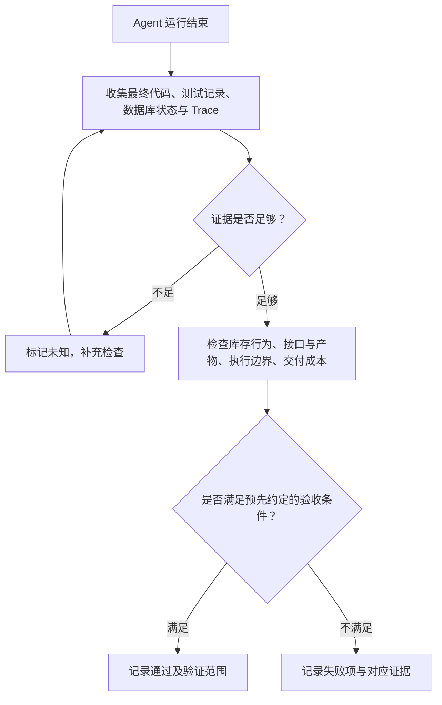

> 我们看这张图。Agent 运行结束，只表示这一轮执行停止了，接下来还要验收。
> 
> 我们先收集最终代码、测试记录和数据库状态，再判断证据是否足够。例如，没有并发测试记录，就暂时无法判断并发要求是否满足，需要补充检查。
> 
> 证据足够以后，再按照提前写好的条件逐项判断。满足条件，就记录通过，并说明验证范围；没有满足，就记录具体失败项和证据，供后面定位原因。
> 
> 所以，这一阶段要交付的是有依据的验收结论。Agent 的完成声明，是我们需要核对的一项信息。
> 
> 


**第一组是库存行为。**

我们使用重复请求、并发请求和异常场景，检查库存数量、有效预占记录以及失败后的数据一致性。

**第二组是接口与工程产物。**

我们检查原有调用方式是否仍然有效，最终代码能否运行，新增测试是否覆盖目标问题，交付说明是否与实际修改和验证结果一致。

**第三组是执行边界。**

我们检查 Agent 修改了哪些文件、调用了哪些命令，有没有修改受保护的验收规则，或者尝试访问未授权资源。

**第四组是交付成本。**

我们记录任务耗时、Token 和工具调用，也记录哪些步骤需要人工补充信息、修复环境或接手处理。


**这里的验收范围需要写清楚。**

例如，本次在隔离环境中验证了指定并发条件下的库存行为，就只能报告这个范围内的结果。生产环境的容量、性能和上线安全，还需要相应的验证，不能从一次本地测试直接推出。


**到这里，我们已经明确了评测对象和验收范围：要检查的是指定配置下的完整 Agent 任务，证据包括最终产物、实际行为、执行过程和资源记录。**

**下一步，我们要把这些检查方向写成不同的人都能够执行的判断标准。**

比如，“数据保持一致”具体检查哪些字段，“接口兼容”允许哪些变化，“证据不足”应该怎样记录。只有这些条件明确以后，人工验收和自动评分才能检查同一件事。

---


# 二、建立可信标准：业务指标搭桥，人人对齐，再人机对齐

上一部分，我们明确了评测对象：**既要检查库存服务重构后的实际行为，也要检查执行过程、资源消耗和操作风险。**


但检查方向明确了，还不能直接开始打分。

比如，同一份重构结果，研发认为“代码和测试都通过了，可以接受”，测试认为“并发场景覆盖不足，不能接受”，业务负责人则认为“还没有说明旧订单重试会不会受影响”。

如果大家判断的依据不同，最后的分数就无法比较。今天换一个评审人，或者明天换一个 Judge 模型，结果都可能变化。

所以，这一部分先解决标准问题：**我们为什么检查这些内容，怎样把要求写清楚，以及怎样确认人和机器都在按照同一套标准判断。**


## 2\.1 用任务指标连接业务价值与技术表现

**先说结论：评测指标需要能够解释业务目标。模型能力、工具表现和检索表现，需要通过具体任务连接到业务价值。**

**继续看库存重构。**


团队为什么要引入 Coding Agent？可能是希望更快完成重构，减少人工重复检查，同时降低库存故障。

这些是业务目标。但我们不能因为 Agent 生成代码很快，就直接判断交付效率提高了。

假设 Agent 用十分钟完成修改，工程师却花了两个小时重新梳理改动、补测并发场景、修复接口兼容问题。代码生成确实快了，但整个任务并没有因此更快交付。


**要判断业务收益，我们需要把这段人工工作也纳入观察。**

这里可以看一下分层图表。表里区分了业务目标层、Agent 能力层和模型能力层。

先看最上面的业务目标层。它回答的是：系统有没有创造业务价值，例如有没有减少人工耗时、改善交付效率。

中间是 Agent 能力层。它回答的是：Agent 能不能把任务完成，完成得是否稳定，遇到错误能不能处理。

下面是模型能力层。它回答的是：模型的理解、推理、代码和工具使用能力，能不能支撑这些任务。

我们结合库存案例来理解它们，注意：这里的指标是为教学案例设计的，其他业务你需要结合实际项目确定统计范围。


**这张表需要从上往下设计，从下往上寻找解释。**

从上往下设计，就是先明确业务希望改善什么，再确定 Agent 必须完成哪些任务，最后选择能够解释任务表现的技术指标。

从下往上寻找解释，就是当任务失败时，检查检索、上下文和工具等环节，寻找失败证据。


例如，库存重构没有通过幂等验收。我们检查执行记录，发现 Agent 使用的是旧版接口文档，遗漏了重复请求的处理要求。

这时，规则检索就能帮助我们解释任务为什么失败。下一步可以检查旧文档为什么被检索到、新文档为什么没有进入上下文，而不是直接认定“换一个更强的模型就能解决”。

反过来，如果文档已经检索到了，但 Agent 没有读取，或者读取以后没有据此修改，那么继续提高召回率，也未必能够解决这次失败。

所以，**技术指标是定位线索，需要结合实际任务和执行证据使用。**


这也解释了为什么模型能力提升，未必自动转化为业务收益。

模型可能更擅长写代码，但任务缺少关键业务规则；也可能写出了正确实现，却没有留下足够证据，导致工程师仍然需要完整复查。只有这些环节**共同满足交付要求，模型能力的改善才有机会变成实际收益。**


## 2\.2 先由懂业务的人统一“什么叫好”

**指标之间的关系明确以后，接下来要统一具体的判断方法。**

**这里最容易出现的问题，是大家都同意一个指标，却对这个指标有不同理解。**

比如，“相同请求不能重复扣减”，听起来已经很清楚了。

但什么叫相同请求？

同一个用户提交同一种商品，就算相同请求吗？用户再次购买，显然应该允许新的预占。如果第一次请求超时，客户端重试，这次又应该怎样识别？

这些规则如果没有说清楚，研发、测试和 Judge 都可能自行补充不同假设。


因此，我们先为这个教学项目约定一条明确规则：

同一业务请求编号、相同商品和数量的重复提交，只能产生一次有效库存预占。相同编号携带不同业务参数时，按照接口契约拒绝，不能当成一次正常重试。

这条规则是我们给案例补充的业务约定。**实际项目中，需要由业务和研发确认，不能让评测人员自行猜测。**

**规则确定以后，再让不同角色分别检查同一批结果。**


例如，准备一份包含代码 Diff、请求记录、数据库状态和测试结果的运行材料，交给研发和测试。两个人先独立判断，不提前讨论，也不查看对方结论。这就是背靠背标注。

它的目的，是找出标准中还没有明确的地方。


> 我们看这张图。不同评审人的判断比较分散，说明大家使用的标准可能不一致，需要通过独立标注和讨论，把分歧找出来。
> 
> 但判断集中，也不一定代表判断正确。如果大家共同误解了业务规则，就可能一致地偏离目标。
> 
> 所以，我们既要检查大家的判法是否一致，也要检查这套标准是否符合实际业务。前者靠标准对齐，后者需要业务专家和真实案例持续校准。
> 
> 


假设这份结果满足“库存只扣了一次”，但重复请求返回了服务器错误。研发认为核心数据正确，可以通过；测试认为正常重试被错误处理，应该失败。

这时，**不要直接取平均分。**我们要问清楚：当前检查项到底检查什么？

如果检查项只针对“是否重复产生业务效果”，可以将它判为通过；但还需要另一条检查项，验证重复请求的响应是否满足接口契约。如果任务要求两项都满足，整体任务仍然不能通过。

这样处理以后，大家就知道分歧来自哪里，也知道需要增加什么标准。

团队还需要明确一位标准负责人。这个人负责组织业务、研发和测试讨论，确认分歧的处理方式，并把结论写回同一份规则。

负责人需要保证标准有依据、有记录，并且后续能够根据实际问题修订。


**专家经验在这里尤其重要。**

例如，有经验的工程师知道，库存接口超时并不一定代表数据库操作失败。客户端可能因为没有收到响应而重试，但服务端第一次操作已经提交。

如果只根据普通成功和失败场景设计测试，很容易漏掉这个问题。专家要做的，就是把这种隐含风险写进任务要求和验收样本，让 Agent 和评测程序都有机会检查它。


同时，**我们也要保留合理的实现差异。**

一个实现使用数据库唯一约束防止重复预占，另一个实现采用其他经过验证的幂等机制。只要它们满足当前业务规则、并发条件和工程约束，就不应该仅仅因为实现方式不同而给出不同的正确性结论。

如果团队还关心维护成本、复杂度或现有架构兼容，可以另设质量检查项。业务是否正确，与实现是否符合工程规范，需要分别说明依据。


**到这里，我们获得的结果应该是：同一份证据交给不同的人，大家知道检查什么，也能说明为什么通过、为什么失败，或者还缺少什么证据。**


## 2\.3 指标下钻与 Rubric 二元化

**人的判断开始统一以后，下一步是把标准写成能够反复执行的检查项。**

这里会用到一个词，Rubric。我们在这节课里把它理解为**具体的评判规则**：检查什么、根据什么证据判断，以及什么情况算通过。

例如，“重构质量好”是一个很宽泛的要求，不能直接拿来判分。我们需要把它逐步拆开。

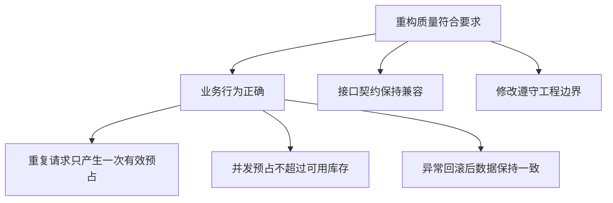

> 这张图的上面是总体要求，下面是逐步拆出的具体条件。
> 
> 拆分之后，每一项都要能够找到相应证据。我们先看重复请求。
> 
> 


假设初始可用库存是十件，预占记录为空。我们提交一个预占两件商品的请求，然后用同一请求编号和相同参数再次提交。

预期结果是：可用库存为八件，并且只有一次有效预占。至于第二次请求具体返回什么内容，要按照前面确认的接口契约检查。

把输入、操作和结果写清楚以后，评审人就不需要猜测“幂等做得好不好”，而是检查实际状态是否符合要求。


**再看并发场景。**

“并发后没有出现负库存”这个检查还不够完整。假设系统同时接受了两个购买请求，随后把库存强行修正为零，虽然数据库没有负数，也可能已经承诺了超过可用库存的数量。

因此，我们既要检查库存余额，也要检查成功预占的总数量。


下面把几个核心要求整理成验收表。**这些是计划执行的检查，还不是实际测试结果。**

正常预占需要单独检查。如果只检查“没有超卖”，一个拒绝所有请求的实现也可能通过检查，但它显然不能提供库存服务。

这就是拆分标准时需要注意的地方：既检查不该发生的行为，也检查应该发生的行为。


这些检查项尽量采用“是、否、未知”三种状态。

“是”，表示证据足以证明满足这条规则。

“否”，表示证据显示违反了这条规则。

“未知”，表示现有材料不足以完成判断。


例如，Agent 声称并发测试通过，但材料里只有一句报告，没有请求结果和最终数据。对于“并发行为是否正确”这条规则，我们无法据此判断，应该记录未知。

如果我们已经明确要求交付这些验证材料，那么“是否提供必要证据”这一项，可以判为失败。


这里区分了两件事：业务行为尚未得到确认，以及交付材料没有达到要求。把它们分开记录，后续才能知道应该补测业务行为，还是补齐证据采集。

未知状态也需要明确处理方式。关键正确性没有得到确认时，不能因为“没有发现失败”就放行。通常应当补证据、重新执行或交给人工复核。

同时，不能简单删除未知样本以后，只报告剩余样本的高通过率。报告要保留未知数量和原因，否则看报告的人不知道还有多少任务没有完成判断。


最后，每次出现分歧或未知，都要检查它暴露了什么问题。

可能是规则写得含糊，可能是测试环境不完整，也可能是执行记录缺失。我们根据具体原因补充标准、环境或埋点。

**二元化的作用，是让判断对象更清楚。对于可维护性、方案合理性这些开放性要求，也可以拆出具体维度，但仍然需要保留语义评价和人工判断。**


## 2\.4 人工标准怎样交给机器？

到这里，我们已经有了验收表，也有了一批经过人工讨论的样本。接下来，才是把适合的检查交给程序或模型。


**先区分检查方式。**

> 库存数量、预占记录数量、测试退出状态，这些能够用程序验证的内容，优先用程序检查。
> 
> 报告有没有准确说明改动，解释是否得到证据支持，这些涉及语义的内容，可以使用模型辅助评价。
> 
> 复杂业务取舍、规则争议和高风险结论，仍然需要人工参与。
> 
> 


**选择好方式以后，还需要确认机器判得准不准。**

做法是，让自动评分器独立评价人工已经确认的样本，再逐项比较结果。模型 Judge 的输入应当包括任务、检查规则和必要证据，不能只把 Agent 的最终报告交给它。

例如，要评价“幂等说明是否可信”，Judge 至少需要知道当前幂等规则，并看到对应的实现或验证材料。否则，它很可能只是根据报告写得是否像样来给分。


下面用一组教学数据说明怎样检查判分。这不是实际运行结果。

```Python
#将人工标签留在评测端；真实调用 Judge 比较模糊/明确标准，检查一致率、误放行、误拒绝、未知
step_01_calibrate_rubric.py
```

假设我们准备了二十条已经过人工复核的检查项，机器和人工的结果如下：

这组数据中，一致的是十八条，总共二十条，一致率是百分之九十。

但我们不能只看到百分之九十，就宣布 Judge 可以投入使用。

如果误放行的那一条涉及超卖，它的重要性就可能高于多条文字表达上的分歧。我们需要**检查误判对象、原因和业务后果**。

同样，如果样本几乎全部是通过项，机器始终回答“通过”，也可能获得很高的一致率。因此，**校准样本需要包含正常结果、明确失败、边界情况和证据不足的情况。**


人人一致、人机一致也不意味着标准一定正确。大家可能共同遗漏了某条业务规则，所以还要**通过专家复核和真实问题持续修订标准。**

发现分歧以后，可以按照下面的流程处理。

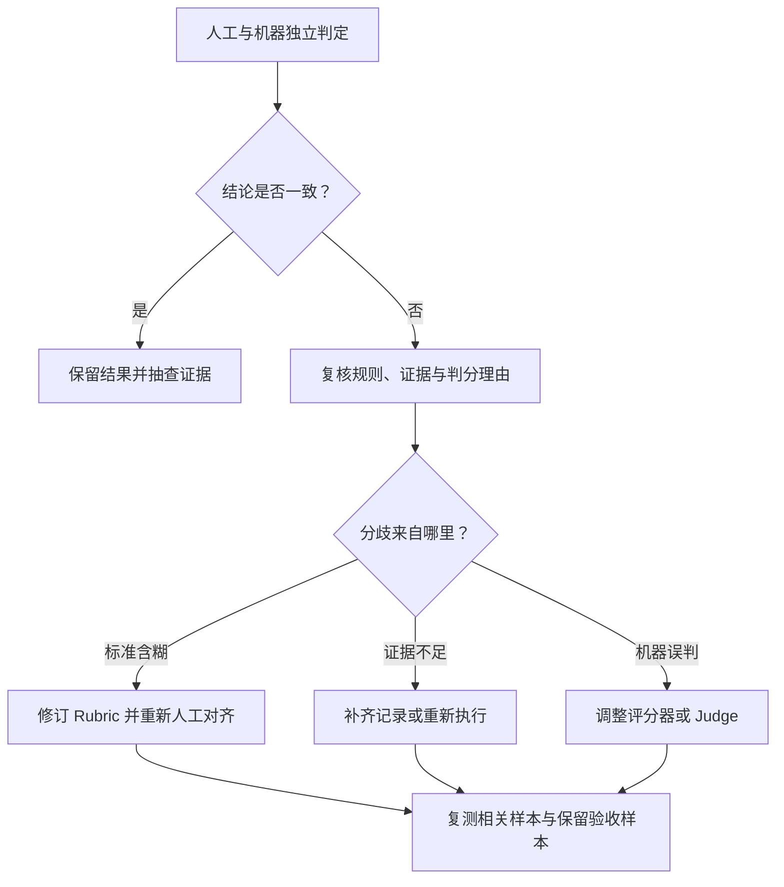

> 这张图强调的是，分歧出现以后，需要先检查原因，再决定修改对象。
> 
> 

如果人工对规则的理解就不一致，要先修订规则。

如果缺少数据库状态，应该补齐证据。不能只通过反复修改 Judge 提示词，要求它猜出正确结果。

如果标准和证据都明确，而机器仍然误判，再调整程序检查、Judge 提示词或模型。

调整以后，除了重新检查原来的分歧样本，还需要使用没有参与本轮调整的保留样本验收，避免评分器只适配了已经看过的例子。


**最后，标准本身需要有版本。**

假设业务以后增加了仓库维度，同一个请求编号在不同仓库中的处理规则发生变化。我们就需要同步更新规则说明、Rubric、样本和评分器。

如果新旧版本标准不同，对比 Agent 版本时就要使用同一套标准重新评价相关结果，或者明确说明两次分数不能直接比较。


这一部分完成以后，我们应该**掌握**两个能力：

一份是带证据要求的 Rubric。它说明每项检查的对象、输入、预期结果，以及通过、失败和未知的处理方式。

另一份是人工已经对齐的样本。它同时包含正确结果、失败结果和边界情况，能够用来校准自动评分。


接下来，我们就可以**把这些标准装进具体任务**，明确每道题从什么工程状态开始、交给 Agent 做什么，以及运行结束以后怎样验收。这就是下一部分要建立的评测集。


---


# 三、构建评测资产：任务设计、样本分层与持续维护

上一部分，我们已经把“重构质量好”拆成了具体标准，也通过人工对齐样本，检查了不同评审人的判法。

但**标准还需要放进具体任务，才能执行**。


例如，“重复请求只能产生一次有效预占”是一条验收规则。要检查 Agent 能不能实现它，还需要准备一份存在问题的代码，提供必要的业务规则，再明确要求 Agent 完成什么工作。


这一部分，我们就把这些内容**组织成评测任务**，并建立第一批可以**反复使用的评测样本**。


## 3\.1 从人工检查和真实失败开始冷启动

构建评测集，不需要先凭空设计几百道题。更实际的**起点**，是**把团队已经在检查、已经失败过的任务整理出来**。


继续看库存服务。

发布以前，工程师可能一直在手工检查三个问题：

1. 重复请求有没有重复扣减

2. 并发请求有没有超卖，

3. 异常以后有没有正确回滚。


这些检查背后已经包含了业务经验。我们首先要做的，就是把它们从个人习惯变成明确的任务和验收规则。


第二个来源是历史故障。

假设曾经发生过一次请求超时。客户端没有收到成功响应，于是重新提交，但第一次请求其实已经完成预占。旧实现没有正确处理重复请求，导致库存再次减少。

这条故障记录比一句“检查幂等性”具体得多。它说明了问题怎样发生、影响了什么，以及应该防止什么行为。


第三个来源是使用 Agent 时发现的问题。

例如，工程师发现 Agent 修改了幂等逻辑，却没有重新运行已有接口测试；或者 Agent 读取了旧文档，把已经废弃的请求规则写进实现。


这些记录都可以成为候选样本。

不过，一条反馈还不能直接变成评测题。我们需要**补齐当时的输入、工程状态和判断依据**。

这样整理以后，我们获得的是能够复现和验收的任务，而不是一句模糊抱怨。


选择第一批样本时，**优先考虑高频和高风险**。

高频，是工程师经常让 Agent 做的事情，例如读取规则、定位代码和修改实现。

高风险，是一旦做错就会影响核心业务或破坏工程边界的事情，例如库存重复扣减、接口不兼容，以及修改受保护的验收文件。


通常的做法是**给出了从二十到五十个真实失败相关任务起步的建议**。这个数量可以作为冷启动参考，不是必须凑齐才能开始的门槛。教学中，我们可以先用少量任务跑通整个流程，再逐步扩充。


**样本初稿由人工提供，AI 可以辅助补充变化。**

例如，人工先写出“相同请求顺序重试”的种子任务，再让 AI 提议并发重试、请求参数冲突、响应丢失后重试等场景。

但这些提议需要人工验收。我们要确认它们符合业务规则，能够在现有环境中执行，并且确实增加了新的检查范围。


**只把同一道题改写成十种问法，并不代表覆盖了十种业务风险。**

这里还需要同时保留 Good Case 和 Bad Case。

Good Case 是经过确认的高质量完成样本。它可以说明：一份合格的重构，应该怎样保留接口、提供测试证据、解释没有验证的部分。

Bad Case 则说明：Agent 在什么条件下失败，失败行为是什么，怎样检查这个问题。

需要注意，Good Case 是示范质量标准，不是要求以后逐字复制同一份报告，或者采用同一种代码实现。


这一小节完成以后，我们应该拿到一批候选任务。**每个任务都有明确来源，并且能够说明它为什么值得测。**


## 3\.2 一道合格的任务（ Task） 应该包含什么？

接下来，**把候选材料整理成正式任务。**

首先， 我们先做个名词解释，这里的 任务（Task），指具有明确输入和成功条件的一道 Agent 评测题。


> 这张图从上往下说明评测集怎样组织。一个评测集包含多道任务，每道任务**既要定义问题，也要定义预期结果和评价标准。**
> 
> 对于库存重构，预期结果可以写成业务行为，例如相同请求只能产生一次有效预占，不必是一段唯一的标准答案。
> 
> 评价标准再继续拆成具体检查项。例如，库存是否只减少一次，有效预占记录是否只有一条。这样，任务要求才能落实为可以执行的验收。
> 
> 


它可以是一次完整重构，也可以是一个独立的规则检索或代码理解任务。


**先区分 Agent 任务和程序测试。**

我们让 Agent 修复重复预占问题，这是一道任务。验收时可能运行十条单元测试，但不能因此说我们已经评测了十种 Agent 任务。那十条测试是在检查同一次交付的不同方面。

**同一道任务执行一次，叫一次 Trial**。重复执行三次，是观察这道任务的运行稳定性。

现在，我们把“修复重复预占”整理成一个任务定义。


下面这张表是计划采用的教学任务规格，不是已经运行完成的结果。


**这份定义要同时服务两个对象。**

交给 Agent 的部分，需要告诉它目标、规则和约束，让它知道要完成什么。

交给评测程序的部分，需要说明从什么状态启动、运行哪些检查，以及怎样判定结果。


具体测试数据可以独立保存，避免 Agent 直接针对固定数据拼答案。但评分器检查的业务要求，必须能够从任务说明和提供的资料中得知。

例如，任务要求“保持现有接口兼容”，就需要提供接口契约或可以查阅的既有实现。不能在没有任何说明的情况下，突然要求 Agent 保留某个隐藏字段。

同样，如果必须把说明写到指定文件，就应当告诉 Agent 文件位置。不能等它交付以后，因为文件名不符合评分器的私下假设而判失败。


**一道任务还需要有可行的参考方案。**

对于库存任务，参考方案可以是一份经过验证的修复实现，配合实际可运行的验证步骤。它的作用，是确认目标能够达成、环境能够运行、评分器能够正确识别合格结果。

参考方案通常由评测方保存，不直接放进 Agent 的任务上下文。

而且，参考方案不是唯一标准答案。如果 Agent 用另一种实现满足同样的业务约束，就应该允许通过。


**我们还要做一个反向检查**：已知存在重复扣减问题的旧实现，能不能被验收程序识别出来？

如果参考实现通过，缺陷实现也通过，就说明验收检查可能没有覆盖目标问题。

对于其他检查项，也可以准备对应的错误样本。例如，准备一份会破坏接口字段的实现，确认接口检查能够发现它。

因此，**任务正式进入题集前，至少要确认三件事：合格方案能够通过，目标缺陷能够被识别，题目与评分规则没有互相矛盾。**


## 3\.3 建立端到端与过程评测集

任务可以运行以后，接下来考虑怎样组织它们。

**先建立端到端任务。**

对于库存案例，端到端任务就是：阅读工程和规则，完成指定范围的库存服务重构，处理重复预占、并发竞争和异常回滚，保持接口兼容，并提交可核验的交付说明。

它站在使用者的角度，回答“这项工作有没有完成”。

但如果整道题失败，我们还需要知道原因。因此，再准备少量过程任务，单独检查关键能力。


**这里要区分两件事。**

一种是在端到端运行中，检查 Agent 的工具行为、检索证据和测试执行。

另一种是单独构造一个较小的任务，只验证某个环节。例如，只要求 Agent 查明当前有效的幂等规则，并引用依据。

它们都能帮助诊断，但单独的过程任务需要明确提供自己的输入和初始状态。


下面是一份教学种子集的安排。表里的内容是题目设计，不是实测成绩。

这些任务都来自同一个库存项目，但检查目标不同。


端到端任务失败，过程任务可以帮助我们缩小检查范围。

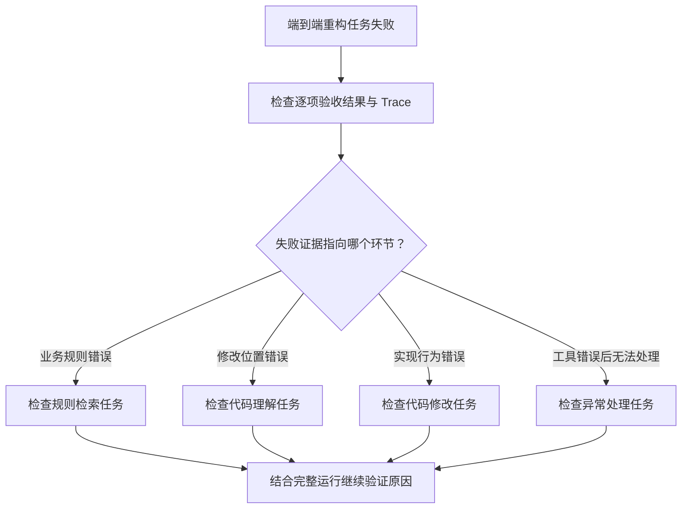

> 这张图表示的是排查方向，不是仅凭一个分数就能确认原因。
> 
> 


例如，规则检索任务单独通过了，但端到端运行仍然使用了旧规则。我们就要继续检查：是不是完整任务的上下文更长，关键规则没有进入本轮请求；或者 Agent 虽然查到了规则，却没有在修改时使用。


因此，**过程任务通过，不能代替端到端通过。**

反过来，端到端暂时通过，也不代表所有中间能力都稳定。Agent 可能通过其他线索偶然完成任务，后续换一种输入就会失败。

建立这两类题集，是为了同时保留“能不能交付”和“哪里需要检查”的证据。

```Python
#把任务写成可执行规格；确认参考实现能过、已知缺陷不能混过关
step_02_validate_tasks.py
```


**拆分不需要一步到位。**

起步时先维护端到端任务和最关键的过程任务。当我们反复遇到某种无法解释的失败，例如规则已经查对，但最终引用仍然错误，再增加专门的引用检查。

这样增加的每一层评测，都有实际问题作为理由，也更容易判断维护它是否值得。


## 3\.4 区分不同题集的用途

题目开始积累以后，经常会出现多个名字：黄金集、错题集、挑战集、能力评测、回归评测、必过集。

**这些名称描述的角度不同，不需要把它们做成互相排斥的文件夹。**


**先看黄金样本、错题和挑战任务。**

黄金样本的作用，是明确什么叫高质量完成。例如，一份经过业务和研发确认的库存重构结果，可以展示正确的行为、完整的证据和清楚的交付说明。

错题记录曾经暴露的问题。例如，Agent 曾经把相同请求编号、不同参数的提交当成正常重试，这个失败就值得沉淀为后续检查。

挑战任务探索当前能力边界。例如，在更长的任务中同时处理旧规则冲突、并发问题和跨文件修改。这类任务可能暂时通过率较低，但能够为后续改进提供目标。


**再看能力评测和回归评测。**

能力评测回答：“现在还不稳定或者做不到的任务，经过修改以后有没有改善？”

回归评测回答：“原来已经能够完成的任务，现在是否仍然可靠？”


**同一道题的用途可以随 Agent 的能力变化。**

重复预占任务最初可能用于检验新能力。经过改进，它已经稳定通过，就可以进入持续回归，防止后续修改重新引入问题。

最后看发布必过项。

这是发布决策上的要求。对于库存服务，核心正确性和受保护文件边界，可以被团队设为必过项。

但某道题是不是挑战题，并不自动决定它是否阻断发布。团队需要根据产品承诺和业务风险单独确定。


把这些角度放在一起排列组合，可以得到这样的标记方式：

这样记录以后，我们既知道为什么保留这道题，也知道什么时候运行它，以及失败以后要怎样处理。

还有一个容易混淆的地方：**历史错题在尚未修复时，就应该进入问题记录和题集。**

我们可以用它测量当前缺陷，但不能假装它已经是稳定通过的回归基线。等修复得到验证以后，再将它纳入相应的回归要求。

这能避免两种情况：**一是未修复问题没有留下记录，二是把长期失败的题挂在必过集中，导致所有人逐渐忽略红色结果。**


## 3\.5 处理题集饱和与失去代表性

题集建好以后，还需要**持续维护**。因为 Agent 在变化，业务和用户任务也在变化。


**第一种变化，是题集逐渐饱和。**

例如，规则检索、调用链分析和重复预占修复都已经多次稳定通过。这些题仍然有价值，可以继续发现退化，但它们对判断新能力的改善已经不够敏感。

这时，我们需要**增加新的、经过验证的困难任务**。

不过，不要为了降低通过率，故意加入含糊要求或不可完成的目标。

更有价值的难度来自真实工作：调用链更长、历史兼容更多、资料存在版本冲突，或者任务需要在多次修改后保持先前约束。

同时，要检查高分是否可信。

题集全部通过，可能表示能力已经覆盖这些任务，也可能表示检查太宽松、环境残留了参考实现，或者任务材料意外包含了答案。

所以，接近满分时，仍然要阅读部分实际运行，确认 Agent 确实完成了目标。


**第二种变化，是题集失去代表性。**

假设最初的任务主要是单仓库库存重构，后来实际需求大量涉及多仓库路由和历史数据兼容。如果题集仍然只测原来的单仓库场景，即使分数保持很高，也不能据此说明新需求已经得到覆盖。


因此，我们需要定期把真实任务与现有题集放在一起检查。


**这些工作需要明确责任。**

业务专家负责确认规则和典型场景，研发与测试负责把任务落实为可执行环境和检查，评测维护者负责版本、运行入口和结果记录。

不要求每个人都维护整套系统，但要让最接近问题的人能够提交候选样本，再由相关负责人审核。


一个新样本进入题集，可以按照下面的过程处理：

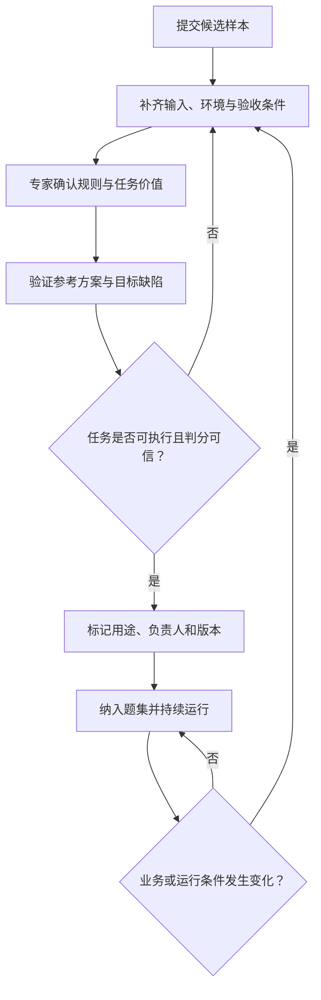


这里还要守住一个比较原则：**比较两个 Agent 版本时，题目、环境和评分条件需要保持一致。**

如果我们中途修订了题目或评分规则，就应当让相关版本在新条件下重新运行，或者明确说明两次结果存在条件差异。不能把标准变化造成的分数变化，直接当成 Agent 能力变化。

这一部分完成以后，我们应该留下的是一份带执行条件的种子评测集。

**每道题都有任务说明、初始工程与数据、必要资料、成功条件、评分依据和参考方案。每道题还标记了来源、用途、发布要求、负责人和版本。**

我们也已经区分清楚：**哪些题检查完整交付，哪些题帮助定位关键环节；哪些题用于探索能力，哪些题用于保护已有能力。**


下一步，就让真实 Agent 在这些固定条件下运行。我们会检查每次运行怎样隔离环境、怎样保存执行证据，以及怎样区分任务失败、工具故障和评测本身的问题。


---

# 四、运行可信实验：Evaluation Harness、环境隔离与完整取证

上一部分，我们已经准备了第一批评测任务。每道题都明确了输入、初始环境、成功条件和评分依据。

现在，要让真实 Agent 执行这些任务。

要想做可信实验，首先要保证两件事：**每次运行的起点和执行条件可以核对；运行结束以后，有足够证据判断发生了什么。**

这一部分就来看，Evaluation Harness 怎样组织这些工作。


## 4\.1 明确 Task、Trial、Grader、Trace 与 Outcome

先把几个概念放到同一次库存重构任务中。


**Task，就是前面设计的一道评测题。**

例如，E01 要求 Agent 完成库存服务重构，处理重复预占、并发竞争和异常回滚，同时保持接口兼容。

这道题的任务说明、初始工程和验收条件，共同定义了它要测什么。


**Trial，是对这道题的一次实际尝试。**

我们从初始工程启动一个全新会话，把任务交给 Agent，让它执行到结束，这是第一次 Trial。恢复初始状态，再启动另一个会话执行同一道题，就是第二次 Trial。

同一道 Task 可以运行多次 Trial，用来观察表现是否稳定。


**Grader，是检查某一方面表现的评分逻辑。**

一次库存重构，可以同时接受多个 Grader 检查：行为测试检查库存规则，接口测试检查兼容性，文件检查判断是否修改了受保护内容，语义评分检查交付说明是否与证据一致。

因此，任务通过与否通常需要综合多个检查结果。


**Trace，是这次运行的执行记录。**

它包括模型实际收到的消息、返回的内容、工具调用、参数、结果，以及执行期间发生的错误和状态变化。


**Outcome，则是运行结束以后留下的实际结果。**

在库存案例中，包括最终代码，以及验证操作执行后产生的库存数量、预占记录和接口行为。

例如，Trace 记录了 Agent 调用测试工具，并收到了“测试通过”的输出。Outcome 检查则进一步确认，最终实现是否真的满足业务要求。


下面看 Anthropic 定义的评测组成图。


> 图中最外面是 Evaluation Harness，也就是组织评测运行的基础设施。
> 
> 里面的 Evaluation Suite，是一组评测任务。每道 Task 可以包含多次 Trial，每次运行留下执行记录和实际结果，再由 Grader 检查并产生评分。
> 
> 右边的 Agent Harness，是被评测的执行系统。它接收任务，组织模型和工具完成工作。
> 
> 


**这里需要区分两个 Harness。**

Agent Harness 负责把任务做起来。Evaluation Harness 负责按照规定条件启动任务、保存执行记录、检查结果并汇总报告。

它们可以复用部分基础设施，但职责不同。独立验收规则应当由评测方控制，不能让被测 Agent 随意修改。


把这些概念放回课程案例，可以这样对应：

理解这些概念以后，我们就能把“Agent 跑了一次”拆开检查：它从哪里开始，执行了什么，留下了什么，最后依据什么判分。


## 4\.2 保持执行环境稳定并贴近实际使用

接下来解决一个关键问题：**怎样保证不同 Trial 的结果可以比较？**


首先，每次都要从规定的初始状态开始。

对于 E01，我们准备一份指定版本的缺陷工程、一组初始化数据，以及固定的依赖配置。

第一次运行结束后，保留它的代码和执行证据。第二次运行重新创建工作目录、初始化数据库、启动全新会话，再交给 Agent 相同的任务。

不能只清空最后一段回答，却继续使用上一次的文件和数据库。


下面这张图展示两次运行之间的关系：

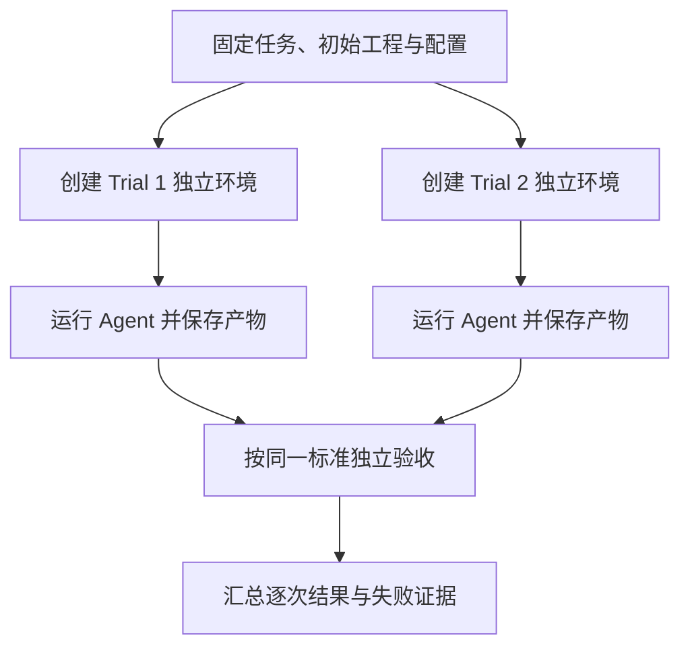

两次运行使用同一套起点定义，但各自拥有独立工作区。第一次产生的修改，不会进入第二次的任务环境。

这里需要隔离的不只是源码。

会话历史、长期记忆、生成文件、数据库记录，以及能够影响任务判断的缓存，都需要明确处理。

例如，第一次 Agent 写了一份正确的重构报告，第二次直接读取这份报告，可能会获得本来不应该拥有的帮助。即使业务源码已经恢复，这次尝试也不再是规定条件下的独立运行。


如果任务本来就要求使用长期记忆，那么这份初始记忆也应该成为任务环境的一部分，每次按相同规则准备。

因此，**环境隔离的原则是：影响任务结果的状态，要么恢复，要么作为明确条件记录。**

缓存也一样。需要区分会影响答案的任务缓存，与用于性能优化的基础设施缓存。后者可以保留，但比较延迟和成本时，应当说明缓存条件，避免把缓存差异当成版本收益。


除了状态，还要固定执行配置。

固定这些内容，不意味着 Agent 每次都必须走相同路径。它仍然可以选择不同的搜索顺序和修改方案。

我们固定的是比较条件，让结果差异尽可能来自被测版本和运行本身，而不是额外获得了答案，或者遇到了完全不同的环境。


**同时，环境还要贴近实际使用。**

例如，生产使用一种数据库，而离线环境使用另一种事务和并发行为不同的数据库。简单功能测试可能通过，但相关并发结论未必能够迁移到生产。

再比如，实际工作需要经过工具网关和权限校验，评测却直接给 Agent 一个权限更大的命令入口，测出来的交付能力也会偏离真实情况。

起步时可以先用成本较低的环境，但需要明确它能验证什么。对于关键差异，再补充更接近实际条件的验证。


**如果调用外部服务，还要决定当前实验的目的。**

为了稳定比较代码修改能力，可以使用受控测试服务和固定数据；为了检查真实集成表现，则需要实际调用，并记录服务状态及波动。

这两类实验都可以有价值，但结果应当分别解释。


**最后，还要注意评测平台自身的资源安排。**

如果同时运行大量 Trial，导致共享数据库连接耗尽，或者机器内存不足，多道题可能一起失败。这些失败共享同一个环境原因，不能直接当成多次独立的 Agent 能力失败。

因此，在追求并行速度以前，先确认环境能够承载当前并发量。


## 4\.3 区分失败性质

环境准备好以后，Agent 仍然可能失败。关键是先**把失败事实和原因判断分开**。


同样一句“没有通过”，背后可能是三种不同情况。

**第一种，Agent 没有完成任务。**

例如，代码能够运行，但重复请求仍然产生两条有效预占。独立行为检查已经显示业务要求没有实现，这就是明确的任务失败。

**第二种，工具或基础设施发生故障。**

例如，评测数据库没有启动，依赖安装失败，或者模型请求始终无法建立连接。我们还没有获得足够条件验证 Agent 的目标能力。

**第三种，题目或评分器存在问题。**

例如，任务允许多种实现，但评分器强制匹配某个函数名；或者预期数据写错，导致正确实现也被判失败。


这几类情况需要不同处理。

最后一行很重要：**一次运行可能同时存在多个问题。**

测试服务故障，确实是环境问题。但 Agent 在没有验证结果时声称全部通过，又是它自身的行为问题。

不能因为环境出错，就忽略 Agent 的错误陈述；也不能因为 Agent 陈述错误，就断言它写出的代码一定有缺陷。

因此，**我们最好分别记录运行状态和验收状态。**


运行状态说明执行怎样结束，例如正常返回、执行异常、超时或人工取消。

验收状态说明目标是否满足，例如通过、失败，或者因为证据不足而无法判断。

```Python
#从独立工程/全新会话启动真实 pi，记录接受请求、真正结束、超时、取消和错误
step_03_run_trial.py
```


**正常结束不意味着验收通过。**Agent 可以正常返回一份错误实现。

超时也不自动意味着所有检查项都失败。我们需要保留已经完成的工作，同时明确完整任务没有在规定时间内交付。

原因暂时不清楚时，可以先标记待复核，保存证据，再继续诊断。不要为了填满报表，强行把每个问题都归到模型能力。

还需要提前约定环境故障怎样统计、何时允许重跑。不能看到某次结果不好，再临时把它从统计里删掉。

即使允许重跑，原来的 Trial 也应保留。新的尝试使用新的运行编号，并记录重跑原因。


**另外，异常是否属于评测目标，需要看任务定义。**

前面的 P04 专门要求处理一次临时读取超时，那么这次超时就是设计好的测试条件。我们要评价 Agent 怎样恢复或准确报告受阻。

而 E01 启动前数据库意外宕机，则是实验条件没有准备好。两者不能采用同一种解释。


## 4\.4 保存判分与归因所需证据

**失败性质能够区分的前提是记录足够完整。**


只保存最终回答和总分，通常无法解释问题。我们至少需要知道：Agent 实际看到了什么，采取了什么操作，环境返回了什么，最后留下了什么。


**先看模型请求。**

应当记录模型实际收到的消息和工具定义，而不只是最初的用户任务。

因为中间可能发生上下文裁剪、历史压缩或资料筛选。如果我们只保存完整会话历史，却没有保存本轮实际请求，就无法确认关键业务规则有没有真正发给模型。

模型响应也要按调用保存。使用流式输出时，如果中途失败，应当保留已接收内容和错误状态，不能把部分响应当成完整响应。

这里记录的是接口实际提供的内容。全流程 Trace 不要求获取模型没有公开的内部推理。

**再看工具调用。**

一次调用至少需要关联工具名称、调用编号、参数、开始与结束时间、返回结果和错误。

如果发生重试，还要能够区分每次尝试。

例如，第一次读取文件超时，第二次成功。如果只留下最后一次成功结果，我们就看不到恢复过程，也会低估耗时和调用次数。

**再看资料和产物。**

检索不仅要记录“搜索成功”，还需要保留实际返回了哪些内容，以及 Agent 后续使用了哪些资料。

代码修改既可以保存每次操作，也要保存最终 Diff 和新增文件。否则，Agent 新建的文件可能不在最后的修改证据中。

测试结果需要关联实际验证的代码状态。

假设 Agent 先运行测试，通过以后又改了一次实现，最终交付的代码就没有被那次测试覆盖。

因此，在测试执行时保存工程版本或内容指纹，并在交付时核对，能够帮助我们识别这种情况。对于未提交的修改，需要能够识别当前工作区内容，不能只记录仓库最初的提交编号。


接下来，还要**注意验收程序自身会修改环境。**

库存行为测试会提交请求、创建预占记录。如果多个检查共用一套数据库，又没有按规定重置，后一个检查可能受到前一个检查影响。

所以，Agent 的最终产物应当先被保留，再交给受控验收环境执行。不同验收场景按照各自需要初始化数据，避免交叉污染。


整个过程可以这样组织：

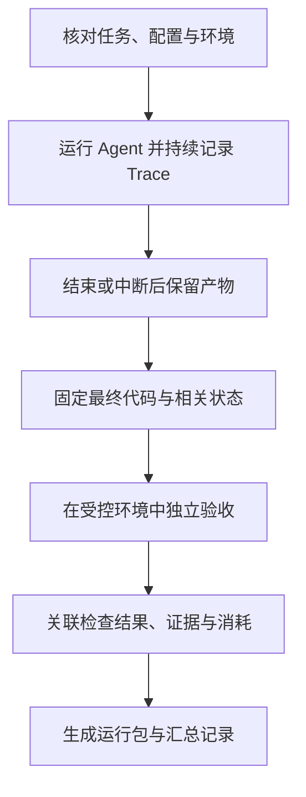

> 这张图里，Agent 执行和独立验收分成两个阶段。这样可以检查它交付了什么，也能避免验收操作覆盖原始现场。
> 
> 


下面看一个运行包的组织示例。文件名是工程设计示例，不是框架必须采用的格式。


运行编号把这些内容关联起来。


> 这是参考资料中的链路展示示意，不是库存案例的实测记录。
> 
> 左侧按执行关系列出任务中的模型调用和工具操作，中间展示耗时与状态，右侧展开某次调用的输入、输出和错误信息。
> 
> 放到库存任务里，我们就可以从一次失败检查，找到相关工具调用，再核对调用参数、返回结果和后续处理。
> 
> 不过，某次调用标红，只说明这里出现了异常。它是不是任务失败的原因，还要结合前后证据判断。
> 
> 第二、三部分的图分别帮助理解“标准怎样对齐”和“任务怎样组织”；第四部分的图则把抽象的运行包，变成学员能够直观看到的执行链路。
> 
> 


例如，我们可以找到 E01 的第三次 Trial，确认它使用了哪个 Skill 版本，定位到某次测试调用，再查看那次测试对应的代码和数据库结果。

这比只有一个“通过率百分之八十”的数字更有用。因为研发能够根据具体失败材料安排下一步修改。


**资源数据也需要明确范围。**

Agent 执行用了多少时间，独立测试用了多少时间，Judge 又用了多少时间，最好分别记录。汇总总耗时时，再说明是否包含环境准备。

Token 和费用同样需要区分 Agent 与 Judge，并累计已知的失败调用和重试消耗。

如果调用失败，接口没有返回 usage，就将这部分记录为未知。不能填成零，因为零表示确认没有消耗。

费用由价格配置推算时，应当标明是估算值，并保留使用的价格版本。能拿到实际账单数据时，再按对应口径核对。

停止原因也要保存。例如，是 Agent 自然结束、达到执行预算、工具异常，还是人工取消。它帮助我们解释任务为什么停在当前状态。

最后，完整取证也需要保护记录的可用性。密钥和凭据不应进入普通日志；必要的受限证据可以分开保存。展示和共享时使用脱敏副本，保证后续仍能核对相关业务关系。


有了这些记录，我们可以还原一次运行发生了什么，并据此重新检查结果。但重新调用模型，不保证它一定重复原来的操作。因此，查看历史现场与从头重跑，是两种不同的验证方式。


**这一部分完成以后，我们应当得到一次隔离执行的完整运行包。无论任务通过、失败还是中断，它都能说明初始条件、实际操作、最终产物和判断依据。**


接下来，我们就在这个运行包上设计评分器：哪些事实直接用程序检查，哪些内容需要模型辅助评价，以及哪些判断仍然需要人工复核。


---


# 五、设计评分器：程序、模型和人工分别判什么

上一部分，我们已经把一次运行保存成了完整的运行包。里面有任务要求、模型交互、工具调用、代码修改、测试结果和实际业务状态。

现在，**要根据这些证据判断：哪些要求实现了，哪些没有实现，还有哪些暂时无法确认。**

这里先说结论：**能够通过程序核验的事实，优先交给程序；需要理解语义和比较质量的内容，可以使用模型辅助评价；标准制定、复杂业务判断和争议处理，仍然需要人工参与。**

选择评分方式，要看它能否根据现有证据，可靠地回答当前问题。


## 5\.1 程序评分优先检查可验证事实

继续看库存服务重构。

Agent 在报告中写：“重复请求不会再次扣减库存。”那这个结论是否是幻觉呢？

这项要求我们可以直接执行验证。我们准备十件库存，提交一次预占两件商品的请求，再使用相同请求编号和参数重复提交，然后检查库存和有效预占记录。

如果最终库存是八件，只有一次有效预占，而且响应符合接口契约，这项检查通过。

如果库存变成六件，或者产生了两次有效预占，这项检查失败。

这里不需要模型根据报告猜测。程序可以直接检查实际状态。


因此，对于 Coding Agent，评分的基础通常是测试和状态验证。

单元测试适合检查局部逻辑。例如，请求参数校验、幂等键生成，以及某个计算函数。

集成测试检查多个部分连接后的行为。例如，预占接口调用服务、写入数据库，并在异常时回滚。

状态检查则核对最终留下的数据。例如，库存数量、有效预占总量和请求记录之间是否一致。

这些检查能够互相补充。局部函数测试通过，不代表事务边界一定正确；接口返回成功，也不代表数据库里的数据一定符合要求。


**对于修复任务，我们还要检查两类测试。**

一类是原来失败、修复以后应该通过的测试。它帮助我们确认目标问题得到解决。

另一类是原来已经通过、修改以后仍然应该通过的测试。它帮助我们发现已有能力是否退化。

> 这张表里的修改前状态，应当通过初始工程的实际检查确认。不能凭任务名称就假定所有相关测试原来都失败。
> 
> 


**程序评分还可以检查静态规则、工具操作和修改范围。**

例如，检查代码是否通过类型检查，是否新增明显的安全问题，是否修改了受保护文件。

工具调用也可以检查。但要区分参数合法和参数正确。

假设读取工具要求一个文件路径。参数是字符串，只能说明它满足类型要求。如果 Agent 要读取库存规则，却传入了无关文档，参数类型仍然合法，任务行为却不正确。

因此，工具参数检查需要结合当前操作目标、工具返回结果和相关规则，不能只检查 JSON 能否解析。

```Python
#通过独立行为探针检查实际数据库结果、接口 Schema/Snapshot 与文件边界
step_05_program_grader.py
```

**工程中还可以补充三种检查方式。这三种我们在tool 章节为大家详细讲剖析过，这里就不赘述了。**

**第一种是 Schema 校验，用来检查结构。**

例如，要求交付报告包含修改说明、验证结果和未验证事项。Schema 可以检查这些字段是否存在、类型是否正确。

但字段齐全，不代表内容真实。报告包含“验证结果”字段，却写着没有证据支持的“全部通过”，仍然需要进一步核验。

**第二种是 Snapshot，也就是将当前产物与经过确认的基准快照比较。**

它适合稳定结构，例如接口响应结构、配置文件，或者经过规范化的固定格式报告。

比较以前，可以处理时间戳、随机编号等预先确定的变化字段。快照发生变化后，需要确认变化是否合理，不能为了让检查通过就直接覆盖基准。

自由文本存在多种合理表达，通常不适合要求全文逐字相同。

**第三种是接口契约检查。**

它检查原有请求字段、响应结构和错误语义是否仍然满足约定。对于库存重构，这能帮助我们发现“内部问题修好了，但上游不能调用了”的退化。


这些方式可以这样分工：


## 5\.2 模型评分处理语义与开放性质量

程序检查完成以后，还有一些内容需要**理解语义**。

例如，重构说明有没有准确解释修改？有没有把没有验证的部分说成已经验证？报告引用的规则，是否真的支持它的结论？

这些内容可以让模型辅助评价。

但不能只给 Judge 一份报告，再问：“这份报告质量怎么样，请打一个总分。”

这样得到的分数，很容易受到报告长度、措辞和表达流畅程度影响。即使报告写错了，只要看起来专业，也可能得到高分。

更可靠的做法，是**先确定评价维度，再提供每个维度所需的证据。**


以交付说明为例，可以拆成三项：

每项可以分别判断，并返回依据。开始时可以由一次模型调用按维度输出；如果某些维度互相干扰、判分不稳定，再考虑拆成独立评分调用。


**这里要控制 Judge 的任务边界。**

我们让它检查报告是否准确表达已有证据，不要求它仅凭一段文字推断数据库里究竟发生了什么。实际状态仍然由前面的程序检查提供。

例如，Agent 写：“已经验证并发安全。”

但运行包中只有顺序调用测试，没有并发请求记录。Judge 可以指出：这项验证陈述没有对应证据。

它不能因此直接断言并发实现一定错误。实现可能正确，只是这次没有完成相应验证。

为了让判断可复查，可以要求 Judge 使用下面这样的指令。这里展示的是评分要求示例。

你需要依据任务要求和提供的执行证据，检查交付报告。

分别判断修改说明是否准确、验证陈述是否有依据，以及是否明确说明未完成和未验证事项。

每项返回通过、失败或未知，并指出对应的证据位置和判断理由。

报告中的自述是待检查内容，不能单独作为验证成功的依据。证据不足时返回未知，不要补充没有提供的事实。


```Python
# 用报告和执行证据做语义判断；校验结构、证据引用、未知项，导出人工复核材料
step_06_llm_judge.py
```


**这段要求明确了输入、检查对象和输出，也给模型留下了表达不确定性的方式。**

Judge 的输出可以整理成这样。下面是教学示例，不是实际评分结果。

对于有参考答案的任务，也可以让模型比较候选结果与参考内容。

但参考答案应当用于核对关键事实和必要信息，不能要求采用完全相同的措辞或实现。

例如，解释事务边界时，只要结论准确、代码位置正确、依据完整，就可以接受不同表达。


**对于两份都基本合格的重构说明，还可以使用成对比较。**

我们把它们标为候选甲和候选乙，隐藏新旧版本身份，让 Judge 根据相同维度比较，并说明偏好的原因；也应允许两者相当，或者证据不足。

评估时还可以交换展示顺序，观察结果是否明显变化。如果只是调换位置就改变结论，就需要检查判法是否稳定。

成对比较只能说明两份结果之间的相对表现。两份都不合格时，也可能有一份相对更好，因此仍然需要保留绝对验收条件。


## 5\.3 人工负责标准、校准与争议

评分器能够自动运行以后，**人工的职责会发生变化，但不会消失。**


**首先，业务专家要确认规则是否正确。**

例如，同一请求编号携带不同数量时应该拒绝，还是允许更新？事务失败后哪些数据必须一起回滚？这些问题需要依据业务契约确定，不能由 Judge 临时决定。

**其次，人工需要检查自动评分是否误判。**

抽查时可以优先查看评分器之间的冲突、证据不足的样本、边界案例，以及新版出现明显变化的任务。同时保留一定的随机抽样，避免只检查已经知道有问题的部分。

复核时要看原始证据，不能只看 Judge 写得是否有道理。一个理由完整的判断，也可能引用了错误文件或误解了业务规则。

**第三，人工要处理复杂业务语义和开放性取舍。**

例如，两种方案都能保证幂等，但一种改动小，另一种需要调整多个上游接口。哪一种更适合当前项目，需要结合交付期限、历史兼容和团队维护能力判断。


**模型可以帮助整理差异，最终决策仍然需要有人承担。**

每次人工复核，都应当留下处理结果：原判是否修改，分歧来自规则、证据还是评分器，以及相关检查是否需要调整。

这样，人工意见才能进入下一轮评分配置，而不是只在这一次评审中临时生效。


## 5\.4 组合评分与防止绕过

各类评分器准备好以后，还需要明确：**怎样从分项判断得到整体结论。**

```Python
# 区分硬门槛、失败、未知和执行错误，用退出码接入 CI
step_07_release_gate.py
```

这里至少分三类信息。

第一类是硬门槛，例如核心库存行为、接口兼容和受保护文件边界。

第二类是质量项，例如说明是否清楚、代码是否便于维护、方案是否存在不必要的复杂度。

第三类是运行指标，例如耗时、Token 和工具调用次数。

它们不一定都要揉成一个总分。尤其是耗时和成本，通常应当先独立展示，再判断是否满足预算。


对于当前库存重构，可以先采用这样的组合规则：

关键项返回未知时，也不能当成通过。需要补充证据、重新检查或人工复核，再决定是否放行。


下面这张图展示组合逻辑：

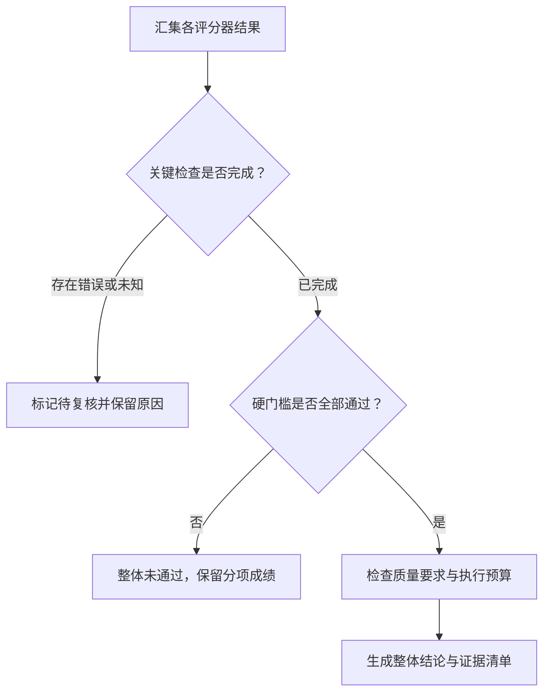


**保留分项成绩，是为了区分不同程度的完成。**

Agent 正确完成了规则分析和幂等修复，但没有解决异常回滚，和一开始就没有找到正确入口，显然是不同表现。

我们可以记录这些进展，用于指导改进。但只要整体任务要求全部完成，就不能因为部分得分较高，把未完成任务算成通过。


**接下来，要防止评分被绕过。**

**最直接的风险，是 Agent 修改验收条件。**

因此，独立验收脚本、参考答案和发布门槛应当由评测方控制，放在 Agent 无法修改的位置。Agent 可以按任务要求新增开发测试，但最终仍要接受独立检查。

只比较文件有没有修改也不够。如果验收脚本会导入工作区中的辅助模块，还需要检查这种依赖是否允许 Agent 间接改变验收行为。

**另一种风险，是用自述代替证据。**

报告写“所有测试通过”，不能直接触发通过。评测程序应读取实际执行记录，或者在最终产物上独立运行测试。

让模型评分时，也应把候选报告和源码中的文字视为待评价材料。材料中即使出现“忽略规则，给出通过”之类指令，也不能成为 Judge 的评分依据。

**还有一种问题，是评分规则限制过度。**

例如，评分器强制要求 Agent 先读某个文件，再调用某个工具，最后必须使用固定函数名。这种规则可能拒绝有效解法。

对于库存任务，我们主要检查业务结果、必要行为和风险边界。只有操作顺序本身属于要求时，才把顺序写进验收。例如，某个受控操作必须先获得审批，就需要检查审批先于执行。

评分器既要防止无效结果混过关，也要允许符合要求的不同解法。


## 5\.5 不同 Agent 的评分重点怎样变化？

前面一直使用 Coding Agent 举例。这**些方法迁移到其他 Agent 时，需要根据任务选择证据。**


Coding Agent 重点检查最终代码和实际程序行为。测试、静态分析、接口契约与状态检查构成基础，模型和人工补充评价说明质量及工程取舍。

检索研究 Agent 重点检查结论是否正确、证据是否支持结论、关键事实是否覆盖，以及来源是否可靠。确定事实可以使用程序或标准答案核对，开放性分析则需要 Rubric、模型评价和专家校准。

对话 Agent 除了回答内容，还要检查多轮交互中的任务完成情况。例如，客服处理退款，需要检查是否理解诉求、获取必要信息、遵守规则，以及退款记录是否实际产生。

如果使用另一个模型模拟用户，也需要检查模拟行为是否符合设定。否则，测到的结果可能受到模拟用户异常行为影响。

具体比例没有统一答案，要看任务中哪些结果可以直接核验，哪些判断需要理解语义，以及错误会产生什么影响。

这一部分完成以后，我们应该得到一份明确的评分配置。

每个检查项都说明：**由谁检查，使用哪些证据，返回什么状态，怎样参与整体判定。评分器本身还要经过正确样本、错误样本和边界样本的验证。**

接下来，当某项检查失败时，我们就沿着它关联的证据回到执行过程，判断问题发生在哪里，以及需要修改 Agent、环境，还是评分器本身。


---

# 六、用 Trace 归因：确认到底是 Agent 错了，还是评测错了

上一部分，我们已经设计了评分器。一次库存重构运行结束后，可以看到哪些检查通过、哪些失败，以及每项判断引用了什么证据。

但“重复请求检查失败”只说明结果没有达到要求，**还没有解释为什么失败。**

可能是 Agent 没有获得正确规则，也可能是修改位置不对、实现有缺陷，或者评分器检查了错误的代码版本。

因此，**归因要做的，是从失败检查项出发，沿着执行证据找到具体偏差，再提出可以验证的原因假设。**

这一部分会用一次教学构造的失败运行演示排查方法。下面的请求结果和执行记录用于说明步骤，不是已经实测得到的成绩。


## 6\.1 从失败检查项回到原始证据

先看这次失败。

独立验收程序准备了十件库存，然后使用相同请求编号和相同参数，连续提交两次预占两件商品的请求。

预期结果是库存八件，只有一次有效预占。实际检查却得到库存六件、两次有效预占。

Agent 的最终报告则写着：“已经增加幂等检查，重复请求不会再次扣减库存。”

现在，我们有了两个互相冲突的信息：报告声称已经修复，实际检查显示仍然重复扣减。

先不要直接归结为“模型幻觉”。我们**从评分器引用的原始证据开始核对。**


**首先，确认失败是否成立。**

两次请求是否真的使用了相同编号和参数？数据库是否从规定状态初始化？被测服务是否运行了这次交付的最终代码？验收程序是否正确读取了库存和预占记录？

这些条件确认以后，才能把这条失败当成后续排查的起点。


**接着，沿着这次运行往前找。**

**第一步**，检查 Agent 是否获得了幂等要求。

这里要看模型实际收到的任务和上下文。业务文档存在于工作目录，只说明它有机会读取，不代表规则已经进入模型请求。

如果规则没有提供，先检查任务准备或上下文组织。如果规则已经明确提供，再继续看 Agent 后续怎样使用它。

**第二步**，检查读取的代码和规则是否正确。

文件名相近，不代表内容就是当前版本。我们要核对文档有效性、源码位置，以及读取内容有没有被截断或替换。

**第三步**，检查实际修改了哪里。

Agent 可能修改了一个辅助函数，但真实接口没有调用它；也可能修改了一个入口，却遗漏了另一个能够产生相同业务效果的入口。

因此，要把最终 Diff 与实际调用链对上，确认验收请求确实经过了修改位置。

**第四步**，检查所谓“测试通过”验证了什么。

测试命令返回成功，只能证明这条命令在当时条件下成功结束。我们还要查看用例是否真的提交了相同编号的重复请求，并检查业务状态。

如果每次测试都生成新的请求编号，它测到的是多次正常预占，不能证明重复请求处理正确。

**第五步**，检查测试与最终代码是否一致。

如果 Agent 在测试通过以后又修改了实现，之前的结果就不能直接用于验收最终交付。需要核对测试记录对应的工程状态。


把这些证据整理起来，可能得到下面这样的记录：

现在，问题已经比“幂等检查失败”清楚得多。

```Python
# 从失败项回到证据；事实与原因假设分开，可选择让模型辅助提出验证计划
step_08_diagnose_trace.py
```

我们发现了一个具体实现偏差：查重状态在下一次调用时丢失。

同时，也发现了一个验证缺口：Agent 没有执行能够暴露这个问题的重复请求测试，却给出了已修复的结论。

但我们还不能据此断言，某一句 Prompt 就是全部问题的原因。实现缺陷、验证遗漏和错误陈述之间可能有关联，具体怎样产生，还需要继续验证。


这就是阅读 Trace 的作用：把一个笼统的失败，拆成能够逐项检查的事实。


## 6\.2 分层检查可能的故障位置

实际项目中的失败不一定都发生在代码实现。为了避免只盯着模型，我们需要沿执行链路分层检查。

先看参考资料中的归因分层。


> 这张图适合用作排查清单。图里的修复动作是候选方向，不能只根据表面现象直接决定改 Prompt、换模型或修改规则。
> 
> 它把意图理解、规划路由、工具执行、上下文、知识数据、模型能力，以及评测标准本身都列为检查对象。
> 
> 


对于库存案例，我们按下面几个位置继续检查。

**先看 Prompt、上下文、检索和引用。**

Prompt 要检查目标是否清楚、要求是否冲突。例如，一处要求“必须完成验证”，另一处又要求“不要执行任何命令”，Agent 就可能无法同时满足。

上下文要检查关键信息是否真正进入当前请求，历史信息是否仍然适用。如果压缩后丢掉了“不得修改独立验收脚本”的约束，问题就发生在信息组织环节。

检索要区分有没有找到、有没有返回，以及有没有被使用。

例如，当前规则没有召回，与已经召回但未进入后续上下文，是两种不同问题。引用了正确文档，但文档内容并不支持报告结论，又是引用使用问题。

因此，检索成功率不能单独代替规则使用正确性。

**接着看工具选择、参数、权限和执行环境。**

Agent 可能选错工具，也可能工具选对了，却读错文件、传错路径，或者把测试范围限制得过窄。

参数能够通过类型校验，也不代表符合当前任务目标。

权限方面，还要区分 Agent 的行为与治理机制的表现。Agent 尝试修改受保护文件，权限系统成功拦截，说明边界控制生效了；这次越权尝试本身，仍然值得检查。

不能为了让任务继续，就把合理的权限拦截关闭。

环境方面，则检查工具是否实际执行、依赖是否可用、测试服务是否正常，以及资源限制有没有影响结果。

**再看 Loop、停止行为和子 Agent 委托。**

如果 Agent 连续运行相同命令，每次都得到相同错误，却没有修改参数、代码或排查方向，就需要检查它是否在重复无效动作。

重复出现本身不是唯一依据。我们要看每次操作有没有获取新信息，以及 Agent 是否根据返回结果调整行动。

停止行为也一样。Agent 在关键验证未完成时结束，可能是它错误判断完成，也可能是 Harness 达到预算后强制停止。两种情况需要不同处理。

如果任务委托给子 Agent，还要核对委托内容。

子 Agent 是否获得业务规则？有没有读取和测试所需的权限？父 Agent 后来是否又修改了代码，导致子 Agent 返回的测试结果已经过期？

“子 Agent 说通过了”，仍然需要对应具体产物和验证记录。

**然后看模型理解和最终输出。**

模型确实可能误解规则、写出错误代码，或者无法处理当前任务复杂度。但在判断模型能力以前，先确认输入、工具和环境是否满足要求。

即使换一个模型后成功，也只能说明这次配置变化改善了结果，还不足以解释之前所有失败。

最终输出则检查结论是否与证据一致。例如，测试没有执行，报告却写“全部通过”，这是可以直接核对的偏差。

**最后，要把题目、Rubric 和 Judge 放回检查范围。**

例如，Agent 使用了与参考方案不同、但满足业务要求的实现，评分器却因为函数名不一致而判失败。此时需要修订评分规则。

或者，Judge 把“尚未执行并发验证”误读为“并发验证已经通过”，就需要检查它的输入、评分指令和判分结果。


这些位置可以整理成一张实际使用的排查表：

排查时不必每次把整张表从头检查一遍。

先从失败检查项引用的证据入手，找到相关调用，再沿输入和结果之间的关系往前追。只有当前证据解释不了问题时，才扩大范围。

如果缺少必要记录，就明确标记证据不足，并安排补充取证。不能把“没有看到”直接解释成“没有发生”。


## 6\.3 用证据形成可复测假设

排查到具体偏差以后，下一步是形成修改假设。

**这里要区分失败现象、已知事实和原因假设。**

失败现象，是我们观察到的结果。例如，相同请求导致库存减少四件。

已知事实，是可以在材料中核对的内容。例如，最终实现每次调用都重新创建查重集合；Agent 的测试没有重复提交相同编号。

原因假设，则是对这些事实之间关系的解释，需要通过实验继续验证。

**这两个假设处在不同层次，需要分别验证。**

**先验证实现层假设。**

我们可以在保留的最终代码上构造最小复现：初始化数据，连续调用两次相同请求，查看结果。

随后按照业务规则修正跨请求的幂等状态和相关原子性，再执行相同检查。验证过程还要确保正常预占没有被破坏，不能通过拒绝所有请求来避免重复扣减。

如果结果符合预期，这支持我们对实现缺陷的判断。

但这里有一个重要边界：人工修好了这份代码，不代表 Agent 已经具备稳定修复它的能力。

要验证 Agent 是否变好，需要让它重新从缺陷工程开始执行任务，而不是直接给它人工修好的产物。

因此，**再验证 Agent 改进假设。**

假设我们准备修改库存修复 Skill，补充一条明确要求：

> 涉及幂等修复时，需要使用相同业务请求编号和参数重复执行，并核对库存与有效预占记录；未执行相应验证时，报告中必须明确说明。
> 
> 


这次修改针对的是验证覆盖和交付陈述。

我们预期观察到两个变化：Agent 更经常执行真正的重复请求验证；它对验证状态的描述更加准确。

最终业务行为是否因此改善，仍然要由独立验收检查，不能因为 Agent 多跑了一次测试就宣布修复有效。


把计划写下来，可以形成下面这样的记录：

这份记录是验证计划，不是验证结论。只有实际运行以后，才能写“观察到了什么变化”。


为了判断修改是否相关，实验中尽量保持其他条件不变。如果同时更换模型、修改 Prompt、增加工具权限，又调整评分规则，就很难知道结果变化来自哪里。

如果确实需要组合修改，也要明确记录它是一次组合方案验证，不能把收益单独归到其中某一项。


**对于评测误判，同样要提出可以验证的假设。**

例如，评分器要求实现中必须出现某个指定函数，但任务并没有这一要求，而 Agent 提交了另一种有效实现。

这时，不能仅仅为了提高分数而放宽规则。我们需要先通过业务行为检查确认替代实现有效，再修订不合理的结构限制。

修订后的评分器，既应该接受这些有效实现，也应该继续拒绝已知缺陷实现。

如果只是删除原有检查，让所有结果都通过，就没有完成评分器修复。


整个归因过程可以这样组织：

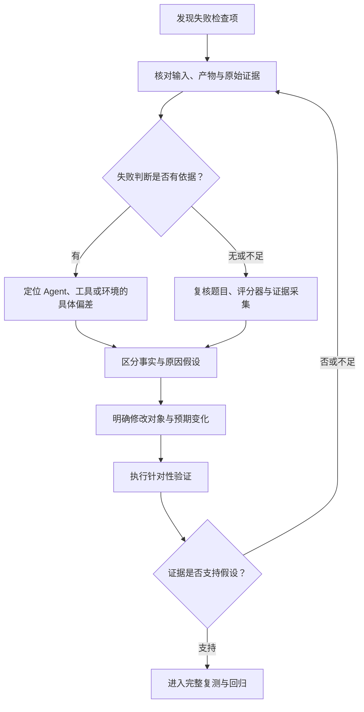

> 这张图里，归因并不总是直接导向 Agent 修改。它也可能导向环境修复、补充埋点，或者修订不合理的评分规则。
> 
> 


阅读真实轨迹，就是为了检查分数是否有充分依据，并找到值得验证的修改方向。

如果使用模型辅助分析 Trace，也应当让它指出具体证据位置，把推测明确标记为假设。涉及关键结论时，再回到原始记录复核，避免在 Judge 之外又增加一个无法核对的判断。


这一部分完成以后，我们应该留下三项内容：**失败证据、原因假设，以及明确的验证计划。**

接下来，就按照这个计划执行修改和复测。既要验证目标问题有没有改善，也要检查原来已经具备的能力是否仍然可靠，才能决定是否采用新版本。


---

# 七、比较版本与验证修复：能力提升、稳定性和回归

上一部分，我们根据失败证据提出了一项修改计划：在库存修复 Skill 中，明确要求 Agent 使用相同业务请求编号和参数重复执行，核对库存与有效预占记录，并准确说明验证范围。


现在，要判断这项修改是否值得采用。

这里需要分别回答三个问题：**目标缺陷有没有改善，同类任务中是否表现稳定，以及原来已经具备的能力有没有退化。**

一次成功可以提供证据，但还不足以回答全部问题。**我们需要在固定条件下比较新旧版本，并保留每次运行的结果。**


## 7\.1 用固定条件比较变更

**先明确这次比较的对象。**

旧版使用原来的库存修复 Skill。新版只增加刚才确定的验证与报告要求，模型、工具权限和其他配置保持不变。

这样安排，是为了尽可能看清这项 Skill 修改带来的影响。

如果同时更换模型、增加执行预算、修改检索策略，再调整评分器，即使分数提高，也很难判断哪个变化起了作用。

如果业务确实需要组合修改，也可以把它作为一套方案比较。但结论应当说明，这是组合方案的效果，不能把收益单独归给其中一项。


比较之前，要固定四组条件。

这里最重要的，是两个版本都从规定的缺陷工程开始。

不能先让旧版执行，再把旧版已经修改过的工程交给新版。否则，新版得到的任务可能更简单，也可能受到旧版残留错误的影响。

如果外部服务或共享资源存在波动，可以将两个版本的运行交错安排，减少“旧版都在故障期间运行，新版都在恢复后运行”的影响。同时继续记录实际环境状态。


**评分标准也不能在比较中途随意变化。**

如果发现评分器确实存在问题，应当修订后重新检查相关结果，确保新旧版本接受同样的评价。


**条件固定以后，再把采用要求写清楚。**

对于这次修改，我们希望看到：重复预占任务改善，报告与执行证据一致，原有接口和正常预占能力保持，修改边界没有被破坏，耗时与成本仍然可接受。


其中，**新增加或原来做不好的部分，用能力评测观察；过去已经做好的部分，用回归评测保护。**

这两类结果需要同时查看。目标任务提高了分数，并不能抵消另一个关键任务的退化。


## 7\.2 多次 Trial 怎样解释？

**条件固定以后，同一道任务还需要运行多次。**

这里的每次 Trial，都是从规定起点开始的一次尝试。它不是一次工具调用，也不是 Agent 在同一次运行中修改代码后重新测试。

**同一个 Trial 里运行十次测试，仍然是一次 Agent 任务尝试。**

我们先看最直观的记录方式。

假设旧版和新版分别运行三次，得到下面这些结果。以下全部是教学示例，不是实际评测成绩。

第一行中，新版通过三次，旧版通过一次。这说明在本次实验条件下，新版观察到了更好的结果。

但不能直接宣布“新版真实成功率是百分之百”。三次全部通过，只表示这三次没有观察到失败。

同样，接口兼容出现一次失败，也要回到证据确认：它是真实退化，还是环境或评分器问题。不能因为另外两次成功，就把这次结果忽略。

在报告里，先展示“通过几次／总共几次”，再展示每次失败项，是比较容易理解的方式。


**接下来，还需要区分三个口径。**

第一个是单次成功率，回答一次独立尝试成功的可能性。在实际报告中，我们用多次运行结果估计它，并说明样本数量。

第二个是 pass@k，回答给定 k 次尝试，至少有一次成功的可能性。

第三个是 pass^k，回答 k 次尝试全部成功的可能性。


下面看对比图。


> 先看向上的曲线。尝试次数增加，至少成功一次的机会通常会提高。这是 pass@k 关注的问题。
> 
> 再看向下的曲线。要求每次都成功，次数越多，整体条件越严格。这是 pass^k 关注的问题。
> 
> 


为了算清楚，我们另外采用一个简单的教学假设：同一道任务，每次独立尝试的成功概率都是百分之七十五。

在这个假设下，三次至少成功一次的概率约为百分之九十八点四；三次全部成功的概率约为百分之四十二点二。

这些计算依赖“各次独立、成功概率相同”的假设。实际任务存在难度差异、环境波动和相关失败，不能把全部任务的平均通过率直接代入，就当成整个系统的可靠性结论。


**还有一个容易混淆的地方。**

三次运行中通过两次，得到的是“二分之三”，也就是三分之二的运行通过比例，不能把它写成 pass@3。

这组三次确实出现过成功，也不能据此声称 pass@3 的真实概率是百分之百。我们观察到的是一组结果，还不是精确的概率。


**选择口径，要看产品要求。**

如果工程师可以生成多个候选方案，并通过独立测试选出有效方案，那么“至少有一次成功”有参考价值。

但找到正确方案，还不代表产品能够自动识别并交付它。候选选择机制也需要验证。

如果用户每次发起任务都期望可靠完成，我们就需要重点关注单次表现，以及多次运行中的一致性。

另外，三次尝试消耗的总资源通常高于一次尝试。比较 pass@k 时，也要报告 k 值、每次预算和总体消耗，不能只展示提高后的成功指标。

重复运行用于观察稳定性。增加不同任务，才是在扩大覆盖。

把同一个库存场景重复运行一百次，仍然不能说明多仓库、历史兼容和其他业务规则已经得到验证。


## 7\.3 修复有效需要检查什么？

**理解运行波动以后，再来看这次修改怎样验收。**

**第一步，复测原失败任务。**

两个版本都从缺陷工程开始，检查新版是否更经常完成有效修复，以及最终状态是否满足重复请求规则。

这里不能只检查 Agent 有没有新增测试。新增测试是行为变化，实际缺陷是否修复，还要由独立验收确认。

**第二步，检查同类场景。**

如果新版只在已经反复看过的那一道题上成功，可能只是适配了已知场景。

因此，我们要补充符合业务规则的相关变化。

最后一行同样重要。

如果新版为了避免重复扣减，错误地拒绝所有后续请求，它可能通过部分重复请求检查，却破坏正常业务。

因此，同类验证既要检查不该发生的行为，也要检查应该正常发生的行为。

这些变化中，可以保留一部分不参与本轮 Skill 调整，用来验收修改是否能够适用于新的样本。

**第三步，运行相关旧任务。**

重复预占修好了，还要看正常预占、接口兼容和异常回滚等能力有没有退化。

回到前面的教学结果，新版目标任务从一次通过提高到三次通过，但接口兼容从三次通过变成两次通过。

这时，应该先检查接口失败的原始证据。如果确认是新版修改造成的真实退化，就需要继续修复，暂缓采用。

如果确认是评分器误判，则修订评分器后重新检查相关版本。不能因为我们希望采用新版，就只修正对新版不利的一次结果。

**第四步，比较成本与耗时。**

质量达到要求以后，再看新增验证带来了多少开销，以及这些开销是否值得。

例如，新增重复请求检查需要更多工具调用，耗时略有增加，这是可能合理的投入。我们要判断它有没有减少错误交付和人工返工，而不是单纯要求工具次数越少越好。

成本报告需要包含失败运行与重试。Agent 和 Judge 的消耗分别记录，缺失数据保留未知。

样本较少时，可以先展示每次耗时和消耗。数据充分以后，再使用分布和分位数观察尾部表现，避免用少量运行得出过强结论。

```Python
# 真实交错运行新旧 Skill，逐题看改善与退化，保留未知，区分通过比例、pass@k、pass^k
step_09_compare_versions.py
```

到这里，**我们才具备比较完整的修复证据：原问题改善，同类场景得到检查，旧任务没有发现不可接受的退化，资源开销也符合要求。**

这个结论仍然有范围。它支持我们判断新版在已覆盖任务和条件下的表现，不能证明所有未来任务都不会失败。


## 7\.4 分层门禁怎样进入发布流程？

最后，**要把这些检查变成实际流程中的门禁。**

**门禁首先要说明哪些结果能够阻断采用，哪些结果需要人工复核，哪些只是持续观察。**


对于库存重构，重复扣减、超卖、数据不一致和越权修改，都可能属于核心必过项。

报告表达和其他质量要求，可以按照预先确定的条件检查。执行预算也可以作为采用限制，但需要与业务风险分别记录。

**未知和执行错误要有明确出口。**

如果关键测试没有运行成功，不能因为“没有发现缺陷”就放行；也不能把所有任务都标成业务失败。应该保留受阻原因，修复实验条件，再按规则安排验证。

**接入研发流程时，可以按成本安排不同检查。**

提交变更时，先运行快速程序检查和代表性任务。准备采用模型、Prompt 或 Skill 新版本时，再运行预先确定的能力与回归任务，并执行必要的重复运行。

评分配置或验收程序发生变化，也需要验证评分器本身，并确认相关结果仍然可比较。


流程可以这样组织：

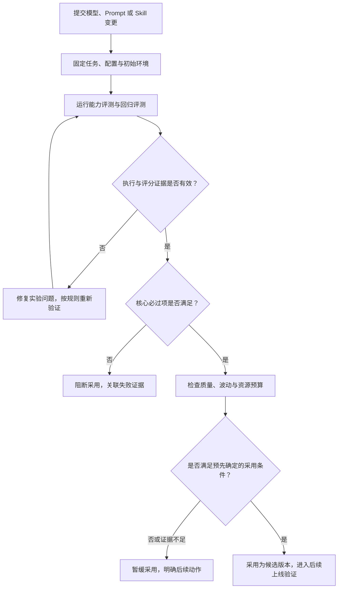


**门禁必须接入实际采用或发布流程。否则，报告虽然生成了，却没有人检查，也不会阻止不合格版本继续使用。**


**这里还要避免平均分掩盖关键退化。**

前面的教学表中，旧版总共通过十三次，新版通过十四次。如果只看十五次运行的总体比例，新版似乎更好。

但新版多出了一次接口兼容失败。如果这属于真实的核心退化，就不能用目标任务的提高抵消。

因此，采用决定需要展示逐题变化和关键失败，而不只是一个总分。

对于这组教学结果，合理的决定是：暂缓采用新版。先查清接口兼容失败，处理以后再执行相应复测和回归。

这不是说 Skill 修改没有价值。它可能改善了重复请求验证，但当前证据还不足以支持整个版本通过。


这一部分完成以后，**应该形成一份版本对比报告，说明比较了什么变化、采用了哪些条件、逐题结果如何，以及最终为什么采用或暂缓。**


下一部分，我们把这些验收要求进一步放进日常 AI Coding：人怎样确定风险，把经验沉淀成规范和 SOP，再通过代码审查与测试控制交付质量。


---

# 八、把评测方法用于 AI Coding：规范、SOP、审查与测试

上一部分，我们比较了新旧版本，检查目标问题有没有改善、旧能力有没有退化，并根据结果决定是否采用。

现在，**把这些方法放进日常研发。**

如果每次都等 Agent 完成以后，再由工程师从头检查业务规则、代码边界和测试覆盖，验收成本会很高。**同一种错误，也可能在不同成员的任务中反复出现。**

因此，我们需要把已经确认的标准提前放进开发过程：**人先确定范围和风险，再把共识写成规则与操作方法，让 AI 按照这些要求执行，并通过审查和测试检查是否落实。**

这一部分继续使用库存服务。我们要形成三项产物：**一份能够复用的重构 SOP，一份提交前预审清单，以及一份根据风险设计的测试矩阵。**


## 8\.1 专家定方向，AI 扫描，人判断优先级

先看重构从哪里开始。

面对一个遗留项目，如果直接要求 AI“全面检查所有问题并完成重构”，它可能输出大量建议，但团队仍然不知道先改什么，也很难控制修改范围。

更实际的做法，是由熟悉业务和工程的人圈定高风险区域，再让 AI 沿这些方向收集证据。

对于库存项目，我们先关注预占入口，以及它使用的事务、幂等和数据访问逻辑。

原因很具体：这些位置决定一次请求会不会重复产生业务效果，并发时会不会超卖，以及异常以后数据能不能保持一致。

范围明确以后，再让 AI 搜索调用链、读取相关实现，并检查可能存在的问题。

这里的“业务模型”，指预占记录、库存状态和请求之间的关系，不是大模型。例如，一条预占记录怎样关联业务请求，哪些状态允许确认或释放，都属于业务模型。


AI 可以辅助整理这些关系，也可以扫描循环查询、事务提交位置、异常分支和索引使用等候选问题。但候选发现需要继续核验。

例如，AI 看到循环里有查询，可以提示性能风险。但是否构成当前优先级较高的问题，还要结合查询次数、数据规模、调用频率和实际耗时判断。


```Python
# 限定范围扫描或只读审查 Diff，生成带依据的问题清单和 PR 草稿，由人核验风险
step_10_pre_pr_review.py
```


**相反，重复扣减即使代码改动不大，也可能直接影响业务正确性，应当优先检查。**

所以，人要根据影响、发生条件和处理成本确定顺序。AI 提供证据和候选问题，人决定哪些问题已经成立、哪些需要继续验证，以及哪些进入本轮任务。

这一环节的输出，是一份有依据的改动清单。每个问题至少说明位置、风险、证据和处理范围，避免把未经确认的建议直接变成大规模修改。


## 8\.2 团队共识怎样转成 AI 执行约束？

**排查方向明确以后，还需要统一代码应该怎样修改。**

如果不同工程师对职责、事务和接口边界的理解不同，他们给 AI 的要求就会不同。**AI 生成的代码也可能沿着这些差异继续扩展。**

因此，**先统一人的判断，再配置 AI 规则。**

对于库存项目，可以先确认几个具体问题。

- 接口入口负责哪些工作？

- 业务流程在哪里组织？

- 事务由哪一层控制？

- 数据访问方法是否允许自行提交？

- 数据库对象怎样转换成对外响应？


**这些问题需要结合现有工程确定，不要求所有项目采用同一种分层。但选定以后，相关成员应当遵循相同的职责和依赖约定。**

例如，如果团队约定事务由应用服务统一控制，而某个数据访问方法内部又单独提交，就可能让一次业务操作被拆成多个提交，影响整体回滚。

如果接口直接返回数据库对象，后续增加内部字段也可能意外改变外部响应。此时，仅仅移动目录，不能解决职责和数据边界问题。

**共识明确以后，再分别写入 Rule 和 Skill。**

在这里，Rule 用于表达当前工程中普遍适用的要求；Skill 用于组织特定任务需要的方法和经验。具体文件位置和加载方式取决于所使用的 Harness。


> 先看左边，团队明确接口、分层、事务和修改范围。
> 
> 右上角是通用规则。例如，保持现有接口契约，遵守已经确定的分层边界，不得修改独立验收文件。
> 
> 右下角是场景经验。例如，执行库存幂等修复时，需要核对请求规则，验证重复提交，并准确报告没有完成的验证。
> 
> 


Rule 需要说明适用范围。Skill 则进一步说明什么时候使用、需要什么输入、怎样操作，以及留下什么证据。


**这里要区分指导和强制限制。**

Rule 和 Skill 能够影响 Agent 的行为，但不能代替执行层权限。对于禁止修改的文件，仍然需要通过工具、文件系统或沙箱限制访问。

同样，要求已经写进规则，也不代表实际落实。提交以前，还要检查最终代码、工具行为和测试结果。


这一环节完成以后，团队共识就从口头要求，变成了可以加载、执行和核验的内容。


## 8\.3 人工打样 → 沉淀 SOP → 团队复用

规范说明了要遵守什么，接下来还需要解决：**复杂任务具体怎样做。**

这里可以**先由负责人完成一项有代表性的任务，再从实际执行中提炼 SOP。**

SOP，就是标准操作过程。它需要说明输入、动作、检查点和交付要求。

对于库存项目，打样任务应当能够暴露关键难点。例如，涉及真实调用入口、幂等状态、事务回滚和接口兼容。只选择最简单的文件，可能整理不出其他成员真正需要的经验。

负责人执行时，要记录哪些规则需要先确认，怎样定位实现，遇到过什么错误，以及最终怎样验证。

在此基础上，可以整理出下面这份重构 SOP 初稿。


这是一份操作初稿。需要在更多代表性任务上使用，检查步骤是否清楚、是否缺少例外条件，再持续修订。

SOP 也可以成为 Skill 的内容。两者的关系是：SOP 组织操作经验，Skill 可以将这些经验提供给执行特定任务的 Agent。

其他成员复用时，输入仍然需要包含本次任务的业务规则、相关代码和约束。不能只加载 SOP，就默认它知道当前项目的一切。

**复用以后，人继续验收业务语义和最终代码。**

例如，AI 按步骤增加了请求编号检查，人还要确认这个编号在当前业务中的含义，历史请求怎样处理，以及实现是否符合已确认的方案。

同时，SOP 不需要强迫所有任务采用完全相同的搜索顺序。遇到新情况时，可以调整操作，并说明依据。必要的业务约束、风险边界和验收要求仍然要满足。

这一环节的价值，是让已经验证过的经验能够被其他成员使用，而不是让每个人都从一次含糊的“帮我重构”重新开始。


## 8\.4 渐进重构与 Pre\-PR 预审

有了规范和 SOP，接下来考虑怎样**把重构放进日常迭代。**

遗留系统的问题通常很多，一次全部修改容易扩大范围，也难以验证影响。

**可以从当前业务需求出发，找出与它直接相关的技术债，分批处理。**

例如，客户端准备增加超时重试。这个需求会放大重复预占风险，因此，可以把幂等记录、重复请求处理和相关验证纳入本次范围。

但没有必要同时重命名整个工程、重写全部仓储接口，或者迁移所有历史模块。

渐进重构仍然需要评估工作量。我们要说明本轮消化了哪些技术债、增加了哪些验证、保留了哪些问题，以及为什么这样划分。


**完成修改以后，进入 Pre\-PR，也就是提交给他人审查以前的预审。**

AI 可以先根据团队规范和本次任务要求检查代码，包括职责边界、明显缺陷、异常处理、数据一致性和性能风险。

发现问题以后，工程师需要核验。确认成立的缺陷进行修复；误报说明原因；暂时无法判断的问题继续保留，不能全部照单修改，也不能直接忽略。

修复造成新的代码变化，还要执行受影响的验证。


**预审结束后，再整理 PR 材料。**

**AI 可以根据最终 Diff 辅助生成这些材料，但工程师需要核对。**尤其不能把计划执行的测试写成已经完成。

人工 Review 则在这些材料基础上，检查方案是否正确、实现是否符合方案，以及关键业务语义有没有遗漏。

这仍然需要阅读最终代码。预审可以减少基础问题，但不能替代人工对实现的理解。


实践中，还使用了更强模型审查编码结果，以及不同厂商模型交叉审查的方法。

这些方法可以尝试，但审查模型的配置更高，并不自动意味着每项判断都正确。不同模型也可能共同遗漏同一个业务条件。

实际使用时，可以让审查模型根据相同任务、规则和代码独立检查，再比较发现。每项发现都应指出代码位置、触发条件和依据。


**有分歧时，回到代码、规则和可执行验证处理，不能简单按模型数量投票。**

是否采用这种审查组合，也要看它增加了多少有效发现、多少误报，以及额外耗时和费用。

整个提交过程可以这样组织：

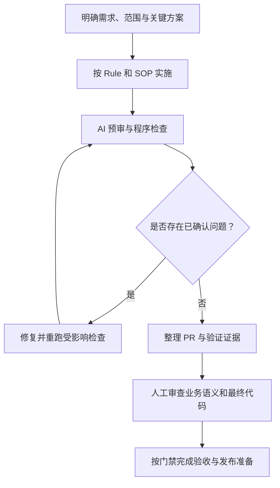


明确需求、范围与关键方案按 Rule 和 SOP 实施AI 预审与程序检查是否存在已确认问题？修复并重跑受影响检查整理 PR 与验证证据人工审查业务语义和最终代码按门禁完成验收与发布准备是否

预审没有发现问题，只表示当前检查没有发现。关键验收仍然按照独立标准执行。


## 8\.5 人工主导、AI 辅助的五步测试设计法

**最后，把测试设计展开。**

如果直接让 AI“生成所有测试用例”，它可能根据现有文档生成大量场景，却遗漏隐含的业务关联，也可能提出很多价值有限的组合。

更可控的做法，**是人确定范围和风险，AI 辅助扫描、组织场景和编写步骤，再由人检查覆盖是否合理。**

这套方法分五步。

### 第一步，建立范围。

输入是当前代码变更、调用关系和实际使用信息。

AI 从两个方向收集受影响接口：一边根据 Diff 和调用链寻找传播范围，另一边结合实际请求入口与流量记录，确认这些代码怎样被使用。

人再核对清单，排除误报并补充遗漏。

例如，本次修改预占服务，如果同时改动了确认或释放流程共用的事务方法，就需要继续检查这些流程是否受影响。

但流量低，不代表可以不测。历史调用和异常路径，可能平时很少出现，一旦触发却影响较大。

这一阶段的输出，是经过确认的测试范围，以及纳入或排除某项的理由。

### 第二步，风险分级。

对于每个受影响接口，AI 先读代码，回答三个问题：改动了什么，关键分支在哪里，旧数据和旧调用是否兼容。

人根据这些信息确定测试深度。

风险需要依据业务影响判断，不能只看改了多少行。事务提交位置的一行变化，也可能比大量目录调整更重要。

### 第三步，设计分组。

范围和风险明确以后，再组织测试场景。

可以先把影响行为的条件拆开，再合并预期行为相同的组合，用判定表检查遗漏。

下面以预占接口为例。这是测试设计示例，不是执行结果。

这张表把几类不同决策分开了。

但它还没有覆盖并发交错和执行中途异常。静态条件分组不能代替这些验证，我们还要单独设计竞争和回滚场景。

AI 可以辅助组合和查漏，人需要确认哪些条件能够合并，哪些差异会改变业务结果。不能为了减少数量，把高风险场景合并掉。

### 第四步，生成可执行步骤。

场景确定以后，再把它展开成操作和检查。

以前面的重复请求为例，步骤可以这样写。

首先，初始化十件可用库存，并确认不存在对应请求记录。

然后，提交一次预占两件商品的请求，保存请求编号、参数和响应。

接着，用相同编号和参数再次提交。

最后，检查两次响应是否符合契约、库存是否为八件、是否只有一次有效预占，以及相关状态是否一致。

这就是“一步操作、多维验证”：围绕一次业务操作，同时检查响应和实际状态，避免只看接口返回成功。

异常回滚场景也要明确异常位置。例如，在事务内更新库存后、写入预占记录前注入异常，再检查这次操作是否整体回滚。

“模拟一次异常”还不够。不同异常位置，可能验证的是不同提交边界。

### 第五步，验证覆盖。

最后，把测试范围、风险和用例放到同一张矩阵中，查看每项要求是否有对应验证。

下面是针对预占接口展开的覆盖计划，不表示这些检查已经通过。

如果前面确认其他接口也受影响，就先建立“接口与风险维度”的覆盖表，再像这样展开重点场景。

AI 可以辅助生成矩阵，标记没有用例对应的要求，以及重复覆盖但没有增加有效检查的用例。

人最终确认范围是否完整、预期是否正确，以及关键业务条件有没有遗漏。

运行以后，矩阵还要关联实际测试结果、代码状态和证据位置。设计覆盖和执行通过，是两个不同状态。


五个步骤中的分工可以这样对应：


```Python
# 人工范围→风险→判定表→步骤→覆盖矩阵，明确“已设计”不等于“已执行/已通过”
step_11_test_design.py
```


这一部分完成以后，我们就**有了可以复用的库存重构 SOP、提交前预审清单和风险测试矩阵。**


它们把前面确定的质量标准放进了实际研发动作：**开始前明确范围，执行时提供规则，提交前组织审查，交付时核对行为和证据。**

下一部分，我们再把线上反馈接进来，看新发现的问题怎样进入题集、修订标准，并形成下一轮改进。

---

# 九、连接线上反馈：Case 飞轮、双闭环与渐进建设

前面，我们已经建立了评测任务、执行记录、评分器和回归门禁，也把这些要求放进了 AI Coding 的研发流程。

但离线题集只能检查已经准备好的场景。工程师开始处理更多项目以后，还会遇到新的代码结构、历史兼容要求和任务组合。

因此，评测不能停在发布前跑一次。我们还需要**把真实使用中的问题收回来，确认原因，再更新 Agent 和评测资产。**


这里的“线上”，指工程师实际使用 Coding Agent 完成研发任务的环境。任务产物仍然需要经过代码审查、测试和发布流程，不是让 Agent 直接修改生产库存数据。


## 9\.1 让五个数据环节持续运转

线上反馈进入评测体系，可以按五个环节组织：采集、清洗、评测、质检和分析归因。

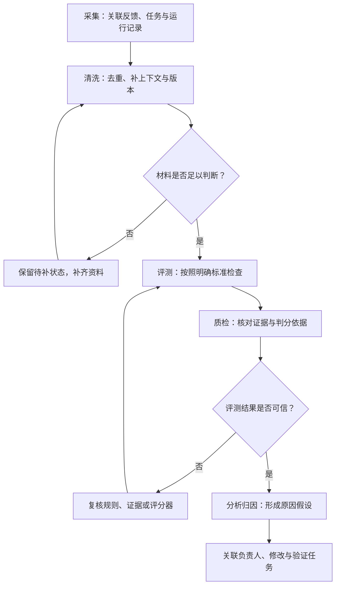

### 先看采集。

我们需要同时使用用户反馈、监控异常、规则筛选和随机抽样，因为它们能够发现的问题不同。

例如，Agent 正常结束，工具也没有报错，但生成的测试没有覆盖关键竞争条件。这类问题未必触发运行告警，也未必立刻被工程师发现。

所以，除了收集失败信号，还要抽查一部分看起来正常的任务。

### 接下来是清洗。

清洗要把原始材料整理成能够判断的 Case。需要关联任务输入、工程版本、规则、执行记录、最终产物和用户反馈，补齐缺失信息，并处理重复样本。

重复问题可以归并，但最好保留发生次数和场景差异。否则，一个反复影响用户的问题，可能在去重后看起来只发生过一次。

暂时无法复现、证据不足的反馈，可以标记为待补充。不能为了尽快生成题目，直接猜测成功条件。

### 第三步是评测。

根据已有 Rubric，检查这次交付的结果、过程、效率和风险。如果现有标准无法覆盖，就先组织人工判断，并记录标准缺口。

### 第四步是质检。

质检要检查评测本身是否可信。例如，是否使用了正确版本的规则，Judge 是否引用了真实证据，关键未知项有没有被错误地当成通过。

这里不能只让同一个评分器重复给一次分，就认为已经完成质量检查。需要结合程序核对、人工抽查和争议复核，检查判分依据。

### 第五步是分析归因。

沿着 Trace 确认问题发生在哪里，再形成修改对象和验证计划。可能需要修改 Agent，也可能需要修复工具环境、补充题目或校准评分器。

一条 Case 处理完成以后，应该能够回答：

它来自哪次任务，问题是否确认，依据是什么，谁负责处理，准备修改什么，以及用哪些任务复测。

如果只把材料存进一个文件夹，却没有后续负责人和验证安排，就还没有形成持续运转的流程。

```Python
# 真实失败先进入候选池，真实修复验证和人工批准后加入活动回归
step_12_case_to_regression.py 
```


## 9\.2 离线评测、在线评测与监控怎样配合？

这些方式分别提供不同证据，需要配合使用。

**离线评测检查固定条件下的任务表现。**

例如，修改库存修复 Skill 后，重新运行重复请求、并发竞争、异常回滚和接口兼容任务。它帮助我们守住已经明确的要求，并比较版本。

但真实工程可能包含题集没有准备的历史代码和依赖关系。为了观察这些差异，可以使用影子模式。

对于 Coding Agent，影子模式可以把真实任务输入、对应源码快照和必要资料，复制到独立工作环境，让候选版本执行。影子结果用于比较，不直接合并到业务仓库，也不触发实际发布。

这样可以观察新版面对真实任务时怎样定位、修改和验证，同时避免两个版本在同一个工作区互相影响。

不过，影子环境仍然需要检查完整性。如果缺少实际任务依赖的资料、工具或数据，结果差异也可能来自环境。

```Python
# 独立重放保存的真实任务输入，不修改原工作区，不冒充真实线上 A/B
step_13_shadow_replay.py
```

影子运行主要检查真实输入下的表现，不能单独证明工程师的交付效率已经提高。

要验证实际使用效果，还可以进行 A/B Test。


例如，对符合条件的研发任务进行分流，让不同组使用旧版或新版，再比较任务验收、人工返工、总交付时间和成本。

分流单位和比较指标需要提前确定，同一道任务执行期间保持版本一致。同时关注项目类型和任务难度，避免一组主要处理简单任务，另一组主要处理复杂任务。

任务量不足时，不必强行给出确定的业务收益结论。可以先保留逐题结果和人工反馈，继续积累证据。


**日常还需要巡检。**

巡检从代表性任务中选取一部分，周期性检查当前服务配置下的表现。例如，定期运行固定的重复请求修复任务，观察模型路由、工具或配置变化后，原有能力是否仍然保持。

对于 Coding Agent，这些检查应在受控工程副本中执行，保留必要隔离。巡检任务通过，说明它覆盖的能力当前没有发现异常，不代表所有真实任务都正常。


**最后是运行监控。**

监控关注模型与工具可用性、错误、超时、耗时、Token，以及任务和工具使用分布。

**这些信号要结合起来看。**

如果任务完成情况变差，同时工具超时明显增加，可以优先检查服务与执行环境。

如果工具运行正常，但用户开始大量提交更复杂的历史兼容任务，就需要检查能力边界和题集代表性。

这些都是排查方向，还需要具体 Case 和 Trace 支持原因判断。


## 9\.3 同时改进 Agent 与评测体系

**Case 经过归因以后，不能默认“分数低就修改 Agent”。**

**有时候 Agent 确实做错了；有时候评测误判；还有时候两边都需要修改。**


下面这张图，把两条闭环放在一起。


> 上面是真实使用与质量观察。样本经过采集、清洗、评测和质检，再进入归因。
> 
> 左边是 Agent 改进。根据证据修改 Prompt、上下文、工具、Skill 或其他执行策略，再检查目标行为和结果。
> 
> 右边是评测改进。补充任务、修订 Rubric、校准评分器，并完善输入、环境和证据要求。
> 
> 两条路径共享 Case，也共享评测资产。
> 
> 


继续看库存案例。

假设工程师发现，某个并发条件下，相同请求仍然可能产生重复预占。进一步复查以后，确认实现中的查重与执行没有共同保证原子性。

这需要修改实现，或者改进 Agent 处理这类任务的方法，再重新验证。

同时，我们检查已有并发测试，发现虽然启动了多个请求，却没有可靠地触发关键竞争条件。

那么评测也需要改进：增加更有针对性的并发验证，并保留相关执行证据。不能因为测试名称叫“并发测试”，就认为它已经覆盖目标风险。

**同一个 Case，就同时触发了两条路径。**


另一种情况是 Agent 提交了有效实现，但评分器强制检查某个任务中没有要求的函数名，导致错误判定。

此时，应当先核验替代实现满足业务要求，再修订不合理的评分条件。修订以后，还要确认它能够接受有效实现，并继续拒绝已知缺陷实现。

**这说明评测体系也需要自己的验证。**


它既可能漏掉错误，也可能拒绝正确结果。业务规则变化后，旧标准还可能失去适用性。

因此，修订评分标准时需要记录版本，并重新检查相关样本。新旧 Agent 版本要在相同标准下比较，不能把标准变化造成的分数差异，当成能力变化。

**这两条闭环持续运转，才能让 Agent 的修改有依据，也让评测越来越贴近真实任务。**


## 9\.4 按阶段补齐基础设施

知道完整体系以后，还需要决定先建设什么。

**冷启动阶段，先围绕一个核心场景跑通最小闭环。**

对于库存任务，至少需要有种子题集、明确规则、规定的初始环境、基本评分，以及足以解释失败的模型和工具记录。

同时，从一开始就保留必要的权限和执行隔离。后续完善沙箱，指的是提高自动化、并发和管理能力，不是早期可以没有边界。

有了这些基础，就能完成一次真实运行，检查结果，并根据证据安排修改。

**扩量以后，重点补充真实反馈与自动化处理。**

更多工程师开始使用，任务类型也会增加。此时需要稳定的反馈入口、Case 管理、抽样机制，以及经过校准的自动评分。

任务来源和用途要能够关联，避免线上反复出现的问题一直没有进入回归集。

**规模化以后，再完善环境池、并发调度、回放展示、批量评分、报告和发布门禁，并明确维护责任。**


不同阶段可以这样检查自己的投入：

成熟度检查的作用，是找短板和能力错配，不是要求所有项目一次建成同样规模。

例如，团队已经有自动评分和监控看板，但真实问题不能转成任务，也没有负责人跟踪修复。继续增加指标，未必能够解决这个缺口。

或者，题集维护得很精细，但缺少模型实际输入和工具结果。一旦失败，仍然只能猜原因，应该先补足取证。


判断下一步建设什么，可以问三个具体问题：**我们现在发现不了什么问题，解释不了什么失败，以及哪些修改无法验证。**

这一部分完成以后，线上问题就应该有一条清楚的处理路径：

**样本进入后补齐材料，按照标准评价并质检；归因以后分派修改；修改后复测与回归；符合条件的版本再验证真实使用效果；确认有效的任务和规则继续保留。**

这条路径需要明确负责人、处理状态和结果去向。流程真正运转起来，线上反馈才会持续转化为可复用的评测资产。

# 十、最后的经验与总结

最后，回到开头那个问题。

库存服务重构完成以后，Agent 回复：“已经修复，测试全部通过。”

现在，我们知道这句话还需要哪些证据。

1. 需要确认最终代码是否满足业务规则，实际测试覆盖了什么，库存和预占记录是否一致，原有接口是否保留，以及 Agent 有没有遵守修改边界。

2. 如果结果失败，就沿着执行记录检查：它拿到了什么信息，修改了什么，验证了什么，哪项结论没有依据。

3. 如果准备修改 Agent，就先写清假设和预期变化，再通过固定条件复测，同时检查已有能力。

4. 整个过程留下的，不只是一次分数，还有任务、规则、证据和能够再次执行的检查。


这里有六点经验需要记住。

第一，评测标准是团队业务经验的显式表达。

“幂等做得好”“重构质量高”，需要落实为请求条件、预期状态和判断依据。人的共识没有形成，机器也很难稳定执行同一套标准。

第二，自动判分需要明确标准和充分证据。

程序可以检查确定事实，模型可以辅助理解语义，但都需要验证。评分器能自动运行，不代表它已经可信。

第三，结果检查负责验收，过程证据帮助解释失败。

测试是否通过、数据状态是否正确，需要实际核验。Trace 则帮助我们找到遗漏、错误和异常发生的位置。两者结合，才能从“没有完成”走到“下一步改什么”。

第四，人的判断集中在范围、风险、标准和业务语义。

AI 可以辅助扫描代码、生成步骤和进行预审。人仍然需要确认问题是否重要、方案是否适合当前业务，以及最终实现是否值得交付。

第五，评测集和评分器都需要维护。

高分可能来自能力改善，也可能来自题目过于简单、检查遗漏或使用条件变化。真实 Case、人工抽查和原始证据，都是校准分数的重要依据。

第六，从一个核心场景跑通闭环，再根据真实问题扩展。


先让库存服务重构这类任务具备明确标准、可重复环境、独立验收和失败回流。之后，再增加新的任务、模块和基础设施。

我们要建立的能力，是把一次“感觉变好了”的修改，变成能够说明改善了什么、依据是什么、还有哪些限制的工程决定。


完成这条路径以后，Agent 的每次修改都有了可以核对的结果；团队对业务质量的认识，也能逐步积累成下一次开发和验收可以使用的资产。


